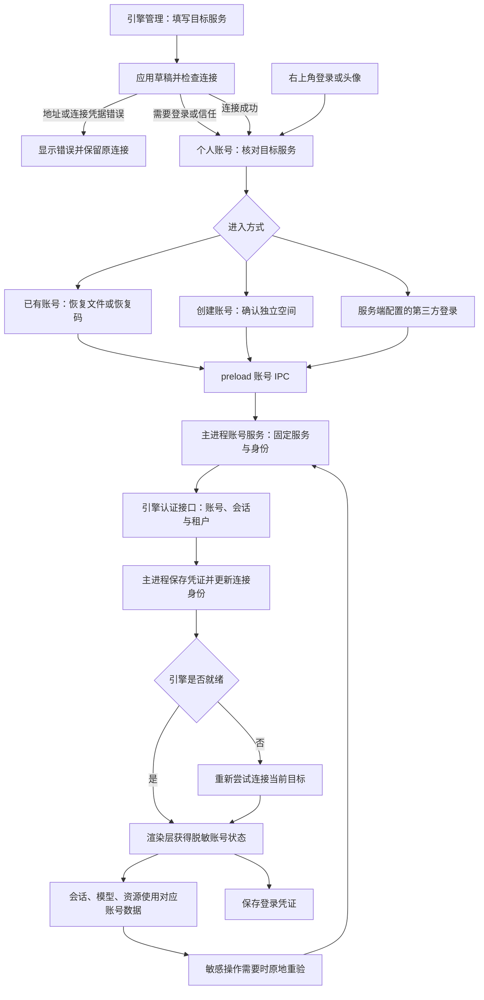

# 账号与登录

源码核对日期：2026-11-18。本文说明当前默认界面的账号操作；引擎连接和模型配置分别见[用户指南](user-guide.md)。

## 先区分账号、引擎和模型凭据

| 项目 | 用途 | 在哪里设置 |
| --- | --- | --- |
| 个人账号的恢复文件、恢复码或第三方登录 | 登录当前引擎服务上的账号，访问该账号的租户数据 | 右上角登录/头像 → 个人账号 |
| 实例令牌 | 进入指定引擎服务；同一服务的客户端使用部署方配置的值 | 设置 → 引擎管理 → 连接其他引擎 → 高级设置 |
| 高级用户凭据（API Key 或 JWT） | 认证当前服务上的用户身份；已有个人账号可直接登录 | 同上，仅在使用高级服务认证时填写 |
| 模型 API Key | 向模型提供方发起推理请求 | 设置 → 模型 |

账号属于个人账号页显示的**当前服务地址**。本机服务上的账号不会自动变成另一台远端服务上的账号；登录也不自动迁移、同步原有本机历史或文件。本地内置模式可以不登录，直接使用本机工作空间。

在引擎管理中编辑地址只改变草稿。主操作会先检查目标，再保存并应用连接；从这里进入个人账号也会先应用草稿，避免给服务 B 填了地址，却登录服务 A。地址或实例令牌有问题时先修正连接，账号页不会绕过这一步。

服务可访问但要求账号登录时，页面会明确显示需要登录以及目标地址；进入个人账号完成登录后，会重新尝试连接。可信内网 HTTP 需要先在该目标的个人账号页完成信任。连接就绪与登录状态分别显示：服务健康并不代表账号永远有效。

**自己部署服务时怎样配对？** 实例令牌由桌面或部署方在本机生成随机值，部署方将它写入引擎启动配置 `AETHER_INSTANCE_TOKEN` 并重启，客户端填写相同的值。本机内置引擎则由桌面自动生成并传递。

**用户凭据能自己填吗？** API Key 可以手动输入，也可以随机生成后交给该服务的管理员登记。在独立服务上，`POST /auth/user` 要求同租户的 `admin` 权限；普通新账号不能自行登记。对已有租户登记新值会替换旧 API Key；连接设置本身不会调用此接口。JWT 需要受信签发方签发，不能用随机字符串代替。未填写新值时保留已有配置。使用个人账号登录时，可直接跳过高级用户凭据。

## 新账号与已有账号

1. 点击窗口右上角“登录”，进入“个人账号”，先核对本机/远端服务及地址。
2. 已有账号选择“登录已有账号”，导入恢复文件或粘贴恢复码。错误时保留输入，便于修正。邮箱是个人资料，不能用于登录或找回。
3. 确实需要新空间时选择“创建新账号”。确认后生成独立账号，原有本机历史和文件保留，但不自动迁入。
4. 创建成功首先提示“保存登录凭证”。选择“保存恢复文件”，也可以“稍后”返回账号设置；姓名、邮箱、简介在“账号设置 → 个人资料”中填写。
5. 登录过期时优先显示“重新登录”，不提供容易误建账号的创建入口。

右上角登录后显示头像。个人账号页可用刷新图标手动更新账号状态；服务地址旁的说明图标支持悬停和键盘聚焦。

## 恢复凭证的三种操作

| 操作 | 实际效果 | 不会做什么 |
| --- | --- | --- |
| 保存恢复文件 | 导出此设备已有的恢复凭证；实际写入成功后记录最近保存时间 | 取消保存不标记已备份，也不轮换恢复码 |
| 复制恢复码 | 主进程把已有恢复码写入剪贴板 | 不把恢复码明文返回渲染页面、不轮换凭证 |
| 安全 → 重新生成恢复码 | 明确确认并完成近期身份验证后生成新码；保留当前登录会话 | 不保留旧恢复码、旧 API Key 或其他登录会话的有效性 |

恢复文件包含登录凭证，**不包含会话、工作区文件或其他业务数据**。它不是工作备份。此设备没有恢复码时，保存和复制按钮不可用；可用已绑定第三方方式登录，或在安全设置重新生成后保存。

## 原地重新验证

绑定、解除绑定、重新生成恢复码等敏感操作要求近期认证。认证时间缺失或超过十分钟，或者服务端要求重验时，客户端打开“重新验证身份”。

可以输入恢复码，或使用当前账号已绑定的第三方方式。成功后继续原操作，不需要先退出；取消不执行原操作。验证失败保留输入。等待过程中切换服务或账号会取消待执行动作，避免旧操作作用到新账号。

## 第三方登录与绑定

提供方由服务端配置，客户端只显示实际可用的方式。支持 OIDC、OAuth2 授权码加 PKCE、已有平台凭证验证接口。

- 未登录：选择提供方；已有绑定登录原账号，首次使用按服务端注册策略创建账号。
- 已登录：“登录与恢复”中选择提供方进行绑定，保留当前内部用户和租户数据。
- 解除绑定：确认后删除关联；应保留恢复文件、恢复码或其他可用登录方式。
- 浏览器授权中可取消；需要粘贴平台凭据的提供方会显示专用输入框。

身份按提供方、issuer 和稳定 subject 关联，不按邮箱自动合并。绑定到其他账号的身份会被拒绝。服务端验证后才接受资料；第三方自定义资料不能授予平台管理权限。

提供方部署说明见引擎仓库的 [account-external-login.md](../../ai-agent-engine/docs/account-external-login.md) 与 [account-login.md](../../ai-agent-engine/docs/account-login.md)。供应商回调地址、issuer、client ID/secret 或验证接口仍需部署方配置，客户端不内置真实供应商密钥。

## 登录会话与退出

“账号设置 → 安全 → 登录会话”首次展开自动读取；刷新图标再次读取。列表区分当前登录、其他登录，显示短会话标识、创建时间、最近使用时间和到期时间，可逐项撤销。

“退出登录”清理此设备登录并尝试撤销服务端会话；“账号详情 → 退出所有会话”撤销该账号的全部登录。业务数据保留。未记录备份时退出会提示先确认手中仍有凭证。离线退出会说明远端撤销尚未确认。

## 链路与存储边界

访问令牌、刷新令牌和恢复码由主进程管理，正常账号状态不会把这些明文返回界面。系统加密可用时使用 Electron `safeStorage` 保存；不可用时账号凭证只保留本次运行内存，并明确提示保存恢复文件。显式导出的恢复文件属于用户保存的敏感凭证。

账号优先于高级 API Key/JWT。账号过期或退出后，不会静默恢复旧高级凭据；确需改用高级认证，应退出账号、重新输入凭据并应用连接。高级用户凭据和实例令牌各自按服务地址保存，模型密钥另在「模型」中配置。使用 HTTP 连接非回环地址时，先在个人账号页确认信任该服务；确认前不会发送凭据。

远端账号默认要求 HTTPS，本机回环地址允许 HTTP。可信内网 HTTP 必须在个人账号页显式信任当前完整地址，切换地址或端口需重新确认，可撤销信任。HTTP 会明文传输登录凭证。

账号或连接身份切换会失效旧请求、会话缓存和相关浏览器/终端连接。正常刷新同一账号的访问令牌不会被当成切换账号。新建账号的租户管理员不等于全实例管理员；技能管理、实例并发与完全访问等能力以服务端返回的权限为准。

## 源码与验证入口

- 界面：[AccountSettingsView.tsx](../src/renderer/src/features/account/AccountSettingsView.tsx)、[account-store.ts](../src/renderer/src/features/account/account-store.ts)。
- 契约：[account.ts](../src/shared/account.ts)、[preload](../src/preload/index.ts)。
- 凭证与连接：[账号服务](../src/main/account/service.ts)、[credential-store.ts](../src/main/account/credential-store.ts)、[remote-auth.ts](../src/main/engine/remote-auth.ts)。
- 自动化入口：[account-simplify-ui.spec.ts](../e2e/account-simplify-ui.spec.ts)、[account-help-ui.spec.ts](../e2e/account-help-ui.spec.ts)、[account-main-contract.spec.ts](../e2e/account-main-contract.spec.ts)、[account-engine-integration.spec.ts](../e2e/account-engine-integration.spec.ts)、[engine-connection-flow.spec.ts](../e2e/engine-connection-flow.spec.ts)。

本文本轮更新依据当前源码核对，不把历史测试数字当作重新执行结果。第三方生产供应商、生产 HTTPS 配置及长期连续运行仍需对应环境验证。
