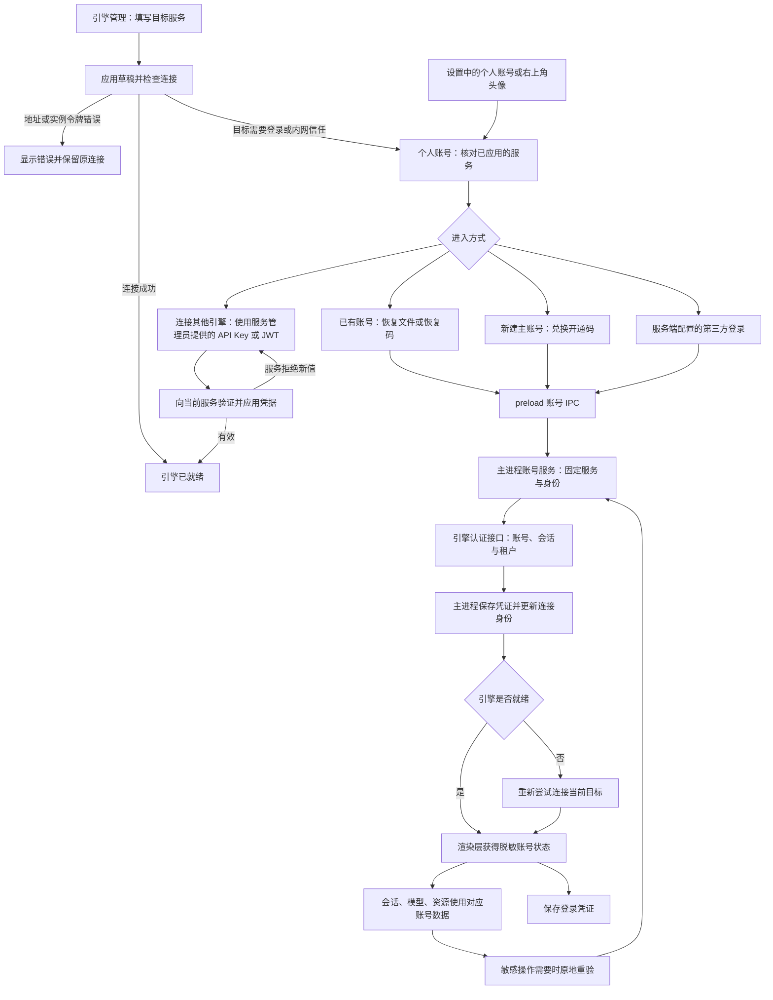

# 账号与登录

源码核对日期：2026-11-23。本文说明当前默认界面的账号操作；引擎连接和模型配置分别见[用户指南](user-guide.md)。

## 先区分账号、引擎和模型凭据

| 项目 | 用途 | 在哪里设置 |
| --- | --- | --- |
| 主账号开通码 | 仅用于开通一个主账号，7 天有效，只可兑换一次 | 服务管理员在管理后台签发；在「个人账号 → 创建主账号」输入 |
| 个人账号的恢复文件、恢复码或第三方登录 | 登录当前引擎服务上的账号，访问该账号的租户数据 | 设置 → 个人账号，或点右上角登录/头像 |
| 实例令牌 | 进入指定引擎服务；同一服务的客户端使用部署方配置的值 | 设置 → 引擎管理 → 连接其他引擎 → 高级设置 |
| 高级服务认证（API Key 或 JWT） | 使用管理员提供的凭据访问已选服务 | 设置 → 个人账号 → 高级认证 → 服务访问凭据（仅「连接其他引擎」） |
| 模型 API Key | 向模型提供方发起推理请求 | 设置 → 模型 |
| 后台管理员身份 | 管理实例的后台成员、权限与审计 | 设置 → 引擎管理 → 打开管理后台，见[管理员指南](../../ai-agent-engine/docs/operations/engine-admin.md#进入后台) |

账号属于个人账号页显示的**当前服务地址**。本机服务上的账号不会自动变成另一台远端服务上的账号；登录也不自动迁移、同步原有本机历史或文件。本地内置模式可以不登录，直接使用本机工作空间。

要切换服务，先在「设置 → 引擎管理」填写地址并点击「应用并连接」，再到「个人账号」核对页上显示的地址。只把地址从 A 改成 B、未应用就点侧栏的「个人账号」，操作的仍是 A。切换设置分区不会提交连接草稿。

服务可访问但要求账号登录时，页面会明确显示需要登录以及目标地址；进入个人账号完成登录后，会重新尝试连接。可信内网 HTTP 需要先在该目标的个人账号页完成信任。连接就绪与登录状态分别显示：服务健康并不代表账号永远有效。

**自己部署服务时怎样配对？** 实例令牌由桌面或部署方在本机生成随机值，部署方将它写入引擎启动配置 `AETHER_INSTANCE_TOKEN` 并重启，客户端填写相同的值。本机内置引擎则由桌面自动生成并传递。

**服务管理员给了我 API Key 或 JWT，填在哪里？** 先在「引擎管理」应用目标地址。即使显示需要登录，仍可到「个人账号」核对地址，在「高级认证」展开「服务访问凭据」，选择 API Key 或 JWT，输入后点「应用凭据」。API Key 可由管理员提供，也可在本机生成候选值并交给管理员登记。JWT 由服务认可的签发方签发。使用个人账号登录可以跳过这项。

服务拒绝新输入的凭据时，旧值保留。编辑过程中若切换了服务，请在当前服务重新输入；若提示该账号或凭据已变化，收起再展开「服务访问凭据」后重试。要移除本机保存的值，点「清除凭据」图标，再点「应用凭据」；把输入框留空会保留原值。清除只影响本机保存的副本，服务端密钥和启动配置里的凭据不变。可信内网 HTTP 需要先点账号页的「信任此内网服务」，再提交凭据。

## 新账号与已有账号

1. 点击窗口右上角“登录”，进入“个人账号”，先核对本机/远端服务及地址。
2. 已有账号选择“登录已有账号”，导入恢复文件或粘贴恢复码。错误时保留输入，便于修正。邮箱是个人资料，不能用于登录或找回。
3. 选择“创建主账号”，输入当前服务管理员签发的开通码，点“创建账号”。开通成功后生成独立账号，原有本机历史和文件保留，但不自动迁入。
4. 创建成功首先提示“保存登录凭证”。选择“保存恢复文件”，也可以选择“稍后”，回到“个人账号”。要填写姓名、邮箱和简介，展开“账号资料”中的“个人资料”。
5. 登录过期时优先显示“重新登录”，不提供容易误建账号的创建入口。

右上角登录后显示头像。个人账号页可用刷新图标手动更新账号状态；服务地址旁的说明图标支持悬停和键盘聚焦。

## 创建和管理子账号

只有**已开通的主账号**可以创建子账号。在「设置 → 个人账号 → 子账号」展开「管理子账号」，点「添加子账号」，填写名称后点「创建子账号」即可，不需要给孩子再领一枚开通码。每个主账号默认可建 3 个，主账号自己不占名额；名额已满请联系服务管理员按主账号扩容。旧版创建的独立个人账号可先登录，在「子账号」选择「输入开通码」原地启用，原有会话、资料和工作空间都保留。

子账号有独立的数据空间。主账号可以进入、停用或恢复自己名下的子账号，也可以设置其独立登录方式。在「管理子账号」点选姓名后可打开「设置登录」。停用立即使子账号已有会话失效；再次启用后需重新登录或由主账号重新进入，数据和已占名额保留。

**登录子账号时看不到「创建子账号」是正常的。** 子账号不能创建下一层账号、管理兄弟账号，也不能用主账号开通码把自己升级。「在此设备使用」会把桌面当前登录替换为所选子账号。切换前请将主账号恢复文件存放在自己控制的位置，或绑定可用的第三方账号。退出子账号、关闭或重启桌面端都不会自动返回主账号。需要管理其他子账号时，先退出，再用主账号自己的凭据登录。

## 子账号的登录名和密码

- **主账号设置子账号登录**：在「个人账号 → 子账号」展开对应子账号，选择「设置登录」。首次填写登录名和初始密码。以后可以只改登录名，也可以设新密码；页面不会显示旧密码。改名后旧登录名不能再登录；重置密码还会作废旧的密码恢复码。两种操作都会退出该子账号的已有设备，不影响主账号或其他子账号。
- **子账号自己改密码**：在「个人账号 → 账号安全 → 修改子账号密码」输入当前密码和新密码。当前设备保持登录，其他设备需要重新登录。新密码允许空格，长度为 15–128 个字符。
- **提前准备找回方式**：在同一处展开「备用密码恢复码」，用当前密码生成并复制一枚恢复码，然后自行妥善保存。重新生成会替换上一枚。这是子账号专用的一次性密码恢复码，与主账号的恢复码、开通码不同。
- **忘记密码**：在当前服务的「登录已有账号 → 用子账号密码登录」点「忘记子账号密码」，输入子账号登录名、先前保存的密码恢复码和新密码。成功后用新密码登录；旧密码、旧会话及用过的恢复码都失效。如未保存恢复码，可请自己的主账号代为重置。

登录名在同一服务内不区分大小写，允许 3–48 位字母、数字、点、下划线或短横线，以字母或数字开头。密码区分大小写。此功能需要桌面端和当前引擎都支持子账号密码；远程服务需要同步更新。

## 恢复凭证的三种操作

| 操作 | 实际效果 | 不会做什么 |
| --- | --- | --- |
| 保存恢复文件 | 导出此设备已有的恢复凭证；实际写入成功后记录最近保存时间 | 取消保存不标记已备份，也不轮换恢复码 |
| 复制恢复码 | 主进程把已有恢复码写入剪贴板 | 不把恢复码明文返回渲染页面、不轮换凭证 |
| 账号安全 → 恢复码 → 重新生成 | 明确确认并完成近期身份验证后生成新码；保留当前登录会话 | 不保留旧恢复码、旧 API Key 或其他登录会话的有效性 |

恢复文件包含登录凭证，**不包含会话、工作区文件或其他业务数据**。它不是工作备份。此设备没有恢复码时，保存和复制按钮不可用；可用已绑定第三方方式登录，或在“账号安全”中重新生成恢复码，再保存恢复文件。

## 原地重新验证

绑定、解除绑定、重新生成恢复码等敏感操作要求近期认证。认证时间缺失或超过十分钟，或者服务端要求重验时，客户端打开“重新验证身份”。

可以输入恢复码，或使用当前账号已绑定的第三方方式。成功后继续原操作，不需要先退出；取消不执行原操作。验证失败保留输入。等待过程中切换服务或账号会取消待执行动作，避免旧操作作用到新账号。

## 第三方登录与绑定

提供方由服务端配置，客户端只显示实际可用的方式。支持 OIDC、OAuth2 授权码加 PKCE、已有平台凭证验证接口。

- 未登录：选择提供方；已有绑定直接登录原账号。首次开通须在“创建主账号”中输入开通码后选择第三方提供方；原来的账号及会话不会自动合并。
- 已登录：“登录与恢复”中选择提供方进行绑定，保留当前内部用户和租户数据。
- 解除绑定：确认后删除关联；应保留恢复文件、恢复码或其他可用登录方式。
- 浏览器授权中可取消；需要粘贴平台凭据的提供方会显示专用输入框。

身份按提供方、issuer 和稳定 subject 关联，不按邮箱自动合并。绑定到其他账号的身份会被拒绝。服务端验证后才接受资料；第三方自定义资料不能授予平台管理权限。

提供方部署说明见引擎仓库的 [account-external-login.md](../../ai-agent-engine/docs/account-external-login.md) 与 [account-login.md](../../ai-agent-engine/docs/account-login.md)。供应商回调地址、issuer、client ID/secret 或验证接口仍需部署方配置，客户端不内置真实供应商密钥。

## 登录会话与退出

在“个人账号 → 账号安全”展开“登录会话”即可查看当前登录和其他登录。列表会在首次展开时自动读取；点刷新图标可以重新读取。每项显示会话标识、创建时间、最近使用时间和到期时间，可以逐项撤销。

只退出本机：在“账号安全”的“当前设备”一行点击“退出登录”。这会清理本机登录，并尝试撤销对应的服务端会话。未记录备份时退出会提示先确认手中仍有凭证。离线退出会说明远端撤销尚未确认。

退出全部设备：在“账号安全”展开“登录会话”，点击列表底部的“退出所有会话”。这会撤销该账号在所有设备上的登录，包括当前设备。两种退出操作都会保留账号数据。

## 链路与存储边界

访问令牌、刷新令牌和恢复码由主进程管理，正常账号状态不会把这些明文返回界面。系统加密可用时使用 Electron `safeStorage` 保存；不可用时账号凭证只保留本次运行内存，并明确提示保存恢复文件。显式导出的恢复文件属于用户保存的敏感凭证。

个人账号登录优先于服务 API Key/JWT。账号过期或退出后，桌面不会自动使用旧服务凭据。要改用服务凭据，请先退出个人账号，再在同一服务的「个人账号」页明确应用新凭据。原来在引擎管理里保存的凭据继续属于原服务，无需搬移。服务地址包含协议、主机、端口和路径；只改变其中一项就可能选中另一份凭据。

远端账号默认要求 HTTPS，本机回环地址允许 HTTP。可信内网 HTTP 必须在个人账号页显式信任当前完整地址，切换地址或端口需重新确认，可点「撤销信任」。HTTP 会明文传输登录凭证。

账号或连接身份切换会失效旧请求、会话缓存和相关浏览器/终端连接。正常刷新同一账号的访问令牌不会被当成切换账号。新建账号的租户管理员不等于全实例管理员；技能管理、实例并发与完全访问等能力以服务端返回的权限为准。

## 源码与验证入口

- 界面：[AccountSettingsView.tsx](../src/renderer/src/features/account/AccountSettingsView.tsx)、[服务访问凭据](../src/renderer/src/features/account/AccountServiceCredentials.tsx)、[account-store.ts](../src/renderer/src/features/account/account-store.ts)。
- 契约：[account.ts](../src/shared/account.ts)、[preload](../src/preload/index.ts)。
- 凭证与连接：[账号服务](../src/main/account/service.ts)、[credential-store.ts](../src/main/account/credential-store.ts)、[remote-auth.ts](../src/main/engine/remote-auth.ts)。
- 自动化入口：[account-simplify-ui.spec.ts](../e2e/account-simplify-ui.spec.ts)、[account-help-ui.spec.ts](../e2e/account-help-ui.spec.ts)、[服务凭据与切换](../e2e/engine-credential-draft.spec.ts)、[account-main-contract.spec.ts](../e2e/account-main-contract.spec.ts)、[account-engine-integration.spec.ts](../e2e/account-engine-integration.spec.ts)、[engine-connection-flow.spec.ts](../e2e/engine-connection-flow.spec.ts)。

本文本轮更新依据当前源码核对，不把历史测试数字当作重新执行结果。第三方生产供应商、生产 HTTPS 配置及长期连续运行仍需对应环境验证。
