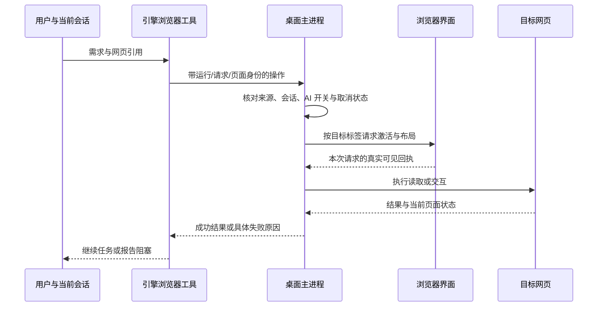

# 内置浏览器工作流与恢复边界

更新日期：2026-11-17。本文描述当前默认界面的浏览器入口、AI 操作链路及故障恢复。早期问题调查、修复过程与当时测试结果见[历史报告](history/browser-workflow-reliability-before-2026-11-17.md)。

## 用户入口

浏览器位于会话工作区，也可从菜单或命令打开；它不是必须切换到另一套 Code／Work 界面才能使用的功能。[BrowserView.tsx](../src/renderer/src/features/browser/BrowserView.tsx) 提供多标签、地址输入、前进后退、刷新、缩放、视口选择和调试工具。

普通网站在原生 `WebContentsView` 中打开。视口可选择桌面、移动或自定义尺寸；控制台与网络检查器可查看日志、过滤请求、查看请求详情和分页数据。网页是否能运行仍取决于它自己的服务、网络与浏览器兼容性。

本地 HTML 和目录可通过本机预览入口打开。远端工作区路径不能直接交给本地文件预览；应在远端启动用户可访问的开发服务器，然后打开相应 URL。

## AI 操作前提与链路

AI 操作需要当前引擎已连接、浏览器允许 AI、已选会话以及网页属于该会话。用户可以将网页添加到当前对话；界面用「AI 可操作当前网页」表达条件已满足，而不是仅凭某个标签处于打开状态就授权。

[main/browser-bridge.ts](../src/main/browser-bridge.ts) 连接引擎与桌面操作；[main/browser-ipc.ts](../src/main/browser-ipc.ts) 及 [main/browser](../src/main/browser/) 管理实际页面；[browser-store.ts](../src/renderer/src/features/browser/browser-store.ts) 管理界面标签状态。

同 URL、同标题的网页也有不同的页面身份。请求必须按目标标签、WebContents 和页面 token 识别；切换标签时要收到对应请求的可见回执，不能拿上一帧可见状态放行输入。弹窗遮挡、隐藏窗口、网页已关闭等状态仍会影响能否操作。

## 停止、失败与恢复

停止当前运行会取消对应的在途浏览器请求，不需要靠断开整个连接完成停止。关闭页面、引擎断开、来源改变或关闭 AI 权限同样会使旧操作失效；条件恢复后不能补发已经取消的点击或输入。

失败要区分未执行与执行结果不确定。点击已发生、后续快照读取失败时，不能简单重放点击。工具返回的失败正文应包含具体原因，避免模型只收到 `null` 后不断猜测定位方式。

排查建议：

| 现象 | 先检查 | 恢复方式 |
| --- | --- | --- |
| 看得见网页但 AI 无法操作 | 会话归属、AI 开关、引擎连接、页面类型 | 选定正确会话并关联网页；普通网页与插件标签分开判断 |
| 提示标签不可见或被遮挡 | 当前窗口、模态弹窗、目标标签布局 | 解除遮挡后发起新的操作，不恢复旧输入 |
| 网页打不开或服务拒绝连接 | URL、端口、项目服务是否运行、网络可达性 | 优先修正现有标签地址，避免重复创建无效标签 |
| 停止后状态仍不确定 | 运行请求是否取消、页面副作用是否已发生 | 先读取当前页面，确认结果后再继续 |
| 远端文件无法本地预览 | 路径是否属于远端机器 | 改用可访问的开发服务 URL |
| 缺少取消或交互能力 | 客户端与引擎版本及协议能力 | 更新匹配运行时；客户端更新不会自动替换远端服务 |

项目开发服务器的 PORT/HOST 与引擎监听设置应分离。服务端环境继承问题属于执行链路，不能通过修改目标网页 CSS 来修复；网页自身的应用逻辑、WebSocket 和业务错误仍需单独排查。

## 普通网页与插件标签

普通 HTTP／HTTPS 网页使用无插件 preload 的原生页面，不能调用 `window.$AE` 或通用 Electron IPC。插件页面及本地插件开发预览使用隔离 iframe 与受限桥，并由结构化插件身份和文档句柄创建标签。

地址栏显示的 `aether-plugin:` 文本不是授权凭据；手动输入这个地址不能创建插件能力。在插件标签输入普通网址会打开普通网页标签，不把插件授权带过去。插件标签保持会话与发布版本边界，刷新校验版本，关闭释放页面。

插件标签目前不支持原生网页的 AI 点击／截图。插件 API 和授权规则以[插件 HTML 参考](plugin-api/content/overview.html)为唯一公开说明；内部承载见[前端结构](frontend-architecture.md)。

## 网站数据、设置与本地文件

[BrowserSettingsView.tsx](../src/renderer/src/features/browser/BrowserSettingsView.tsx) 提供会话持久化、AI 使用和相关浏览偏好。持久化控制网站登录与存储是否保留，相关分区设置影响新建标签。清理浏览数据会清除相应 Cookie、缓存和网站登录状态；这与退出 Aether 个人账号不同。

本地预览由 [browser-preview.ts](../src/main/browser-preview.ts) 与 [browser-workspace-preview.ts](../src/main/browser-workspace-preview.ts) 处理选定文件／目录范围，不把任意网页授权为本机文件读取器。网页下载、插件文档与用户工作区的身份边界分别处理。

## 版本与验证

开发启动 `npm run dev` 会构建并固定一份隔离引擎快照，修改引擎源码后要在任务结束后重新启动开发命令。安装版导入引擎、内置打包引擎与远端服务也需要各自更新；仅生成前端产物不会改变正在运行的服务。

当前保留的专项测试入口包括 [browser-actionability.spec.ts](../e2e/browser-actionability.spec.ts) 与 [plugin-browser-ui.spec.ts](../e2e/plugin-browser-ui.spec.ts)。测试应使用新构建、隔离 profile／端口／数据目录，并检查点击、输入、取消等真实副作用，而不是只检查页面文字可见；单个专项用例不能代替整条浏览器链路的验证。

本轮文档核对没有重新运行历史浏览器测试，也没有验证任意外部网站、外部模型决策或长时间无人值守稳定性。历史报告中的通过数量和构建标识只适用于当时的版本。
