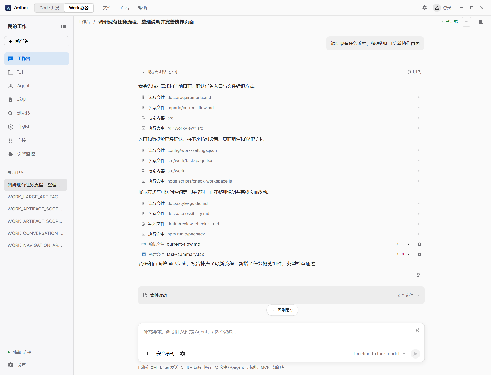
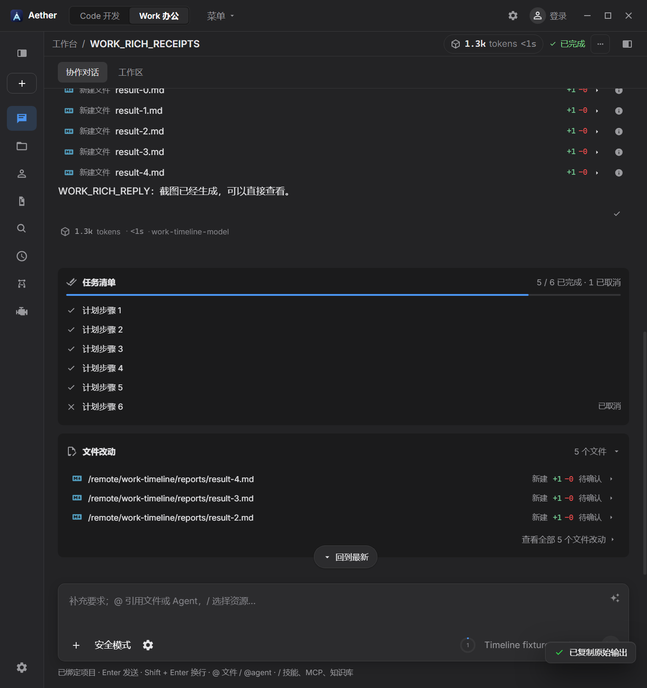
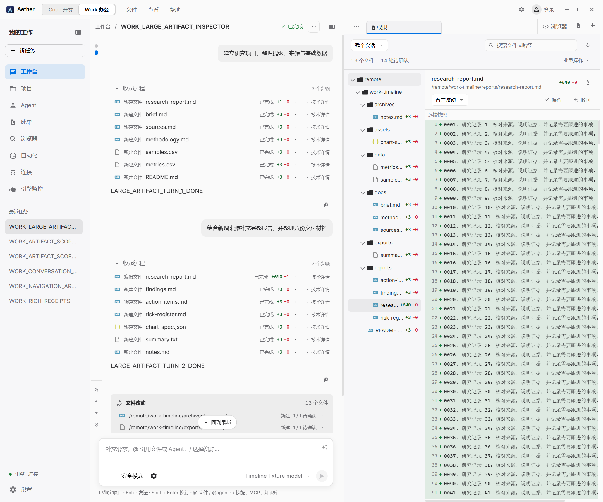
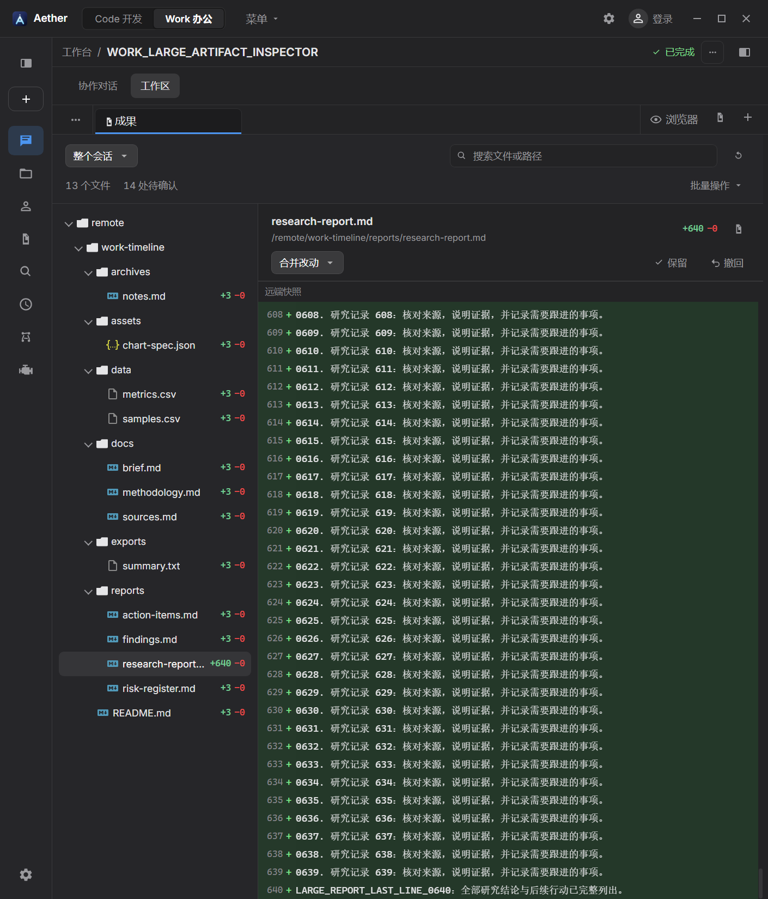
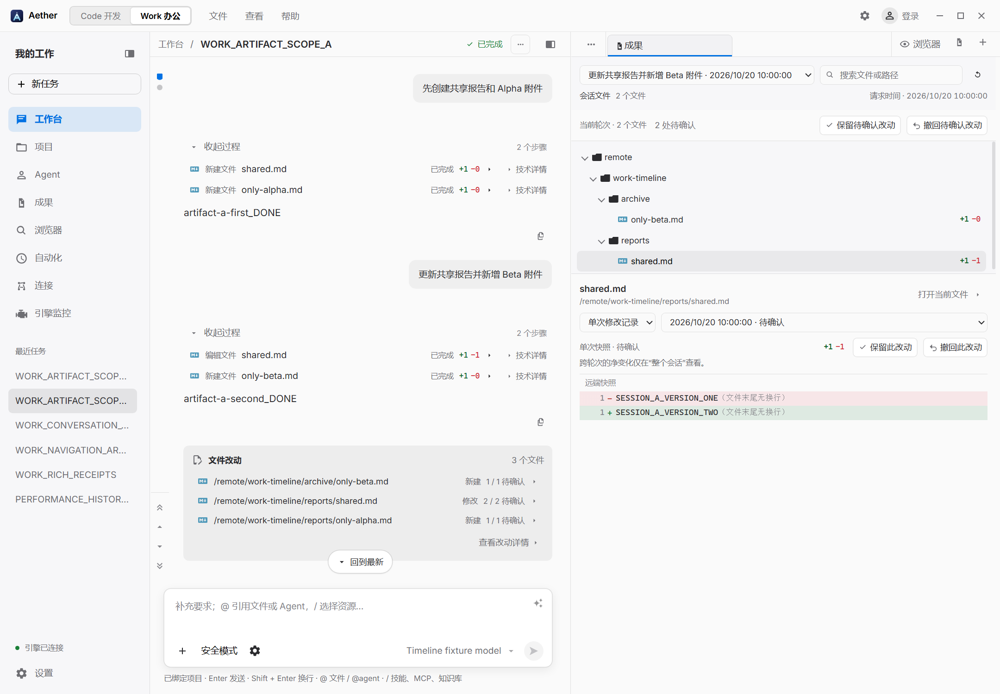
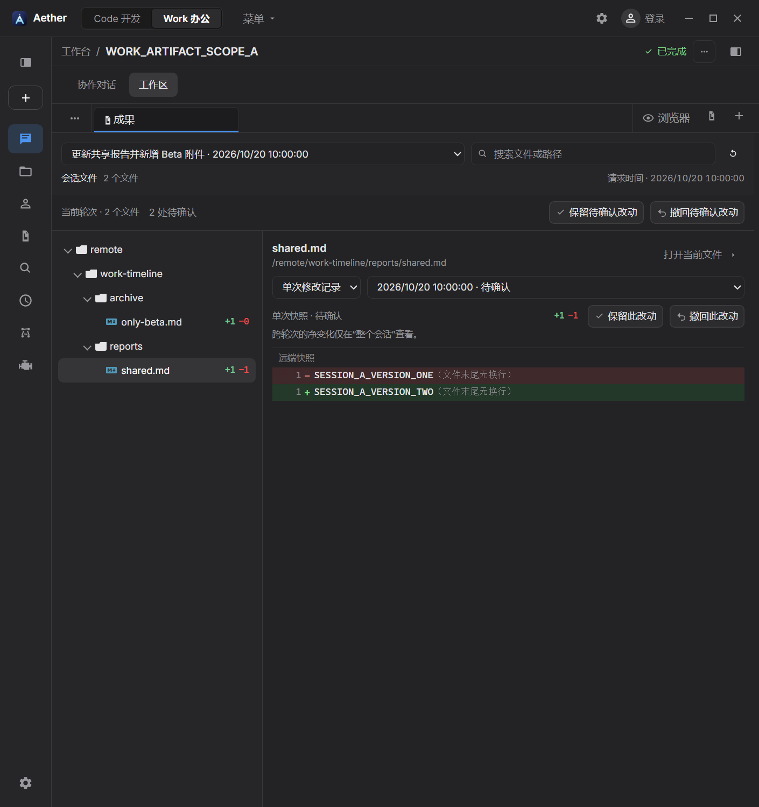
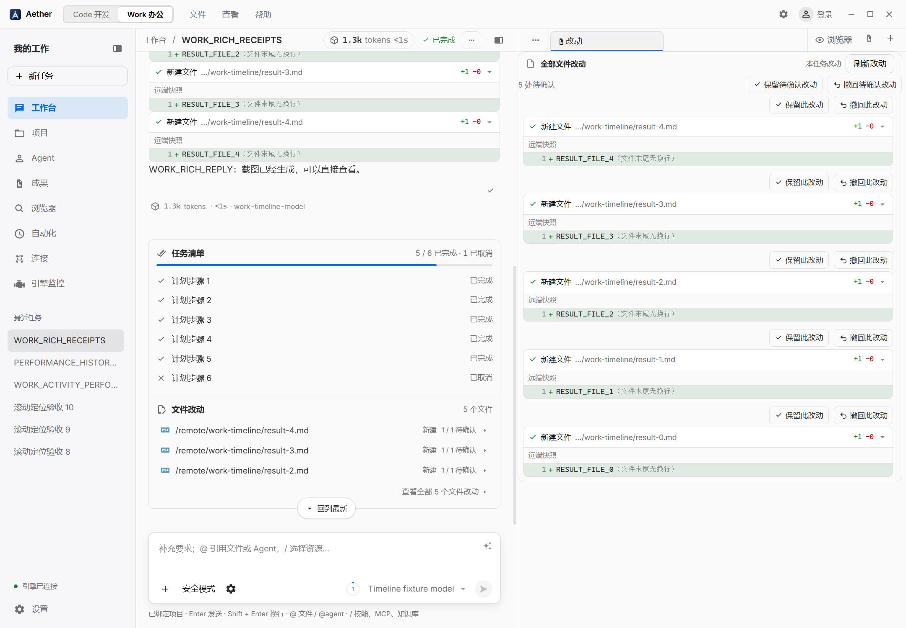
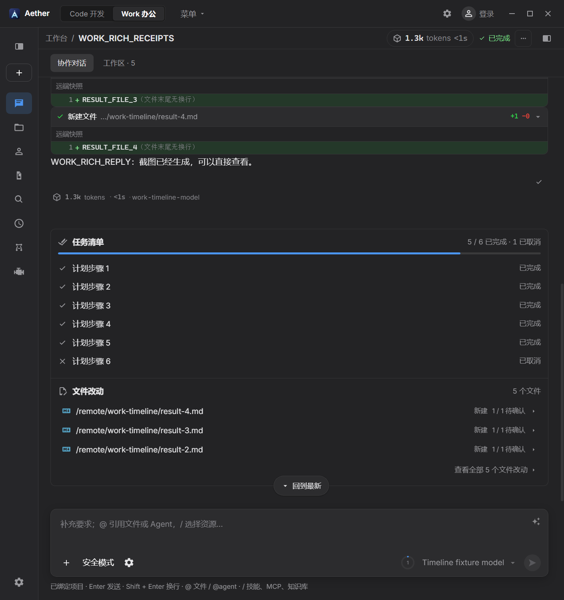
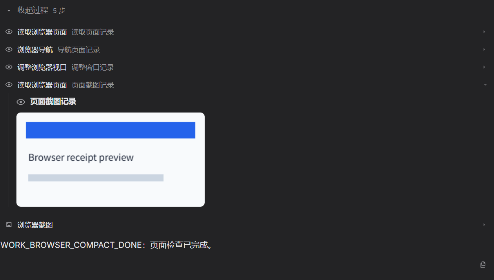
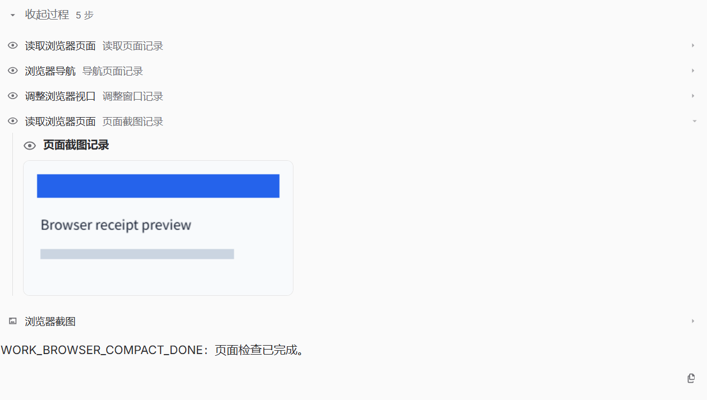

# Code → Work 功能对齐与单工作台迁移评估

日期：2026-11-05（初稿 2026-11-04）  
更新：追加浏览器过程归类、图片恢复和 Work 原始数据入口精简；各阶段验证分见第 10 节  
对象：Aether，Electron + React + TypeScript 桌面应用  
目标：保留 Code 中有用、好用的能力，以 Work 作为未来统一入口；先确认功能、数据和工程依赖，再决定何时移除 Code。

## 1. 执行结论

**当前不具备删除 Code 的条件。本次没有删除 Code，也没有实施历史数据迁移。**

本次对齐改善的是 Work 的对话阅读、工具结果、用量、执行反馈与文件审阅。普通工具只显示中性图标、名称与目标，结果按需原位展开；常规成功与耗时、原始输入输出及技术入口已移除。浏览器读取、导航、调整尺寸等属于可收起的过程；独立截图保留图片，并可单独收起与放大。思考由消息级开关统一控制，真实文件改动回执可精确跳转成果。轮次雷达、完整任务清单、独立且默认折叠的文件摘要与共享显隐也已接入。最新过程与图片验收见第 10.11 节，资源树与刷新性能见第 10.10 节；此前主流程、浏览器与 Git 验收保留在第 10.1 节。各阶段结果分别记录，不累加为当前全库通过数。

成果与资源树阶段的 93 条 Playwright 和 2 条 Node 文件树契约保留在第 10.2 节，旧 159 条与 112 条验收分别位于第 10.3、10.4 节，均不叠加为最新一轮结果。这些改动与测试仍不能据此推导出整个 IDE 已完成对齐。

Code 仍承载一组 Work 尚不可替代的人工操作：可写文本编辑与保存、文件管理、全文搜索替换、快速打开、自由交互终端、语言服务与问题面板。Work 的文件“源码”视图目前主要是只读预览；AI 后台命令卡片也不等于用户可以输入任意命令的 PTY 终端。Work Git 已接入共享完整面板与任务内差异视图，其 15 条真实窗口验证覆盖常用写操作、任务隔离、实时同步、隐藏暂停和高级 Git 菜单；另有服务矩阵、原生竞争及范围逻辑验证，不能再列为高级管理入口缺失。具体性能样本与证据见第 10.1 节。

浏览器、设置、Office/PDF 与媒体预览已经高度共享，应优先保留现有共享实现。后续重点是给 Work 提供正确的功能入口、所属会话和持久化规则，避免制造第二套功能实现。

最终要移除的是 **Code 模式的独立外壳及重复状态管理**。Monaco、xterm、Git、搜索、文档预览、命令注册等基础能力，仍应作为统一工作台的共享模块保留。

## 2. 评估口径与证据范围

本报告使用以下维度判断是否对齐：

| 维度 | 判断标准 |
|---|---|
| 功能 | 用户能否完成相同工作，包括错误、取消、重试、恢复等分支 |
| 可达性 | 是否有实际可用的按钮、菜单、快捷键或命令入口 |
| 呈现 | 是否显示可理解的状态与结果；Work 是否隐藏常规原始数据，图片与过程是否可按需展开 |
| 所有权 | 操作是否指向正确的引擎、账号、任务、会话、工作区和资源 |
| 数据连续性 | 草稿、未保存内容、历史、标签、滚动位置能否恢复 |
| 性能 | 长历史是否有界；隐藏页面是否停止无用刷新；大文件是否受控 |
| 可访问性 | 键盘、焦点、标签、状态公告、减少动态效果是否可用 |
| 可维护性 | 是否复用已有实现，是否避免两套状态和协议持续分叉 |
| 验证 | 是否只有静态代码证据，还是经过真实 Electron 窗口与副作用验证 |

证据来自 2026-11-04 至 2026-11-05 当前工作区源码。工作区已有其他任务的未提交修改，因此本报告描述的是**读取时的整合状态**，不把所有现存能力都归为本次新增。链接相对本报告目录；行号写在链接后的文字中，后续改动可能使其移动。

状态用语：

- **共享**：已经使用同一核心组件或实现；仍需验证入口和所属范围。
- **部分具备**：存在主要路径，但缺操作、边界或可达入口。
- **缺失**：本轮静态审查未找到 Work 中等价的用户操作闭环。
- **本次接入**：代码已完成接入；实测情况以第 10 节为准。

本报告不使用虚构完成率。静态证据不能证明所有平台、远端环境及失败分支都已可用。尤其“组件被 import”“后端有 API”“菜单里能搜到名称”，均不等于用户已经能在 Work 完成操作。

## 3. 本次已迁移的范围

| 能力 | 当前实现 | 直接收益 | 边界 |
|---|---|---|---|
| 会话总用量 | Work 顶部接入共享 `UsageMeter`；runtime 仅在当前会话已恢复或预览就绪时暴露 `sessionUsage` | 查看 token 总量、时间和明细 | 使用会话权威统计，不能把当前分页求和冒充完整会话总量 |
| 每轮用量 | 共享 `TurnUsage`；按 Work 整轮分组汇总，子代理按 run 去重 | 查看本轮消耗、实际模型、耗时 | 缺失用量不编造为零；单个历史时间戳不编造耗时 |
| 轮次导航 | `WorkMessageNav` 适配共享 `MessageNavRail` 与 Work 有界历史窗口；雷达从阅读区侧边中心向上下展开，悬停、聚焦与键盘均可进入 | 有界问题列表、圆点/预览、上一轮/下一轮、到顶/到底、复制和标记；Escape 收起并恢复触发器焦点 | 当前按已加载历史导航，长列表限制在阅读区；不在导航里绕过既有消息修改确认 |
| 工具呈现与文件紧凑行 | 普通工具使用共享 `CompactToolRow` 的 Work quiet 模式，28px 行内只显示语义图标、名称和简短目标；浏览器操作归入过程，独立截图仍可见且可收起 | 去掉成功彩点、重复状态、毫秒及技术入口；真实文件回执显示动作、文件名和增删行数，并跳到精确修改 | 运行、等待、失败、中断与取消仍可识别；实际截图不再依赖视口元信息才能显示；Code 保留原始结果及点击位置呈现 |
| 活动入口与诊断收敛 | 独立活动面板已移除；Work 普通工具、子代理工具与对话中的原始参数、输出、收据及技术图标不再展示 | 日常流程只保留可读结果与必要反馈；失败仍保留明确的诊断入口 | 原始回执与版本数据仍完整保存在数据层，不改变任务生命周期；失败定位、分页和键盘路径保留 |
| 结构化工具结果 | `ToolResultData` 把可识别 JSON 显示为可读字段，嵌套内容按需展开，每次增加 12 项 | 无需阅读 JSON 包装，也不另设原始数据入口 | JSON 解析上限 64,000 字符，最多 32 层；不完整或超限 JSON 显示准确提示。媒体使用专用视图，普通正文保留；Code 继续提供原始结果 |
| 独立后台命令 | Work 接入当前会话 `commandJobs` 和 `visibleChildCommandJobs`，排除已由工具卡片显示的重复项 | 子代理等独立运行命令也有可见状态与输出入口 | 命令缓存归属测试不能替代真实输出、停止和重启恢复验收 |
| 思考与过程 | 过程标题收敛为展开/收起、步骤数与失败数；同一消息的思考由一个开关统一控制，有工具时默认隐藏思考预览，纯思考消息在打开过程时仍可读；思考段保留原时间位置及全文展开 | 避免每次工具之间重复显示思考预览；普通工具段移除重复上下留白，中途正文与最终答复保持顺序和内容 | 思考开关与各段折叠有稳定记忆；开关不删除正文、原始思考或工具；不把未结束的后台执行伪装成成功 |
| 回复复制 | Work AI 回复提供复制操作 | 不必手工拖选长回复 | 与既有整轮多选/导出并存 |
| 执行反馈与收尾区 | `WorkProgressPanel` 将任务清单与文件改动拆成独立区域；任务完整展开并跟踪实时状态，完成行仅保留勾选；文件改动默认折叠，按稳定引擎/账号与会话记忆展开选择，展开显示前三个文件及全部详情入口 | 降低收尾区密度，任务仍逐项可见；文件行显示最新一次真实修改的增删数，点击携带精确回执，折叠时同步错误与重试仍可达 | 文件数与状态依据明确回执；缺快照显示未知、近似统计明确标记，最新一次统计不冒充整会话净变化。折叠文件摘要不停止当前可见任务的状态同步 |
| 会话成果树与历史差异 | `WorkSessionArtifacts` 依据当前会话的持久改动记录构建文件树；同路径保留各次操作与服务端净变化片段，右侧显示精确历史快照 | 历史分页不再改变成果清单；点击工具记录可重复定位到所属轮次、文件及指定修改 | 不从工作区当前文件、文本产物或其他会话回执推断历史；“打开当前文件”单独读取当前磁盘内容 |
| 顶部轮次与搜索 | 树和差异共用顶部范围选择：整个会话、各用户轮次及未关联轮次；轮次菜单分层显示请求摘要与时间，当前时间在计数行可见；文件名/完整路径搜索覆盖当前范围全部文件，包括此前折叠目录中的文件 | 用户可先选一次请求，再搜索其文件；菜单、文件树和差异使用同一范围，避免长摘要把时间挤掉 | 只按可靠 `turnId` 归属；历史请求未加载时标为历史轮次，时间来源在菜单说明；跨轮次净变化不冒充单轮净变化 |
| 连续差异视图 | `FileChangeCard` 的 embedded 模式接入 `VirtualFileChangeDiff`，填满父级剩余高度，不再使用聊天预览的 260px 上限和“展开更多”分页；固定行高、ResizeObserver 与预渲染缓冲控制可见行 | 长差异可连续滚动或用 Home/End 到达首末，保留真实行号、增删标记、未修改内容省略与末尾无换行提示 | 只渲染和高亮视口附近的行，不把上万行全部挂到 DOM；Code 默认卡片的折叠与 60 行分页保持原样；成果与资源树阶段已验证 640 行差异连续滚到底、剩余高度填充与有界 DOM |
| 共享资源树与状态记忆 | Code 与 Work 复用 `FileTreeView`、展开恢复算法与视口记忆；Work 保存目录展开、选择/当前文件、键盘位置、横纵滚动和名称筛选 | 切换标签/任务、刷新或重新打开后按正确来源恢复浏览位置，隐藏面板不会用零尺寸覆盖位置 | 按模式、稳定引擎/账户、连接或会话及真实根目录隔离；恢复须核对真实目录，过期/越界路径不作读取授权；Code 保留既有展开存储，其名称筛选仍是组件局部状态 |
| 成果跳转与文件打开 | 普通工具目标为纯文本，包括 `read_file` 的读取路径；该行仅展开结果。只有通过当前会话校验的 `change/changes` 回执提供成果按钮，携带精确 `changeId`；成果页仍有“打开当前文件” | 区分一次读取、当前文件预览与真实历史修改；读取、搜索、命令目标或仅含路径的 JSON 不会被误作成果 | 不依据工具名称、成功文字或当前磁盘内容推断修改；失败且无真实变更回执不伪造成果。正文中明确文件链接的既有打开行为与本地/远端读取边界保持 |
| 改动确认操作 | 成果页与既有 WorkChangesPanel 复用 `WorkChangeReviewActions`；批量动作收进菜单，仍依据顶部轮次与搜索结果取精确原始记录 ID，并在操作区名称和确认清单表达范围；单次记录及净变化片段使用各自精确 ID 链 | 保留/撤回沿用引擎快照核验、共享逐文件结果与部分冲突报告；仅操作当前可确认范围，对话历史保持不变 | 运行、等待、隐藏或数据未同步时禁用；跨轮次净段只在整个会话可见；“Git 暂存并保留”尚未迁移；成果与资源树阶段的真实窗口请求范围与冲突呈现已通过，生产引擎磁盘回退仍需联调 |

关键证据：

- [WorkView](../src/renderer/src/contrib/work/WorkView.tsx)：总用量、整轮统计、每轮用量、执行反馈、工具呈现、思考、回复复制、工具定位与成果面板入口。
- [work-runtime](../src/renderer/src/contrib/work/work-runtime.ts)：1198–1201 行按当前会话恢复状态暴露命令、用量和统计待同步提示。
- [ConversationUsage](../src/renderer/src/contrib/chat/ConversationUsage.tsx)：46、148 行共享每轮/会话组件；[turn-usage](../src/renderer/src/contrib/chat/turn-usage.ts)：7 行整轮汇总。
- [WorkMessageNav](../src/renderer/src/contrib/work/WorkMessageNav.tsx)：11 行 Work 导航适配；[work-message-nav](../src/renderer/src/contrib/work/work-message-nav.ts)：窗口目标计算。
- [work-message-timeline](../src/renderer/src/contrib/work/work-message-timeline.ts)：17 行展示分段；[work-tool-presentation](../src/renderer/src/contrib/work/work-tool-presentation.ts)：7 行工具分类。
- [WorkToolActivity](../src/renderer/src/contrib/work/WorkToolActivity.tsx)：共享工具入口；[CompactToolRow](../src/renderer/src/contrib/chat/CompactToolRow.tsx)：Work quiet 行与就地结果；[BrowserSnapshotResult](../src/renderer/src/contrib/chat/BrowserSnapshotResult.tsx)：按模式呈现页面结果和真实截图；[WorkFileChangeRow](../src/renderer/src/contrib/work/WorkFileChangeRow.tsx)：真实文件回执；[WorkProgressPanel](../src/renderer/src/contrib/work/WorkProgressPanel.tsx)：执行反馈。
- [WorkSessionArtifacts](../src/renderer/src/contrib/work/WorkSessionArtifacts.tsx)：共享顶部轮次/搜索、文件树、连续差异所需剩余高度和范围内审阅；[work-session-artifacts](../src/renderer/src/contrib/work/work-session-artifacts.ts)：会话归属、精确轮次、净段来源 ID 校验、搜索与选中解析；[work-file-change-presentation](../src/renderer/src/contrib/work/work-file-change-presentation.ts)：紧凑行与成果树共用的真实增删统计。
- [FileChangeCard](../src/renderer/src/contrib/chat/FileChangeCard.tsx) 与 [VirtualFileChangeDiff](../src/renderer/src/contrib/chat/VirtualFileChangeDiff.tsx)：默认聊天卡片与嵌入式连续虚拟差异分流；[virtual-file-change-diff.css](../src/renderer/src/contrib/chat/virtual-file-change-diff.css)：剩余高度、独立滚动和固定行高约束。
- [FileTreeView](../src/renderer/src/contrib/explorer/FileTreeView.tsx)、[file-tree-memory](../src/renderer/src/core/workspace/file-tree-memory.ts) 与 [use-file-tree-memory](../src/renderer/src/contrib/explorer/use-file-tree-memory.ts)：两侧共享树展示、持久化范围、真实目录恢复及隐藏/加载时的滚动保护。

本次未宣称新增的已有能力：Work 整轮多选、复制/Markdown 导出、用户消息操作、历史分页、回到最新、任务级浏览器/文件资源、设置，以及 Office/PDF 预览。当前工作区还包含并发完成的共享 Git 面板接入，详见第 4.2 节；本轮已验证常用写操作、合并冲突中止、高级菜单、任务/账号隔离，以及本机真实引擎和临时裸仓库组成的远端路径。生产部署、非本机远端服务与凭据/网络失败仍需联调。这些实现均应在回归时保护。

## 4. 功能模块矩阵：20 个工程与工作台维度

### 4.1 编辑、文件、搜索和运行

| # | 模块 | Code 现状与证据 | Work 现状与可达路径 | 缺口、价值与依赖 | 迁移优先级 |
|---|---|---|---|---|---|
| 1 | 工作台宿主与布局 | [Workbench](../src/renderer/src/workbench/Workbench.tsx) 94 行 Code surface 承载侧栏、编辑器、底部面板、对话；[EditorArea](../src/renderer/src/workbench/EditorArea.tsx) 提供编辑器组 | [WorkView](../src/renderer/src/contrib/work/WorkView.tsx) 的任务对话、资源标签、工作区分栏；Work 保持任务优先 | 部分具备。缺独立编辑器组和终端/问题等工具面板宿主。需要可选工具面板，不能让所有功能都塞入聊天正文 | P0：先建立可扩展的 Work 宿主 |
| 2 | 可写源码与文本编辑 | [DocumentView](../src/renderer/src/contrib/editor/DocumentView.tsx) 119 行接 Monaco；[MonacoEditor](../src/renderer/src/contrib/editor/MonacoEditor.tsx) 106 行创建编辑器，支持编辑/撤销/光标状态 | 任务资源 → 文件 → 源码；[WorkArtifactPanel](../src/renderer/src/contrib/work/WorkArtifactPanel.tsx) 文本分支使用 WorkTextPreview；[TextPreview](../src/renderer/src/core/editor/TextPreview.tsx) 15 行明确只读 | **缺失，阻断删除 Code。** 源码预览不等于可写编辑。应支持“预览/编辑”，保持任务所属文档和未保存状态 | P0 |
| 3 | 保存、脏状态、关闭确认 | [editor-store](../src/renderer/src/core/editor/editor-store.ts) 410 行串行保存、435 行读盘核对、441 行写盘；[DocumentView](../src/renderer/src/contrib/editor/DocumentView.tsx) 142 行脏状态 | Work 提供下载/导出原文件与预览，没有文本编辑缓冲区保存闭环 | **缺失，数据安全阻断。** 下载不是保存编辑。迁移保存、关闭前确认、失败保留缓冲区、并发写入防护 | P0，随编辑器一起完成 |
| 4 | 重启恢复与外部文件变化 | [editor-recovery](../src/renderer/src/core/editor/editor-recovery.ts) 11 行恢复键、53–54 行排除 sessionFileTarget；[document-sync](../src/renderer/src/core/editor/document-sync.ts) 34 行排除会话文件监听；[DocumentView](../src/renderer/src/contrib/editor/DocumentView.tsx) 95 行冲突提示 | Work 保留任务/资源状态；但尚无等价的可写文件草稿恢复和磁盘修改同步 | **缺失，数据安全阻断。** 共享 store 具有部分 session 支持，但目前恢复/监听并未覆盖 Work 文档；必须引入 source/session/root 身份 | P0 |
| 5 | 文件管理与资源树 | [ExplorerView](../src/renderer/src/contrib/explorer/ExplorerView.tsx) 有重命名、剪切/复制/粘贴、菜单和拖动；此前接入共享树视口与状态记忆 | 任务 → 工作区文件；[WorkWorkspacePanel](../src/renderer/src/contrib/work/WorkWorkspacePanel.tsx) 与 Code 共用 FileTreeView/恢复算法，具备打开、键盘导航、当前行选择和按会话/来源/根目录保存的展开、滚动、筛选状态 | 部分具备。共享展示与记忆不等于完成文件管理；仍缺新建文件/目录、重命名、移动、删除、多选操作、剪贴板和撤销。数据读取继续走 session API，不能直接绑定 Code 的全局 workspace-store | P0 |
| 6 | 快速打开文件 | [QuickOpen](../src/renderer/src/workbench/QuickOpen.tsx) 92 行注册，104 行 Ctrl+P，133 行读取全局工作区 | Work 资源栏支持系统文件选择；[WorkWorkspacePanel](../src/renderer/src/contrib/work/WorkWorkspacePanel.tsx) 的工作区文件筛选仍限已加载目录；会话成果页搜索覆盖当前会话/轮次的全部持久改动文件 | 缺失等价项目快速打开。成果记录搜索不覆盖未发生会话改动的项目文件，系统文件选择器也不是项目索引搜索。需注入任务文件目标和打开回调 | P0 |
| 7 | 全文搜索与替换 | [SearchView](../src/renderer/src/contrib/search/SearchView.tsx) 146/166 行大小写/正则、372 行替换预览；[search-store](../src/renderer/src/contrib/search/search-store.ts) 415 行替换；remote-search 支持远端路径 | Work 有任务标题搜索及文件名过滤，无等价正文搜索/跨文件替换面板 | **缺失，阻断删除 Code。** 复用搜索结果与预览 UI，但状态和 transport 必须按 task/session 分区，结果需跳到 Work 文件位置 | P0 |
| 8 | 代码语言服务 | [editor-commands](../src/renderer/src/contrib/editor/editor-commands.ts) 24–88 行格式化、重命名、修复、定义/引用；[ts-client](../src/renderer/src/core/lsp/ts-client.ts) 200 行 providers | 工具可以返回诊断内容，但没有可编辑 Monaco 上的相同交互闭环 | **缺失。** [lifecycle](../src/renderer/src/core/lsp/lifecycle.ts) 30 行只观察全局 workspace root；迁移前需明确多任务语言服务的归属与生命周期 | P0 |
| 9 | 问题面板与诊断跳转 | [ProblemsView](../src/renderer/src/contrib/problems/ProblemsView.tsx) 42 行视图；[contrib/index](../src/renderer/src/contrib/index.ts) 122 行起注册问题面板 | 未发现 Work 独立问题面板；对话中的工具详情不能替代文件分组、严重级别过滤与源码跳转 | 缺失。与可写编辑器、行列定位、语言服务配套迁移；保留“诊断来源/时效”提示 | P0 |
| 10 | 用户交互终端 | [TerminalView](../src/renderer/src/contrib/terminal/TerminalView.tsx) 53 行视图、97 行重启、168 行多标签；[terminal-store](../src/renderer/src/contrib/terminal/terminal-store.ts) 271 行创建 | Work AI 命令卡片显示输出、状态和停止；没有自由输入的用户 shell 面板 | **缺失，阻断删除 Code。** PTY 不能用 AI 命令替代。307 行终端默认 session 仍取 Code 的 settings.lastSessionId，必须先改 owner，再复用 UI | P0 |

### 4.2 版本控制、资源、命令和配置

| # | 模块 | Code 现状与证据 | Work 现状与可达路径 | 缺口、价值与依赖 | 迁移优先级 |
|---|---|---|---|---|---|
| 11 | Git 基础操作 | GitChangesPanel 提供状态、暂存、提交、同步等 | 任务工作区 → Git；[WorkGitPanel](../src/renderer/src/contrib/work/WorkGitPanel.tsx) 通过 [GitProvider](../src/renderer/src/core/git/git-context.tsx) 挂载共享 GitChangesPanel，[work-git-store](../src/renderer/src/core/git/work-git-store.ts) 按来源、会话、根目录与仓库路径提供实例及任务绑定 | **已接入并通过本轮专项。** 真实窗口覆盖暂存/取消暂存、提交、保留暂存内容的放弃更改、多远程推送及部分失败、任务隔离、自动同步与隐藏暂停；账号范围、异步结果、租约竞争和恢复另有分层验证。远端使用本机引擎与临时裸仓库，不外推生产网络/凭据兼容性 | P1：持续回归与生产远端联调 |
| 12 | Git 高级管理 | [GitChangesPanel](../src/renderer/src/contrib/git/GitChangesPanel.tsx) 包含分支、历史图、stash、merge/rebase/cherry-pick、标签、提交详情与克隆入口 | Work 复用同一面板；WorkGitPanel 提供任务内克隆与仓库切换、工作区/暂存区/提交差异宿主，任务操作使用自己的 Git store | **已接入并通过本轮专项。** 可见菜单已验证分支/标签/stash、克隆、历史泳道与分页、merge 冲突中止后重新合并、rebase、cherry-pick/revert，并核对真实落盘与其他任务仓库不变。详细范围见 10.1；可写冲突编辑、生产部署及非本机远端兼容性仍不在已验证范围 | P1：持续回归与剩余边界 |
| 13 | 差异审阅与改动管理 | 独立 [GitDiffView](../src/renderer/src/contrib/git/GitDiffView.tsx)、GitInlineDiffWidget、FileChangeCard | [WorkGitDiff](../src/renderer/src/contrib/work/WorkGitDiff.tsx) 使用只读 Monaco 差异编辑器，可行内/并排比较、跳转差异，并通过 [git-commit-diff](../src/renderer/src/core/git/git-commit-diff.ts) 读取提交差异；会话成果树按用户轮次/时间和文件搜索，精确快照使用填满剩余高度的连续虚拟 diff；单条/批量审阅见 A17 | 部分具备。共享 Git 入口与只读 diff 不等于可写冲突解决或完整多文件编辑；AI 快照冲突报告与 Git 合并冲突是不同能力；“Git 暂存并保留”联动尚未迁移。成果连续差异的滚底、尺寸及有界行数已有历史验收，本轮 Work Git 也通过任务仓库的 Monaco diff 验证 | P1 |
| 14 | 内置浏览器与调试 | [BrowserView](../src/renderer/src/contrib/browser/BrowserView.tsx) 共用标签、导航、缩放、设备视口、控制台、网络面板 | [WorkBrowser](../src/renderer/src/contrib/work/WorkBrowser.tsx) 37 行直接使用 BrowserView，surfaceMode=work；资源栏或浏览器页可达 | **共享程度高。** 主要差别在标签宿主/命令入口；保留 mode/session 的原生页面所有权，不可合并成无 owner 的全局当前页 | P1：验证与入口收敛 |
| 15 | Office/PDF/图片/媒体预览 | [FilePreview](../src/renderer/src/contrib/editor/FilePreview.tsx) 42 行路由 DocumentPreview；支持图片缩放/平移等，PDF 有批注与另存为 | WorkArtifactPanel 复用 FilePreview；资源内可预览、导出、引用；HTML 运行接浏览器 | **共享。** 不应把 Office/PDF 预览与文本编辑缺口混为一谈。仍需验证 task/session 身份、完整与截断文件、保留预览和后台暂停 | P1：质量与一致性 |
| 16 | 资源标签与预览布局 | EditorArea 管理文档标签、编辑器组、关闭确认、重开关闭文件、上下文菜单 | [WorkResourceTabs](../src/renderer/src/contrib/work/WorkResourceTabs.tsx) 71/75 行打开文件/新建网页；WorkView 统一资源与功能标签，保留预览 | 部分具备。文件/网页统一入口是 Work 优势，但缺可写文档组、脏状态标签、编辑器式重开/批量关闭等完整语义 | P1，依赖文档宿主 |
| 17 | 文件/选区引用到对话 | [MonacoEditor](../src/renderer/src/contrib/editor/MonacoEditor.tsx) 169 行附近的选区加入对话；[editor-context](../src/renderer/src/contrib/chat/editor-context.ts) 保留编辑上下文 | Work 文件预览和成果可“添加到对话”，有预览选区引用 | 部分具备。未来可写缓冲区必须引用未保存文本与准确行范围，不能读旧磁盘文件；引用目标也不能沿用 Code lastSessionId | P1 |
| 18 | 菜单、命令与快捷键 | [contrib/index](../src/renderer/src/contrib/index.ts) 148 行命令、461 行快捷键；MenuBar、CommandPalette、QuickOpen 共用 | [MenuBar](../src/renderer/src/workbench/MenuBar.tsx) 94 行 Work 菜单只有新任务、命令面板、设置、重启；WorkView 471 行注册 work.new | **横向阻断。** [app-mode](../src/renderer/src/core/platform/app-mode.ts) 37 行白名单拒绝大部分 Code 命令；不能仅搬组件或简单取消模式校验 | P0：能力与宿主路由；P1：覆盖所有主要动作 |
| 19 | 设置、资源配置与策略 | [AppSettingsView](../src/renderer/src/contrib/settings/AppSettingsView.tsx) 包含模型、安全、编辑器、终端、搜索、键盘、Git、浏览器、代码图、MCP、技能、知识库、记忆等 | [Workbench](../src/renderer/src/workbench/Workbench.tsx) 210 行 Work 设置弹窗复用相同 AppSettingsView | **共享。** 设置存在不代表对应 Work 功能可达；编辑器/终端配置目前可能先于功能出现。保持一套设置模型，避免另建 Work 配置分支 | P1：可达性和能力提示；P2：组织与文案 |
| 20 | 日志、监控与状态反馈 | [OutputView](../src/renderer/src/contrib/output/OutputView.tsx) 48 行显示主进程捕获引擎日志；可从底部面板/状态入口查看 | [EngineMonitorView](../src/renderer/src/contrib/work/EngineMonitorView.tsx) 66 行提供 CPU、内存、I/O、存储、连接、任务监控；对话有工具状态 | 部分具备且各有侧重。资源监控不等价于逐行引擎日志。移除 Code 后必须仍可排查启动失败、传输和底层错误 | P1：共享日志入口与复制 |

### 4.3 AI 对话模块详细矩阵

<!-- AI_CONVERSATION_MATRIX_START -->

本表对齐的是用户可完成的操作，不以两个模式均使用 `useChat` 推导出完整对齐。“当前已有”包含本次之前的工作区能力；“本次接入”须结合第 10 节实际验证记录判断完成程度。

| # | 能力 | Code / Work 当前状态与入口 | 缺口与迁移要求 | 优先级 |
|---|---|---|---|---|
| A1 | 旧会话接管与历史入口 | Code [SessionHistoryView](../src/renderer/src/contrib/history/SessionHistoryView.tsx) 161–165 行从 `/conversation/sessions` 读取并排除 `work-*`；Work [work-state](../src/renderer/src/contrib/work/work-state.ts) 176–194 行只接纳 `work-*` 或自动化来源任务 | **删除 Code 阻断。** Work 本地目录尚无普通 Code 会话导入、接管或服务端重建闭环。移除 Code 会失去这些会话的访问入口，并不意味着引擎数据已经被删除。迁移需保留原 sessionId、来源/账号、工作区、模型/资源、元信息及归档窗口 | P0 |
| A2 | 会话组织 | Code 历史有置顶、收藏、标记色、仅收藏、时间/标题/颜色排序、打开项目目录及删除；[WorkTaskActions](../src/renderer/src/contrib/work/WorkTaskActions.tsx) 76–102 行有重命名、归档/恢复、继续/停止和导出；[WorkView](../src/renderer/src/contrib/work/WorkView.tsx) 323 行有标题搜索与状态过滤 | 部分具备。优先移植置顶、收藏、色标和排序的元数据与交互；删除与归档需保持明确区别。不能把消息的颜色标记当成会话颜色标记 | P1 |
| A3 | 输入、附件和资源选择 | Work [WorkComposer](../src/renderer/src/contrib/work/WorkComposer.tsx) 已有粘贴/拖拽附件、预览、`@` 文件和协作 Agent、`/` 技能/MCP/知识库，复用 MentionRefPicker 与 ResourcePicker | **已有成熟共享能力。** 保护上传失败、切任务草稿、附件路径与来源范围；无需再做第二套普通资源选择器 | 保持回归 |
| A4 | 模型、推理、记忆与安全设置 | Work 通过 [WorkComposerPreferences](../src/renderer/src/contrib/work/WorkComposerPreferences.tsx) 及共享 [ComposerOptions](../src/renderer/src/contrib/chat/ComposerOptions.tsx) 配置；Code 使用相同核心选项 | 主要能力已具备。仍需验证历史续跑使用实际会话配置，任务切换和 Agent 绑定不会串状态；不能用当前输入框模型替代历史实际模型 | P1 验证 |
| A5 | 请求级资源覆盖 | [work-runtime](../src/renderer/src/contrib/work/work-runtime.ts) 303–305 行把空 skills/MCP/KB 数组发送为 `undefined`，因此恢复 Agent 默认绑定 | **部分具备。** 选资源已有入口，缺的是“显式不使用任何绑定资源”与“继承 Agent”两个不同状态。应统一请求级覆盖语义，并保留队列与历史配置 | P1 |
| A6 | 编辑器、Git、终端内容引用 | Code [editor-context](../src/renderer/src/contrib/chat/editor-context.ts) 26–29 行调用 `showChatPanel()` 与 `pushPendingMentions()`；[ChatView](../src/renderer/src/contrib/chat/ChatView.tsx) 578 行是待引用队列消费者；Work 有自己的文件预览引用，但 WorkComposer 不消费这条队列 | **删除 Code 阻断。** 编辑器选区、Explorer、GitDiff、终端等既有“加入对话”路径需要统一目标路由。应带 engine/task/session scope，并保留未保存文本、行列和基线快照；不能只显示 Work 面板却仍把引用送到隐藏 Code | P0 |
| A7 | 运行中补充 | Work [WorkComposer](../src/renderer/src/contrib/work/WorkComposer.tsx) 79、469–488 行复用 RootFollowup 的投递、接纳回执、失败保留与恢复；Code 也使用该实现 | **已有共享。** 保留当前 run 的接纳能力判断与任务归属；失败或结果待核对时不能把草稿视为已发送，更不能自动重复投递 | 保持回归 |
| A8 | 下一轮队列 | [WorkNextTurnQueue](../src/renderer/src/contrib/work/WorkNextTurnQueue.tsx) 已有持久化、准确接纳核对、暂停/恢复、上下移动、正文编辑、删除/清空；Code [SessionTray](../src/renderer/src/contrib/chat/SessionTray.tsx) 297、321、385 行另有队首立即发送、兼容配置合并、附件缩略图和移除附件 | 部分具备。Work 当前明确只编辑正文并保留附件；补齐合并与附件管理时必须沿用接纳幂等、配置差异保留和编辑竞争防护 | P1 |
| A9 | 停止、断线与恢复 | Work runtime 有停止、跨任务停止、恢复和运行反馈；[WorkView](../src/renderer/src/contrib/work/WorkView.tsx) 1215、1345 行使用 PublishedRecoveryNotice、SessionConnectionNotice；共享 useChat 恢复 snapshot/stream 和归档页 | **已有共享。** 界面入口已存在，仍需覆盖切任务、断线、独立后台工作和未知接纳状态。不能仅以当前订阅结束推断所有任务已停止 | 保持回归 |
| A10 | 审批、提问与历史审计 | Work [WorkView](../src/renderer/src/contrib/work/WorkView.tsx) 1700 行 WorkPending 有单/多选、文本、失败重试、草稿记忆；1723/1788 行要求所有题非空。Code PendingCard 支持跳过、权限直接按钮和本会话完全访问；2555 行 InteractionHistory 显示已处理权限/提问、理由与允许/拒绝结果 | **部分具备。** Work 目前显示 pending 交互与旧 `message.answered`，未接入同等历史摘要。应复用已处理交互展示，明确跳过语义和权限选择；保留审批追溯，不能只优化等待输入时的样式 | P1；移除前审计历史需可读 |
| A11 | 时间线、思考与回答复制 | Work 已接入共享 ThinkingRow、回答复制和内容/工具有序时间线；[work-message-timeline](../src/renderer/src/contrib/work/work-message-timeline.ts)、[ThinkingRow](../src/renderer/src/contrib/chat/ThinkingRow.tsx) 保持顺序；最新一轮新增消息级“思考”开关，有工具时默认隐藏思考预览，纯思考消息仍有可读过程 | **已接入并继续精简。** 思考仍位于原时间位置，保留全文、折叠记忆和流式追加；中途正文与最终回复不因隐藏思考而丢失，Code 共享思考行行为保持 | 最新验证见 10.1 |
| A12 | 轮次导航与标记 | 本次 [WorkMessageNav](../src/renderer/src/contrib/work/WorkMessageNav.tsx) 复用 MessageNavRail，支持从侧边中心展开的雷达问题列表、悬停/聚焦/键盘进入、首尾/相邻跳转、颜色标记及跨挂载窗口定位 | **本次接入。** 长列表有界，Escape 收起并恢复焦点；已加载历史内定位与归档获取须分别处理。导航没有重试/删除/回退上下文菜单，但正文操作区已有这些受控动作，不属于功能丢失 | 当前验证项；P2 入口一致性 |
| A13 | 专用工具呈现与原始回执 | [WorkToolActivity](../src/renderer/src/contrib/work/WorkToolActivity.tsx) 保留图像/浏览器快照、命令与子代理；普通工具采用 quiet 行，目标为纯文本、结果就地展开；成功与耗时移入详情，原始诊断再按需打开。只有真实文件回执按钮跳到成果中的精确修改 | **已接入并继续精简。** 读取路径、命令目标、工具名称与普通 JSON 均不推导成果。运行/失败/等待等状态仍可见，诊断与复制不丢，运行反馈仍定位原工具，Code 默认呈现保持 | 最新验证见 10.1 |
| A14 | 独立后台命令 | [work-runtime](../src/renderer/src/contrib/work/work-runtime.ts) 1198 行暴露当前任务 commandJobs；[WorkView](../src/renderer/src/contrib/work/WorkView.tsx) 993 行使用 visibleChildCommandJobs 并去除已有工具卡片的重复 job | **本次接入，不能再列为缺失。** 仍须验证独立子代理命令的跨重启输出、停止、任务归属和重复显示。它不替代第 4.1 节的用户 PTY | 当前验证项；移除前完整验收 |
| A15 | 子代理协作 | [WorkSubagentsPanel](../src/renderer/src/contrib/work/WorkSubagentsPanel.tsx) 与 [WorkSubagentTranscript](../src/renderer/src/contrib/work/WorkSubagentTranscript.tsx) 已有独立目录、运行/完成分组、属性、完整对话、继续同一代理、实时补充、取消和接纳回执恢复 | **Work 已有完整独立界面，不弱于 Code 的基础卡片。** 保护 parent/child session 归属；继续同一代理不能误建新代理；卡片展示与运行控制共用权威状态 | 保持回归 |
| A16 | 任务清单与执行反馈 | [WorkProgressPanel](../src/renderer/src/contrib/work/WorkProgressPanel.tsx) 的任务清单与文件改动各自独立；任务完整实时展示，逐行完成文字收敛为图标但无障碍名称保留；文件原生 details 默认折叠并按来源/会话记忆，展开前三项与全部详情，每项显示最新真实改动增删数 | **已接入并继续精简。** 聚合状态仍保留更早 pending；同步错误与重试放在折叠区外，保留退避与 mode/visible 门控。隐藏工作台停止无用轮询；展开选择不影响引擎任务和真实状态 | 最新验证见 10.1 |
| A17 | 文件改动展示与决策 | [WorkSessionArtifacts](../src/renderer/src/contrib/work/WorkSessionArtifacts.tsx) 按会话持久日志建树，顶部选择整个会话/用户轮次并显示请求摘要与时间，搜索覆盖当前范围全部文件；此前右侧精确快照改为连续虚拟差异，保留全部变更可达性和行号，不再手动展开下一批。跨轮次/缺来源 ID 的净段不会作为单轮净变化，缺轮次记录单独列出。[WorkChangeReviewActions](../src/renderer/src/contrib/work/WorkChangeReviewActions.tsx) 与 [work-change-review](../src/renderer/src/contrib/work/work-change-review.ts) 复用保留/撤回和逐文件冲突报告，批量入口收进菜单；既有 WorkChangesPanel 保留。Code [ChangesPanel](../src/renderer/src/contrib/chat/ChangesPanel.tsx) 另有 Git 暂存并保留 | **已接入，成果与资源树阶段的连续滚动、菜单和审阅请求范围验收已通过。** 批量仅提交当前轮次/搜索命中文件的 pending 精确 ID；单次审阅可显式撤回 kept；净段传完整来源 ID 链，保留对话历史。运行/等待、隐藏、同步中或错误时禁用，提交前重新校验当前精确目标，目标列表、任务或来源变化时拒绝旧操作。Git 暂存联动仍缺，已有 Work Git 不能自动替代引擎确认语义 | UI 与请求验收已通过；生产回退联调、Git 联动 P1 |
| A18 | 用量、时间与上下文 | 本次共享 ConversationUsage 提供累计和每轮 token/耗时/模型；WorkView 637 行显示统计待同步提示；[WorkComposer](../src/renderer/src/contrib/work/WorkComposer.tsx) 438 行原本已有 ContextUsageIndicator 和压缩入口 | **累计/单轮本次接入，上下文原本共享。** 会话累计使用权威统计；当前分页不是全历史总量；子 run 去重，缺数据不编造零与耗时 | 当前验证项 |
| A19 | 用户消息修改与多选 | [WorkUserMessageActions](../src/renderer/src/contrib/work/WorkUserMessageActions.tsx) 与 work-runtime.userMessageAction 已有复制、编辑/重发、重试、回退/删除等六操作及竞争控制；Work 按整轮选择，Code 可按单条消息选择 | **已有成熟能力。** 整轮粒度是合理产品选择，不是删除 Code 的硬阻断；如补单条模式需避免工具、审批和回复被导出为失去上下文的碎片 | P2 粒度；操作保持回归 |
| A20 | 导出、全历史备份与导入 | [work-runtime](../src/renderer/src/contrib/work/work-runtime.ts) 908–954 行导出一次 `/chat/snapshot`，记录 historyCompacted 标志，但不读取完整归档；transcript 仅保留 role/content/thinking/status/createdAt/attachments。WorkView 1157 行多选导出只序列化已加载的选中消息 | **阅读导出已有，完整可恢复备份缺失。** 现有导出没有完整 tools/items/interactions/run/usage，也没有 import；不能作为删除 Code 的迁移备份。Code 多选导出同样不是完整备份 | P0：迁移与回滚；P1：日常导出 |
| A21 | 代码图建索引 | Code [ChatView](../src/renderer/src/contrib/chat/ChatView.tsx) 1202、1254、1730 行有索引轮询、启动和按钮；WorkComposer 未发现相应索引状态/操作入口 | 部分能力在引擎已有，缺可发现入口与索引恢复。应按任务工作区提供建索引、状态、失败重试，并避免切换任务后旧响应污染 | P1 |
| A22 | 工具 profile 与执行能力 | [useChat](../src/renderer/src/core/engine/useChat.ts) 977、1324 行按 owner 选择 Work=`general`、Code=`code`；同级引擎 [registry-factory](../../ai-agent-engine/src/tools/registry-factory.ts) 203–205 行分别计算允许工具，372–375 行注册诊断/代码图 | **不能把 general 误判成没有代码工具。** 差异在允许集合与 Agent 限制；移除前需覆盖默认/受限 Agent、OSM 各配置、旧会话续跑，确认 codegraph、code_diagnose、command、browser、workbench 与权限语义完整 | P0 验收门槛 |
| A23 | 自动化与通知 | Work 左侧“自动化”直接接入共享 [AutomationsView](../src/renderer/src/contrib/automations/AutomationsView.tsx)，94–119 行按引擎能力展示通知、计划/运行记录、暂停/恢复和删除；WorkView 435 行可打开自动化运行任务 | **已有共享入口，Work 具备任务落点。** 依赖能力探测、运行记录和持久通知支持，不能按一个按钮推断所有引擎版本都具备；删除计划与停止当前运行语义仍需分开 | 保持回归 |

对话侧删除 Code 的硬门槛包括：旧会话入口与归档迁移、引用目标路由、已接入的逐文件改动决策验收、工具 profile 行为验证、完整历史备份/导入。会话组织、索引、审批历史、队列附件与资源覆盖也应在兼容期补齐。已完成的卡片、导航、用量和后台命令接入，不能替代这些数据与执行语义。

后续验证至少应覆盖：真实旧 Code 会话与多页归档迁入；未保存编辑选区/终端/Git 引用进入正确 Work 任务；独立子代理命令跨重启输出与停止；单文件/批量保留、回退与冲突；不同工具 profile/Agent/OSM 组合；全历史备份导入恢复。现有 `work-command-sessions` 只证明命令缓存归属，不能替代后台命令 UI 验收。已有 spec 的存在也不代表本轮实际运行过；最终执行情况只记录在第 10 节。

<!-- AI_CONVERSATION_MATRIX_END -->

## 5. 架构、所有权与迁移依赖

### 5.1 现有宿主不能直接互换

Code 围绕全局 workspace-store、editor-store、layout-state 与当前 Code 会话组织。Work 围绕任务、会话绑定工作区、资料和成果组织。二者已共享很多底层组件，但许多操作的默认目标不同。

[WorkWorkspacePanel](../src/renderer/src/contrib/work/WorkWorkspacePanel.tsx) 37–40 行说明了这一边界：Work 文件读取走 session-scoped workspace API，直接复用全局 ExplorerView 会把任务工作区接入不相关的 Code 状态。

建议统一宿主显式传递以下身份，而不是从“最后一个打开的会话”推断：

| 身份 | 作用 | 迁移要求 |
|---|---|---|
| 持久来源/账号 | 区分本地与不同远端服务、账号 | 作为持久数据命名空间，不能只存临时连接序号 |
| 当前引擎 generation | 拒绝切换/重连后的旧响应 | 所有异步读取、写入、预览打开、终端动作均校验 |
| task/session | 归属文件、终端、Git、对话和权限 | UI 当前选择与操作捕获的 owner 一致；切换不能重定向在途写入 |
| workspace binding/root | 明确真实工作目录与授权范围 | 引擎绑定为权威，界面路径是提示或受限恢复信息 |
| document/resource identity | 区分相同路径在不同任务、连接的打开状态 | 缓冲区、标签、光标、草稿、预览缓存必须使用完整身份 |
| execution/run | 区分历史回执和当前动作 | 子代理、命令与恢复不能只靠父消息是否结束判断 |

### 5.2 已具备的共享基础与尚未打通的部分

- **文件传输基础已部分就绪。** [editor-store](../src/renderer/src/core/editor/editor-store.ts) 267 行 `openFile` 支持 `sessionFileTarget`，但当前同路径不同所属范围会拒绝复用已有文档。迁移需要确认同路径双任务是独立缓冲区、只读共享还是显式切换，不能默默覆盖。
- **恢复与监听需要专项迁移。** [editor-recovery](../src/renderer/src/core/editor/editor-recovery.ts) 53–54 行及 [document-sync](../src/renderer/src/core/editor/document-sync.ts) 34 行明确排除会话文档；编辑器 save 后的诊断也在 [editor-store](../src/renderer/src/core/editor/editor-store.ts) 454 行跳过 sessionFileTarget。
- **终端默认 owner 仍是 Code。** [terminal-store](../src/renderer/src/contrib/terminal/terminal-store.ts) 307 行从 settings.lastSessionId 推断；直接挂 TerminalView 会出现 UI 可见但终端归属错误的风险。
- **语言服务当前绑定全局根。** [lifecycle](../src/renderer/src/core/lsp/lifecycle.ts) 30 行取 workspace-store.root；多任务切换要有服务复用、销毁、诊断清理和未完成请求隔离策略。
- **命令校验必须保留。** [commands](../src/renderer/src/core/platform/commands.ts) 64、77 行统一校验模式与上下文，避免隐藏 Code 被快捷键修改。后续替换为能力/宿主校验，而不是删除校验。
- **浏览器可作为迁移参考。** Work 复用 BrowserView，显式传 surfaceMode 并维护任务标签和原生页面所有权；共享展示与隔离操作目标可以同时成立。
- **基础注册不应随 Code 外壳删除。** [contrib/index](../src/renderer/src/contrib/index.ts) 同时注册文档渲染、视图、命令、键位和浏览器。应拆分宿主无关贡献与 Code 专属布局入口，防止删模式时顺带删掉 Work 所需初始化。

### 5.3 生命周期与性能

[ModeSurface](../src/renderer/src/workbench/ModeSurface.tsx) 当前保持两个工作台常驻，逻辑模式立即提交，退出期间即设 inert/aria-hidden，过渡结束后 hidden。仅隐藏 UI 不会自动停止网络请求、计时器、订阅或解析。

执行反馈与命令卡片已按引擎就绪、Work 模式、窗口可见性和对话面板可见性控制 UI 刷新。窄窗切到工作区会暂停隐藏对话的命令输出和改动读取，切回或恢复宽窗双栏会继续；这不停止引擎任务。成果与资源树阶段已复验隐藏请求计数、切回恢复与宽窗继续刷新，也复验成果范围、搜索及所选版本保持。成果树延续当前会话/引擎、面板和窗口可见性门控读取，失败保留上次记录并退避重试。本轮共享 Git 已验证隐藏暂停、恢复补刷、单请求合并与有界虚拟列表，实测见 10.1。后续迁移仍需把同类规则覆盖到终端绘制、LSP、预览解析和日志订阅。

本轮动效保留的是退出画面，读取门控仍使用真实的 active/visible：共享子代理历史与工具详情、Work 子代理对话和执行反馈在逻辑关闭时即停止相应读取或计时器，不等退出动画结束。这里不宣称所有隐藏读取都已停止：Code 的 [SessionTray](../src/renderer/src/contrib/chat/SessionTray.tsx) 为保留计数持续挂载 [ChangesPanel](../src/renderer/src/contrib/chat/ChangesPanel.tsx)，后者仍会响应快照、文件变化及轮次结束事件读取 `/changes`；它没有持续轮询，该事件刷新作为现存计数行为保留。Work Git 的自动同步、事件合并、冷却与隐藏暂停另列本轮专项验证。

连续 diff 的总滚动高度覆盖全部精简后的差异行，但只挂载视口及前后少量缓冲行，语法高亮也仅处理这些行。横向宽度独立于当前挂载行，避免滚过长行后横向位置跳动；状态轮询不改变内容快照时不重新计算整份差异。资源树的滚动恢复等待真实目录和可见尺寸就绪，隐藏/加载中的零位置不写回持久记忆。资源树记忆只保存浏览偏好，不能替代第 4 节可写文档的草稿恢复与外部变更处理。

## 6. Apple 风格 UI 评估标准与迁移边界

本节参考 `macos-design` 的布局与交互原则，以及项目现有 `ui-ux-pro-max` 约束；这些是设计参考，不是未经实测的“Apple 官方认证”。Aether 当前是跨平台 Electron 应用，Windows 用户应保留平台窗口控件和键盘习惯，不能机械复制 macOS 交通灯、字号、快捷键或固定像素。

Work 成果、工具与任务区沿用 28px 桌面控件、系统字体与等宽数字、统一间距和圆角，以及现有深浅主题令牌。最新一轮将普通工具收敛为 28px 的中性语义图标、名称和目标行，成功与耗时下沉，展开后原位显示结果与技术详情；文件改动行使用同排信息图标提供诊断，保留真实增删统计。消息级思考开关减少交错预览，工具段不再重复留下上下空白。收尾区的任务清单与文件摘要分成两个区域：任务始终完整显示，文件摘要默认折叠，用户展开后再查看文件及精确改动。运行、等待和失败仍有明确文字；颜色主要用于选中、焦点、进行中状态及红删绿增。

| 原则 | 在统一 Work 中的具体要求 | 不能为了视觉简洁牺牲的能力 |
|---|---|---|
| 内容优先 | 正文、截图、文档和 diff 是主内容；边框/元信息层级克制 | 不能把重要工具成果埋在三层折叠里，也不能删掉操作入口 |
| 渐进披露 | 摘要先行，原始收据和高级参数可展开；运行/失败状态直接可见 | 折叠只是阅读优化，不是删除诊断、审批或失败证据 |
| 明确全局与局部操作 | 顶部放任务/资源级动作，侧栏导航，正文附近放复制/打开/停止等局部动作 | 不要让相同“保存”“停止”“打开”按钮指向不同隐藏 owner |
| 键盘是一等入口 | 主要动作具备可发现的快捷键；菜单与命令面板保持同一动作语义 | 不能仅有鼠标 hover；复制、搜索、切标签、保存、终端必须键盘可达 |
| 保持阅读上下文 | 侧栏详情与资源预览保留当前对话；跳转后可返回；用户上滚时暂停跟随 | 新流式消息、图片加载、展开卡片不能不断抢滚动 |
| 状态真实且可恢复 | 正在运行、等待输入、失败、取消、断线分别呈现；错误旁边给恢复入口 | 不把派发完成写成任务完成；不隐藏未保存编辑或冲突 |
| 空态与加载态可理解 | 告知无数据、未关联任务、权限不足、正在读取及可执行下一步 | 不能用空白代替失败；不能无条件展示不可用工具栏 |
| 主题一致 | 使用 tokens.css；深浅色分别检查文字、边框、选中和焦点 | 不硬编码颜色；Monaco/xterm 继续走 palette 归一化 |
| 克制动态效果 | 面板/选择变化有明确反馈；遵循 reduced motion；高频流式不做布局动画 | 不把统一固定动画时长套给所有交互；不依靠动效表达唯一状态 |
| 桌面密度与响应布局 | 宽屏支持并排工具；窄窗可折叠侧栏，避免标题/用量/操作互相挤压 | 不为追求宽留白降低长代码、终端和多文件操作效率 |
| 无障碍与系统习惯 | 控件语义、aria 状态、焦点可见、Esc/Enter 行为稳定；拖动有键盘替代 | 不用颜色或悬停作为唯一说明；不自造与平台冲突的系统快捷键 |

推荐边界：迁移功能能力与成熟交互，采用 Work 的信息层级；不逐像素复制 Code 外壳。高频人工工程工具可以默认收在可选工作区面板，但必须完整可达。用户确认不再需要的能力可以另行决定退役，不能在“同步 UI”过程中默默删减。

当前成果布局将范围、搜索和刷新放在共同顶部，计数与时间同列，批量操作按需展开；文件身份只保留一处，完整路径单行省略并可悬浮查看。差异正文占据工具区下方全部剩余高度，窄面板按可用宽度改为上下树/差异，减少标题、重复元信息和空白占位。成果与资源树阶段的深浅主题、940/1440 宽度与长差异滚底已在真实窗口验证，截图见第 10.2 节。

### 6.1 追加需求与共享显隐动效覆盖

本轮追加实现采用共享 [MotionPresence](../src/renderer/src/workbench/MotionPresence.tsx)、[motion](../src/renderer/src/workbench/motion.ts) 与 [motion.css](../src/renderer/src/assets/motion.css)。默认进入 180ms、退出 120ms、悬停反馈 100ms，由 [tokens.css](../src/renderer/src/assets/tokens.css) 统一定义；资源树分支使用 120ms 的轻量行过渡。系统开启减少动态效果时立即切换，不保留退出等待。下表是源码接入范围，**不是每个入口均已独立完成窗口验收的声明**。

| 区域 | 本轮行为与覆盖 | 边界及验证重点 |
|---|---|---|
| 轮次雷达 | `MessageNavRail` 从阅读区侧边中心展开；鼠标悬停、聚焦和键盘均可打开；短列表不占满阅读区，长列表有界滚动 | Escape 收起与焦点回归、窗口边界钳制、跨历史窗口跳转；位置算法计入统一纯逻辑，窗口结果见第 10.1 节 |
| 收尾任务与文件 | `WorkProgressPanel` 将任务与文件分区；任务始终完整显示实时状态，文件默认收起，按稳定引擎/账号/会话记忆展开选择 | 文件展开摘要仍可进入全部改动；折叠外的同步错误/重试可达，收起文件不停止可见任务同步 |
| Popover、Select、ActionMenu | 共享 Popover 负责双向淡入/淡出和短距离位移，保留定位与键盘入口 | 首次打开必须从进入样式开始；快速重开取消旧退出，不能被旧定时器卸载 |
| Dialog、Prompt、Confirm | 对话框遮罩原位淡出，内容小幅位移；Prompt、Confirm、最近项目以及已接入的业务对话框保留退出画面 | `closeDisabled` 显式阻止忙碌时 X、Escape 和遮罩关闭；草稿未保存确认保持可见，提交副作用不等待动画 |
| ContextMenu 与 MenuBar | 主菜单、子菜单和顶部菜单共享进入/退出状态 | 退出立即不可交互；真实右键坐标、视口边界及已定位父容器必须验证，不能只断言 CSS left/top |
| CommandPalette 与 QuickOpen | 关闭时保留内容；退出期间停用全局键盘捕获；重开重置查询/焦点并取消旧退出 | 快速反转不受旧回调影响；文件索引和打开动作沿用原有所有权与就绪判断 |
| 输入候选与 Toast | CompletionPopover、提示消息采用共享状态；引用选择器的全局监听遵循交互可见性 | closing/hidden/inert 的保留节点不能继续抢键盘或滚动；不改变消息派发与提示业务时机 |
| 对话过程与成果 | 普通工具、思考、结果、子代理、后台命令和 SessionTray 的展开内容与悬停动作接入过渡 | 原始内容和专用卡片保留；昂贵读取按逻辑可见性暂停，Code 事件驱动计数例外见第 5.3 节 |
| Git | 文件分组、历史、stash、详情/选择/克隆/分歧处理弹窗及悬停动作接入共享显隐 | 写操作/Promise 按真实动作处理，保留显示不代表继续执行；本轮恢复、隔离、同步与性能分层验证已通过，具体边界见 10.1，并非每个 Git 弹窗都有独立逐帧断言 |
| 资源树 | Code/Work 共用分支进入与收起动效；收起子项立即移除，真实后续行以 4px、120ms 轻移就位 | 已删除造成文字叠影的旧子项退出层；不增加离开行 DOM，不给普通虚拟滚动加动效；来源、根目录、筛选或视口滚动变化立即清除旧展示，保持有界挂载，追加验收见 10.9 |
| 搜索、问题与大纲 | 搜索替换区、筛选、结果组、预览覆盖层，以及问题组与编辑器大纲接入显隐 | 既有结果范围、定位、替换副作用和焦点语义不因动画改变 |
| 工作台与资源区 | 模式切换、Code 侧栏/底部面板、Work 导航/资料资源及关闭按钮接入过渡；保活面板使用 CSS 离散可见性 | 模式/活动状态立即生效，拖动分隔条保持直接反馈；稳定表面使用 `translate: none`，避免成为 fixed 菜单的意外包含块 |

共享约束是：关闭意图立即赋予 inert/aria-hidden，动画只延长视觉存在；不克隆页面 DOM，不等待动画才派发用户动作；重新打开须取消旧 RAF/定时器，来源、根目录和会话切换不能借退出动画继续展示旧 owner 内容。部分原生 `details` 与保活容器使用浏览器的尺寸或 display 离散过渡，昂贵读取仍由组件生命周期显式约束。旧式条件挂载弹窗的纯关闭回调可能在退出结束后交回父层；它不能作为写操作或请求所有权的时钟。

[motion-ui.spec.ts](../e2e/motion-ui.spec.ts) 当前针对菜单、Popover、右键菜单和真实文件创建、Code 布局、命令面板、悬停工具及减少动态效果设置 7 项真实窗口用例，检查中间帧、退出 DOM 与 inert、快速反转、实际落盘和菜单几何；这份测试范围小于上表源码接入范围。首次运行暴露的 Popover 首帧问题已修正，7 项已全部通过，计入第 10.1 节主流程 75 项。

## 7. 分阶段优先级与交付标准

| 阶段 | 优先级 | 交付内容 | 阶段通过条件 |
|---|---|---|---|
| A：对话体验对齐 | 当前工作 | 本报告第 3 节；补齐共享卡片与阅读入口 | 类型、构建、真实窗口、历史/消息操作回归通过，缺口据实登记 |
| B：统一宿主与身份 | P0 | 任务工作区上下文、资源身份、命令路由、持久化命名空间、隐藏暂停规则 | 切任务/切连接/同路径双任务不会串操作；所有在途结果都校验 owner |
| C：人工操作闭环 | P0 | 可写编辑/保存/恢复、文件管理、快速打开、全文搜索替换、用户终端、LSP/问题 | 在完全不挂载 Code surface 的窗口中完成项目修改、运行、定位、修复与恢复 |
| D：完整工程效率 | P1 | 共享 Git 持续回归及生产远端联调、独立差异审阅、编辑器分组、完整上下文引用、菜单/快捷键、日志 | 已通过的 Git 专项保持；剩余编辑/冲突解决/终端恢复等路径具备等价入口，副作用与所属范围验证通过 |
| E：交互和性能统一 | P1/P2 | 主题、窄窗、焦点、命令提示、长历史/大文件性能、设置组织 | 无不可达主要功能；隐藏不持续消耗资源；视觉与交互一致 |
| F：历史迁移与移除演练 | P0 放行项 | 版本化迁移、Code 禁用演练、回滚、旧数据验证 | 第 8、9 节全部满足后，才移除 Code 模式入口与专属外壳 |

P0 表示正确性、数据安全或统一入口的基础阻断；P1 表示重要能力/效率，删除 Code 前仍需迁移或由产品明确接受替代；P2 为一致性和精细体验。优先级不等于可以无限期遗漏某项已有能力。

建议每次迁移以一条完整用户路径验收，例如“打开任务文件 → 编辑 → 保存 → 看到 Git diff → 运行终端 → 查看诊断 → 重启恢复”，而不是以“新增了五个组件”作为完成标准。

## 8. 删除 Code 前的放行检查

以下检查是未来删除模式的验收门槛，不表示本次已经完成。

### 功能与可达性

- [ ] 第 4 节全部模块都有明确“保留/迁移/替代/经确认退役”结论，不能有未记录消失的能力。
- [ ] 第 4.3 节 AI 对话矩阵完成，运行、追加、队列、停止、审批、恢复和历史操作有真实验证。
- [ ] Work 完成文本编辑、保存、关闭确认、未保存恢复、文件变更冲突、搜索替换、终端和诊断完整闭环。
- [ ] 已通过专项的共享 Git 高级入口在 Code 完全禁用后仍可用，生产远端联调完成；写操作继续遵循确认、lease 和失败恢复策略。
- [ ] 主要动作同时具备菜单/命令与可用快捷键；不存在只修改隐藏 Code 的处理器。
- [ ] Code surface 不挂载时，浏览器、文档、设置、命令和 AI 工作台 API 仍正常初始化。

### 所属范围与数据

- [ ] 本地/远端、两个任务同路径、两个账号同 sessionId、连接重建等场景不会串文件、终端、Git、缓存或草稿。
- [ ] 权限/会话绑定继续生效；外部本地文件预览不会被误升级为可写工作区。
- [ ] 重启、断线、取消、切任务期间的在途读写都有明确结果，未知状态不会伪装成成功。
- [ ] 原 Code 会话历史、附件、工作区关联、草稿、消息标记、模型/资源选择都可恢复。
- [ ] 未保存文本缓冲区有可靠迁移与冲突处理；新旧客户端兼容或明确禁止不安全降级。

### 体验与工程验证

- [ ] 真实 Electron 窗口验证，构建产物与源码一致；按项目约定先 build 再运行 E2E。
- [ ] 重点验证磁盘、Git、剪贴板、队列等真实副作用，而不只断言按钮出现。
- [ ] 长历史分页、跨页导航、阅读锚点、多选导出、流式图片/工具更新不回归。
- [ ] 窄窗/分栏、高 DPR、深浅主题、键盘焦点、减少动态效果均通过。
- [ ] 隐藏任务/窗口停止无用轮询与解析，重新显示时恢复到正确状态。
- [ ] 旧 Code 行为兼容回归在迁移期间保持通过；移除后替换为统一入口回归。
- [ ] 性能、迁移失败、数据损失风险有明确责任项，回滚演练实际完成。

## 9. 数据迁移与回滚方案

本节为后续方案，**本次没有执行这些迁移或删除操作**。

### 9.1 数据清单

| 数据 | 当前证据 | 建议迁移方式 |
|---|---|---|
| Code 会话 UI 元信息 | [session-meta](../src/renderer/src/contrib/history/session-meta.ts) 37 行 key，45/58 行按来源读写 | 保留原 sessionId 和工作区关联；新增 Work 任务映射，不复制成新的引擎会话 |
| Code 对话草稿 | [draft-store](../src/renderer/src/contrib/chat/draft-store.ts) 10 行 drafts key，19/57 行来源分区 | 保留文本、附件、引用与修订版本；不只迁移可见文本 |
| Work 任务状态 | [work-state](../src/renderer/src/contrib/work/work-state.ts) 264/300 行持久化 | 版本化导入 Code 映射，幂等合并；现有 Work 任务优先保护 |
| 编辑器未保存内容/标签/组 | [editor-recovery](../src/renderer/src/core/editor/editor-recovery.ts) 11/72 行 | 迁移到 source/session/workspace/document 身份；迁移前后校验内容，冲突保留两份并让用户选择 |
| Code 布局 | [layout-state](../src/renderer/src/core/platform/layout-state.ts) 31 行 `aether.ide.layout` | 只迁移有明确对应的布局偏好；保留原值供回滚，不能把比例直接套到不同布局 |
| Work 资源标签 | [work-resource-store](../src/renderer/src/contrib/work/work-resource-store.ts) 32 行按 engine generation + session 的内存身份 | 区分临时运行身份与持久来源身份；设计可恢复资源记录时不要持久化过期 generation |
| 模型/思考/资源/安全选择 | shared chat session stores 与 Work runtime | 逐类核对来源/会话 scope 和默认值；恢复历史实际模型不能被当前输入框模型覆盖 |
| PTY/后台命令/子代理/队列 | 各自有运行时 owner 和引擎侧状态 | 恢复绑定和可观察状态，不复制运行任务；避免导入造成重复发送或重复执行 |

### 9.2 迁移协议

1. **先建立清单与只读预览。** 记录可迁移条目、来源 schema、目标映射和无法解析的项目；不修改原数据。
2. **版本化、幂等、分阶段提交。** 每个来源数据带迁移版本与完成标记；中途退出后可继续，重复运行不会重复创建会话或任务。
3. **保留原始副本与校验信息。** 保护未保存内容、附件路径、选项和关联关系；无法迁移的条目保留原记录并提示，不静默丢弃。
4. **以引擎会话为权威。** UI 任务记录是映射，不能克隆历史造成 token 统计、权限、子代理与命令归属分叉。
5. **先迁读，再迁写。** 先让 Work 展示原会话与文件；编辑/删除/重试等动作验证 owner 后再启用。
6. **兼容期保留旧入口或受控开关。** 用户能回到原布局检查结果；迁移期间不让新旧界面同时无约束写同一份本地 UI 状态。
7. **最终移除前做一次禁用演练。** 在测试构建中完全不挂载 Code surface，不能靠隐藏 Code 的副作用维持 Work 功能。

### 9.3 回滚边界

- 回滚首先关闭新宿主/新路由，恢复旧入口与旧配置版本；不直接重置整个工作区或删除用户新增文件。
- 已保存到磁盘或 Git 的用户工作必须保留；回滚 UI 不能恢复旧快照覆盖新成果。
- 未保存缓冲区必须导出或恢复到兼容格式，再切换实现；不兼容时提供只读恢复入口。
- 队列与运行任务只能重新连接/核对状态，不重放发送请求；不确定是否执行时保留“待核对”状态。
- 保留迁移日志与可定位的失败项，但不把隐私文件正文或凭据写入日志。
- 真实演练至少覆盖：迁移中退出、已有同名任务、同路径不同来源、旧 schema、缺附件、未保存内容冲突、离线远端、运行中会话与降级打开。

## 10. 验证记录与未决事项

### 10.1 本轮过程、导航、显隐与 Git 验收

本节保留该阶段验收记录。后续用户反馈的工具精简与截图恢复以第 10.11 节为准；以下“原始输入/输出可展开”不再代表当前 Work 日常界面。

本轮完成普通工具紧凑呈现、消息级思考开关、真实改动精确跳转、居中轮次雷达、独立任务与文件收尾区，并为共享菜单、弹窗、过程卡片及布局接入双向显隐。原始输入/输出/错误仍可展开与逐字复制；任务清单完整展开，文件摘要默认折叠并按来源/会话记忆。**过程与 Code 回归、浏览器、Work Git、账号工作区边界专项均已有真实窗口通过证据。**

结果按验证层分别记录。重跑只取各项最终结果，不与此前 93、159、112 条历史阶段累计，也不把服务接口测试称为可见 UI 测试。

| 验证层 | 范围与最终结果 | 证据与限制 |
|---|---|---|
| 类型检查与生产构建 | **第六次构建通过**，包含 Node/Web 类型检查与 Electron 生产构建 | `.e2e-tmp/work-radar-build6.log`；最终边界用例显式指向 build6；此前有效的 build3/4/5 专项按对应日志保留 |
| 过程、导航、动效与树纯逻辑 | **53 passed** | `.e2e-tmp/work-radar-final-pure.log`；工具/时间线/改动/打开契约、执行反馈、导航/雷达、树记忆/分支动效、显隐状态机。早期局部 23/9 条不重复计算 |
| 同步调度、流归属与选择恢复 | **13 passed**：Git 调度 9、流归属 1、实际 workspace store 3 | `.e2e-tmp/work-sync-final-pure.log`；验证同代际重新就绪、事件合并/冷却/隐藏暂停、原子恢复选区、同根重开/清空及过期目录返回。不是实际网络性能样本 |
| Git 服务、原生竞争与范围逻辑 | **50 项分别通过**：服务矩阵 11、原生竞争 3、实例隔离 24、store 12 | 初次 46 条见 `.e2e-tmp/work-git-matrix-final.log`；新增安全恢复 4 条连同实例/store 重跑 36 条见 `.e2e-tmp/work-git-store-final.log`，不将 46＋36 相加。服务矩阵经真实 preload IPC 覆盖 82 个方法；实例/store 为逻辑契约 |
| 过程、动效、资源树、客户端与 Code 回归 | **75 项完成闭环**：timeline 15、motion 7、tree 4、client 9、smoke 40 | build3 日志 `.e2e-tmp/work-radar-verified-ui.log` 中前四份共 35＋smoke 38 通过；剩余 smoke Git 2 项在 build4 的 `.e2e-tmp/work-git-scope-verified.log` 通过。此为分次最终结果，不声称某一轮 75/75 |
| 浏览器真实窗口 | **8 passed**，build6 | `.e2e-tmp/work-final-boundaries.log`；同会话迟连接管、跨会话/模式隔离、准确引用和真实发送、菜单键盘/焦点、同坐标退出首帧重开、复制/刷新/关闭与原生页面状态 |
| Work Git 真实窗口 | **15 passed**，build5 | `.e2e-tmp/work-git-final-acceptance.log`；真实引擎、独立临时仓库、可见菜单与真实落盘；含高级操作及同步/性能，**0 nativeEvents / 0 failures**。同轮早期浏览器失败保留在日志中，其最终通过见上一行 |
| Code 账号工作区边界 | **5 passed**，build6 | `.e2e-tmp/work-final-boundaries.log`；本机真实引擎的远端模式：租户仓库初始化、资源树/Git 一致、暂存与外部更新、账号切换隔离。与浏览器 8 条同轮共 **13 passed，34.3 秒**，不重复计数 |
| 孤儿租约真实恢复 | **1 passed** | `.e2e-tmp/work-git-scope-final.log`；真实引擎与桥接 API，非可见“恢复”按钮测试 |
| 视觉与静态 | 当前 21 张真实截图、令牌与相关 diff 已检查 | `docs/assets/work-process-2026-11-05/`；受控测试数据，深浅色/宽窄窗口见下方 |
| 全库收集 | **未通过，未宣称全仓库回归通过** | `npx playwright test --list` 在本轮无关的旧 `e2e/chat-send-rejection.spec.ts:27` 报 `Missing production dispatchQueued`，第 210 行仍提取生产代码已不存在的内部函数；`.e2e-tmp/work-final-test-inventory.log`。未扩修该夹具 |

Git 专项逐份范围：

| spec | 最终结果 | 验证重点 |
|---|---:|---|
| [work-git-panel.spec.ts](../e2e/work-git-panel.spec.ts) | 15 passed | 暂存/取消暂存、Monaco diff、保留暂存内容的放弃更改、提交、分支/标签/stash、多远程推送/部分失败、任务隔离、克隆、历史泳道与分页/目录树、实时同步及高级操作 |
| [git-service-matrix.spec.ts](../e2e/git-service-matrix.spec.ts) | 11 passed | 82 个 Git preload 方法的真实仓库服务矩阵；不等于 82 条 Work UI 流程 |
| [git-live-sync.spec.ts](../e2e/git-live-sync.spec.ts) | 9 passed | 受控时钟下执行真实调度逻辑：来源/会话过滤、冷却、退避、隐藏完成、同代际重连 |
| [git-read-contention.spec.ts](../e2e/git-read-contention.spec.ts) | 3 passed | 原生 supervisor、真实 index 与读取/写入竞争 |
| [git-work-recovery-real.spec.ts](../e2e/git-work-recovery-real.spec.ts) | 1 passed | 真实引擎 API 恢复孤儿租约，保留仓库状态 |
| [git-workspace-scope-ui.spec.ts](../e2e/git-workspace-scope-ui.spec.ts) | 5 passed | Code 可见 Git 与资源树共享租户范围；本机真实引擎的远端模式 |
| [git-instance-scope.spec.ts](../e2e/git-instance-scope.spec.ts) | 24 passed | 同路径任务所有权、冻结写目标、后台操作、分支/推送/stash 与错误信封 |
| [git-store-scope.spec.ts](../e2e/git-store-scope.spec.ts) | 12 passed | A→B→A/账号/过期返回、后台不变零通知，以及仅核验孤儿且有代际的 Code 只读恢复；拒绝活跃/未知/缺代际及切目标恢复 |

Work Git 新建、暂存后再修改和删除均无需手动刷新即可更新，真实 index 的已暂存版本保持不变。第五次构建的实际指标如下：

| 场景 | 本次实测 | 原始证据 |
|---|---|---|
| 外部新建＋修改 | 列表更新 5.447 秒；状态读取最大并发 1 | [自动同步指标](assets/work-process-2026-11-05/metrics/work-git-auto-sync-metrics.json) |
| 外部删除 | 列表更新 4.376 秒，已暂存内容不变 | 同上 |
| 125 文件＋25 次 focus 突发 | 仅 32 个文件行挂载；并发最多 1，结束后只补 1 次状态读取；收敛 6.443 秒，包含 650ms 受控响应等待与 UI 核对 | [突发与隐藏指标](assets/work-process-2026-11-05/metrics/work-git-burst-hidden-metrics.json) |
| 隐藏与恢复 | 隐藏 8.5 秒读取增量 0；重新显示后 3.669 秒出现新增文件 | 同上 |

外部文件写入通过 2.5 → 5 → 8 秒空闲轮询发现；已知工具完成或聚焦信号可提前唤醒，经 80ms 合并。它不是即时文件监听。调度还限制一个在途请求和一次补刷、250–2500ms 冷却及最高 30 秒错误退避。以上是本机单轮真实样本，不是 p95 性能承诺；受控突发耗时不能当作普通读取耗时。

高级 Git 三项均通过可见菜单操作：merge 冲突中止恢复原 HEAD 后再次成功合并、rebase 改写父链、cherry-pick 后 revert 恢复原树。实际 `/api/v1/git/action` 均核对 session/root/binding epoch/general profile，并确认其他四个仓库的 HEAD/index/工作树指纹不变。证据：[合并与中止](assets/work-process-2026-11-05/metrics/work-git-advanced-merge-http.json)、[变基](assets/work-process-2026-11-05/metrics/work-git-advanced-rebase-http.json)、[拣选与反转](assets/work-process-2026-11-05/metrics/work-git-advanced-pick-revert-http.json)。

验收中实际修复了：Popover 首次显示缺少进入帧、稳定表面 transform 影响右键坐标、Code 重载时临时空选区覆盖记忆、ModeSurface 的显式可访问状态、Code 已核验孤儿读锁恢复、历史 Git 菜单写入忙碌门禁，以及浏览器同坐标快速重开被旧退出回调关闭。测试夹具同时补齐当前会话范围与合法 RootRun 接纳协议，旧选择器按共享 Git 树的实际结构更新；发送、越权、落盘及原生页面断言未放宽。中间运行记录保留在 `.e2e-tmp/work-radar-final-ui.log`、`work-radar-verified-ui.log`、`work-git-browser-verified.log` 与 `work-git-ui-final.log`，最终结果以上表为准。

当前布局的 21 张真实 Electron 截图是受控验收数据。工具保持紧凑，文件摘要默认折叠；任务清单截图中的文件区是用户展开后的状态。





其他当前证据：[浅色雷达展开](assets/work-process-2026-11-05/work-radar-navigation-light-1440-open.png)、[深色雷达展开](assets/work-process-2026-11-05/work-radar-navigation-dark-1440-open.png)、[浅色紧凑过程](assets/work-process-2026-11-05/work-process-compact-light.png)、[深色紧凑过程](assets/work-process-2026-11-05/work-process-compact-dark.png)、[结果原位展开](assets/work-process-2026-11-05/work-read-result-inline.png)、[Work 树记忆](assets/work-process-2026-11-05/work-tree-memory-restored.png)、[Code 重载后的树与编辑器](assets/work-process-2026-11-05/code-shared-file-tree-reloaded.png)。雷达窄窗文件名中的 `680` 为请求尺寸；Electron 最小窗口限制仍适用，不据此宣称实际 680 像素验收。

### 10.2 成果与资源树验收（93 条历史记录）

该阶段发生在本轮过程精简之前，针对成果区留白与 diff 手动展开问题，加入填满剩余高度的连续虚拟差异，并继续收拢范围菜单、文件信息与审阅动作；同时补齐 Code/Work 资源树共享记忆。**当时针对性 Playwright 验收为 93 passed / 0 failed / 0 skipped：60 条纯逻辑与 33 条真实 Electron 交互；另有 2 条 Node 文件树契约通过，单独记录。** 此结果保留为历史记录，不代表本轮过程精简已通过相同测试。下方 159 条和 112 条属于其他历史阶段，不叠加计数；共享 Git 不属于这些专项验收范围。

| 验证项 | 该阶段范围 | 结果 |
|---|---|---|
| 类型检查与生产构建 | `npm run build -- --outDir .e2e-tmp/work-refinement-build-out` 内含 Node/Web 类型检查和 Electron 生产构建；UI 显式指向这份新产物 | 通过；默认 `out/` 锁定原因与处理见下方过程记录 |
| 纯逻辑与树契约 | 差异/分页兼容、成果轮次/搜索/精确选择、审阅目标 51 条；文件树来源隔离、存储清洗、真实目录恢复 9 条 | **60 passed**；另有 **2 条 Node 文件树契约通过** |
| 对话与连续差异真实窗口 | `work-timeline-ui.spec.ts`：工具、导航、用量、复制、隐藏刷新、轮次/搜索与精确操作范围；13 文件多轮成果、640 行差异首尾、剩余高度填充、有界虚拟 DOM，940/1440 宽度与深浅主题 | **14 passed** |
| 文件树真实窗口 | `work-file-tree-memory-ui.spec.ts`：标签/任务切换、刷新和页面重载的展开/选择/滚动/筛选恢复，同根不同会话及异根隔离；Code 旧展开存储兼容、重载视口与编辑器标签恢复 | **3 passed**；补取干净截图时再跑 3 条通过，不累加 |
| 改动决策真实窗口 | `work-change-review-ui.spec.ts`：取消、精确 ID 链、批量 pending、撤回 kept、部分冲突、运行禁用、确认与响应期间切任务 | **7 passed** |
| 文件预览与 Code 回归 | `workbench-client-ui.spec.ts`：真实读取、同路径重新读取、失败/取消/切会话隔离、Code 未保存内容与模式切换后台预览 | **9 passed** |
| 运行时健康 | 四个 UI suite 串行运行，均使用该阶段新构建；Electron health monitor 检查 | **33 passed，75.6 秒；0 nativeEvents / 0 failures** |
| 静态与视觉证据 | 该阶段范围 `git diff --check`、新增文件冲突标记检查；`work-session-artifacts.css` 与 `virtual-file-change-diff.css` 的变量引用；报告本地链接、截图存在性与实际视觉检查 | 通过；样式引用均有定义，行高/行号宽度的内联变量有明确来源；截图为受控测试数据，见下方 |
| 全库测试收集 | `npx playwright test --list` | 仍被 `e2e/chat-send-rejection.spec.ts:27` 的 `Missing production dispatchQueued` 阻断，未宣称全仓库通过 |

最终构建与窗口测试命令：

```powershell
npm run build -- --outDir .e2e-tmp/work-refinement-build-out
$env:AETHER_E2E_APP_ENTRY = (Resolve-Path '.e2e-tmp/work-refinement-build-out/main/index.js').Path
npx playwright test e2e/work-file-tree-memory-ui.spec.ts e2e/work-timeline-ui.spec.ts e2e/work-change-review-ui.spec.ts e2e/workbench-client-ui.spec.ts --reporter=list
```

该阶段纯逻辑测试命令：

```powershell
npx playwright test e2e/work-session-artifacts.spec.ts e2e/work-file-change-presentation.spec.ts e2e/work-change-review.spec.ts e2e/file-change-preview.spec.ts e2e/change-diff.spec.ts --reporter=list
npx playwright test e2e/file-tree-memory.spec.ts --reporter=list
```

最终日志位于 `.e2e-tmp/work-refinement-isolated-build.log`、`.e2e-tmp/work-refinement-final-ui.log`、`.e2e-tmp/work-refinement-pure.log`（51 条）和 `.e2e-tmp/work-refinement-tree-pure.log`（9 条）；全库收集日志为 `.e2e-tmp/work-refinement-test-inventory.log`。纯逻辑 51 条已包含差异/预览测试的局部重跑，不重复计数。

过程记录：首轮四个 UI suite 为 **32 passed / 1 failed**，暴露 Code 重载后恢复的滚动位置被“显示新展开目录首项”逻辑覆盖。修复后使用新构建完整复跑，33 条全部通过。重建默认 `out/main/chunks` 时遇到 Windows `EPERM` 文件占用，最终改用上述隔离目录完成生产构建，并显式指定测试入口，未使用旧产物。补截图又独立复跑树的 3 条用例，8.5 秒通过，仅补视觉证据、不增加总数。

以下为该阶段实际 Electron 截图，用于保留连续差异与资源树证据，**不用于验收最新过程区布局**。长差异直接占满可用高度，滚动至第 640 行可见 `LARGE_REPORT_LAST_LINE_0640`；轮次菜单保留请求摘要与时间，树恢复截图记录了已恢复的筛选、选择和视口。





其他该阶段证据：[浅色轮次菜单](assets/work-refinement-2026-11-04/work-artifacts-turn-picker-light.png)、[深色轮次菜单](assets/work-refinement-2026-11-04/work-artifacts-turn-picker-dark.png)、[浅色窄窗差异底部](assets/work-refinement-2026-11-04/work-artifacts-large-light-940-bottom.png)、[深色宽窗差异顶部](assets/work-refinement-2026-11-04/work-artifacts-large-dark-1440-top.png)、[Work 刷新后的文件树](assets/work-refinement-2026-11-04/work-tree-memory-refresh.png)、[Work 切回后的文件树](assets/work-refinement-2026-11-04/work-tree-memory-restored.png)、[Code 共享树](assets/work-refinement-2026-11-04/code-shared-file-tree-memory.png)、[Code 重载后的树与编辑器](assets/work-refinement-2026-11-04/code-shared-file-tree-reloaded.png)。

### 10.3 更早成果改造验收（159 条历史记录）

以下为**连续差异与资源树记忆返工之前**的验收记录，保留历史结果，不代表当前返工已通过同样的验证。该阶段包含独立活动面板移除、文件紧凑行、会话成果树、顶部轮次/时间、全范围文件搜索、精确历史改动选择及第一轮视觉精简。**该阶段针对性验证合计 159 passed / 0 failed / 0 skipped：130 条纯逻辑测试与 29 条真实 Electron 交互测试。** 不包含更早阶段的通过数，也不是全仓库测试通过声明。

| 验证项 | 方法与范围 | 最终结果 |
|---|---|---|
| Node/Web 类型检查与构建 | `npm run typecheck`；最终样式完成后 `npm run build` 再次执行 Node/Web 类型检查和 Electron 生产构建 | 通过；Vite 仍有既有静态/动态 import 混用提示 |
| 纯逻辑契约 | 会话与轮次归属、跨轮净变化、完整文件搜索、精确操作选择、快照与增删统计、回执状态、文件打开、计划、导航、用量、保留/撤回 | 两组分别 **79 passed、51 passed** |
| 对话与成果交互 | `work-timeline-ui.spec.ts`：文件工具跳转、键盘与失败分页、原始回执复制、全部任务实时更新、历史导航、Code 共享组件、双轮同路径、跨会话同路径、折叠目录搜索、筛选后的批量范围 | **13 passed** |
| 改动决策交互 | `work-change-review-ui.spec.ts`：取消不写入、精确 ID 链、批量 pending、已保留项撤回、部分冲突、运行禁用、确认和响应期间切换任务 | **7 passed** |
| 文件预览回归 | `workbench-client-ui.spec.ts`：真实读取、同路径重新读取、缺失文件、取消与切任务隔离、Code 未保存内容、模式切换后台预览 | **9 passed** |
| 生命周期与状态保持 | 窄窗隐藏成果后跨完整 4 秒周期不再读取 net `/changes`，切回恢复；切离成果再返回保留轮次、搜索和选中版本 | 通过；宽窗仍正常刷新 |
| 运行时健康与视觉 | 最终三个 UI suite 串行运行；检查深浅主题及 940/1440 窗口，成果区无横向溢出，真实截图如下 | **29 passed，59.9 秒；0 nativeEvents / 0 failures** |
| 静态与文档检查 | 该阶段范围 `git diff --check`、6 个新增样式模块的令牌引用、报告本地链接与截图存在性 | 通过 |
| 全库测试收集 | `npx playwright test --list` | 仍被旧夹具 `chat-send-rejection.spec.ts:27` 的 `Missing production dispatchQueued` 阻断；未扩修本轮无关的发送夹具 |

最终窗口测试命令（先完成生产构建）：

```powershell
npx playwright test e2e/work-timeline-ui.spec.ts e2e/work-change-review-ui.spec.ts e2e/workbench-client-ui.spec.ts
```

纯逻辑测试命令：

```powershell
npx playwright test e2e/work-artifact-receipts.spec.ts e2e/work-child-artifact-receipts.spec.ts e2e/work-state.spec.ts e2e/work-file-change-presentation.spec.ts e2e/work-tool-presentation.spec.ts e2e/work-timeline-contract.spec.ts e2e/work-session-artifacts.spec.ts e2e/work-file-open-contract.spec.ts e2e/work-change-review.spec.ts e2e/work-progress-state.spec.ts e2e/work-message-nav.spec.ts e2e/work-turn-usage.spec.ts e2e/tool-result-data.spec.ts --reporter=list
npx playwright test e2e/file-change-preview.spec.ts e2e/change-diff.spec.ts e2e/change-actions.spec.ts e2e/change-revert-contract.spec.ts e2e/task-plan-presentation.spec.ts --reporter=list
```

该历史阶段还修复了旧 pending 回执覆盖已撤回状态、缺快照被误算为新增文件、隐藏成果仍轮询、切标签丢失所选轮次四类问题。当时构建与窗口日志分别位于 `.e2e-tmp/work-artifacts-build.log` 和 `.e2e-tmp/work-artifacts-final-ui.log`；全库收集日志为 `.e2e-tmp/work-artifacts-test-inventory.log`。

以下是该历史阶段构建的真实 Electron 截图，内容为受控验收数据，**不代表当前连续差异与过程区的布局**。当时双栏中较窄的成果面板采用上下树/预览，单栏中较宽的成果面板采用左右结构；连续差异与资源树证据见第 10.2 节；最新过程区证据见第 10.1 节。





该历史阶段其他截图：[全部任务与改动摘要](assets/work-artifacts-2026-11-04/work-progress-light-1440.png)、[深色双栏](assets/work-artifacts-2026-11-04/work-artifacts-dark-1440.png)、[浅色单栏](assets/work-artifacts-2026-11-04/work-artifacts-light-940.png)。

### 10.4 更早对话对齐验收（112 条历史记录）

以下是**更早对话对齐阶段**的验收记录，发生在会话成果树与后续返工之前，不能代表当前代码已通过相同测试。当时先执行 `npm run build`（内部依次运行 Node/Web 类型检查与 Electron 构建），再串行执行以下测试。**该阶段针对性测试合计 112 passed / 0 failed / 0 skipped：93 条逻辑契约、19 条真实 Electron 窗口交互。** 这也不是全仓库测试通过的声明。

| 验证项 | 实际命令/方法 | 结果 | 范围与限制 |
|---|---|---|---|
| Node/Web 类型检查 | `npm run typecheck`；最终 `npm run build` 再次运行同一检查 | 通过 | 两个 TypeScript 项目均无错误 |
| Electron 生产构建 | `npm run build` | 通过 | 产物包含最后的在途撤回结果保留和隐藏对话轮询修复；Vite 有现存静态/动态 import 混用提示，未阻断构建 |
| 纯逻辑契约 | 下方 15 个 spec 的命令 | **93 passed** | 时间线、专用卡片分类、JSON 解析与原型字段、用量、导航窗口、任务/改动摘要、会话归属、保留/撤回范围及切源防护 |
| Work 与 Code 对话真机交互 | `npx playwright test e2e/work-timeline-ui.spec.ts` | **12 passed**，32.8 秒 | 真实 Electron、受控 HTTP/SSE；包含输入候选、工具侧栏、子代理继续、活动分页、历史锚点、截图解码与放大、剪贴板、6 项任务实时更新、5 个改动文件、220 条消息跨窗口导航及隐藏请求计数 |
| Code 共享组件回归 | 上述 suite 第 11 条 | 已通过，计入 12 条 | 两轮导航、总用量/每轮用量明细、思考展开、图片放大，以及 Code 默认 JSON 原文展示 |
| 文件改动决策真机交互 | `npx playwright test e2e/work-change-review-ui.spec.ts` | **7 passed**，8.5 秒 | 取消不提交、单项完整 ID 链、批量只含 pending、已保留记录显式撤回、部分冲突报告、运行时禁用、确认前与响应期间切换任务 |
| 运行时健康 | 两个 UI suite 的 Electron health monitor | **0 nativeEvents / 0 failures** | 测试实例正常退出；未捕获渲染/主进程运行时错误 |
| 主题与视觉 | 查看真实窗口深浅色截图，940 与 1440 宽度；活动区滚动和无横向溢出断言 | 已检查 | 任务全部显示，改动摘要 3 项，详情在工作区；活动用例申请 680 宽度但受 Electron 最小窗口宽度限制，不宣称完成真实 680 像素窗口验收 |
| 静态检查 | 上一阶段相关文件 `git diff --check`、新增样式令牌引用检查、报告本地链接检查 | 通过 | 未清理或覆盖工作区其他任务的修改 |
| 全库测试收集 | `npx playwright test --list` | **上一阶段未通过，收集阶段中断** | 当时 `e2e/chat-send-rejection.spec.ts:27` 抛出 `Missing production dispatchQueued`，第 210 行仍提取 `useChat.ts` 已不存在的内部函数；该阶段未扩修这份旧夹具，后续状态须依据实际收集结果更新 |

上一阶段纯逻辑测试的实际命令：

```powershell
npx playwright test e2e/work-timeline-contract.spec.ts e2e/work-tool-presentation.spec.ts e2e/work-message-nav.spec.ts e2e/work-progress-state.spec.ts e2e/work-turn-usage.spec.ts e2e/task-plan-presentation.spec.ts e2e/tool-result-data.spec.ts e2e/work-change-review.spec.ts e2e/change-actions.spec.ts e2e/change-revert-contract.spec.ts e2e/work-command-sessions.spec.ts e2e/work-inline-activity-contract.spec.ts e2e/work-activity-presentation.spec.ts e2e/session-usage-contract.spec.ts e2e/work-performance-state.spec.ts
```

上一阶段运行日志记录于工作区 `.e2e-tmp/`：`work-parity-build.log`、`work-parity-contract.log`、`work-parity-timeline.log`、`work-parity-change-review.log`、`work-parity-test-inventory.log`。这些是本地验收日志，不是报告源码依赖；若后续沿用同名日志，须按实际运行时间区分阶段。

### 10.5 更早阶段验收中发现并修复的问题

- **长历史阅读锚点偏移。** prepend 历史时，`content-visibility` 的估算高度在滚动补偿后才更新为真实高度。浏览历史期间改用真实布局，导航在布局提交后定位，仍保留最多 180 条挂载上限；长历史和跨窗口导航均已通过。
- **在途撤回报告丢失。** 确认并派发后切走原任务，不能因原面板卸载而丢弃已返回的逐文件结果。现在结果保存在原会话，返回后可见；切换引擎仍拒绝旧来源结果。新增延迟 HTTP 响应测试已通过。
- **隐藏对话继续 UI 轮询。** 对话可见性沿组件传递；940 宽度切到资料后，跨过完整 1 秒命令/4 秒改动轮询周期无新增 UI 请求；切回对话或放大为双栏后恢复。后台任务继续执行。
- **特殊 JSON 字段安全呈现。** `constructor`、`__proto__` 等键只查自有标签映射，避免将原型成员作为 React 内容；大 JSON、日志和源码仍保留原文路径。

上一阶段还适配了旧 HTTP/SSE 测试夹具和重复“停止任务”按钮的选择范围。该阶段统计只采用修复后完整运行的通过结果；最新过程区交互的独立验收见第 10.1 节。

### 10.6 更早阶段界面证据（不代表本轮布局）

以下为更早阶段的实际 Electron 截图，文字与文件是受控测试数据。截图保留作为历史证据，其中活动入口和文件改动展示已调整，不能用于验收当前布局；最新过程区截图见第 10.1 节，连续差异与资源树截图见第 10.2 节。当时布局沿用项目主题令牌、系统字体、轻边框与清晰层级，任务清单没有条数截断。

上一阶段 1440 宽度、浅色：任务清单与改动摘要位于对话底部，全部改动在右侧展开。



上一阶段 940 宽度、深色：任务逐项完整显示，改动保留 3 项摘要和查看全部入口。



上一阶段工具结果的额外截图：[深色宽窗](assets/work-parity-2026-11-04/work-rich-receipts-dark-1440.png)、[浅色窄窗](assets/work-parity-2026-11-04/work-rich-receipts-light-940.png)。

### 10.7 尚未验证的范围

此前对话与成果 UI 使用真实窗口和受控 HTTP/SSE 夹具，验证精确 ID、冲突报告、剪贴板和交互，**不能代替生产引擎的 AI 文件快照回退、真实模型服务或所有远端版本联调**。本轮 Work Git 则通过本机真实引擎、临时仓库和可见菜单完成 15 条验证，包含写入、merge 冲突中止、rebase、cherry-pick/revert、同步及性能；账号范围的 5 条也使用本机真实引擎的远端模式，多远程推送和克隆使用临时裸仓库。孤儿恢复另有真实桥接 API 用例，并非点击恢复按钮。上述结果不覆盖生产部署、非本机远端服务、真实凭据与网络故障，也不能外推到 AI 快照回退。全库收集仍被旧发送夹具阻断；本报告也未宣称完整 Code 禁用演练、旧数据迁移、跨重启后台命令恢复与停止、全部操作系统/屏幕阅读器验收，或第 4 节尚未迁移模块验收已经完成。

后续任务应以本报告为能力清单继续更新，不把一次 UI 对齐等同于模式替代完成。是否最终删除 Code，需要同时满足功能完整、数据连续、所有权正确和独立运行四项条件。

### 10.8 用户反馈修复：点击子目录导致根目录收起（2026-11-05）

用户反馈在 Work 点击内层文件夹会把外层全部收起。旧 build6 的真实窗口已稳定复现：Windows 绑定根使用反斜杠，目录条目使用正斜杠；展开子目录时祖先遍历把根目录的另一种写法加入展开集合，持久化去重又以该别名覆盖原根路径，树的严格字符串匹配遂把根误判为收起。此前资源树验收使用 POSIX 路径，未覆盖这一组合。

修复统一了祖先遍历、展开切换、共享树展示和记忆中的路径身份比较，同时保持实际文件请求的绑定规则。目录读取暂时失败时保留展开偏好与已有内容；异步恢复不覆盖期间新发生的用户展开和选择。保留的偏好不会授权读取尚未验证的后代目录，也没有增加递归扫描或后台轮询。

验证：`npm run build -- --outDir .e2e-tmp/tree-click-fix-out`（含 Node/Web 类型检查）通过；文件树记忆、动效及 Code 选区纯逻辑 **16 passed**；[文件树真实窗口回归](../e2e/work-file-tree-memory-ui.spec.ts) **8 passed，22.0 秒**，覆盖旧有 4 项以及 Windows 子目录反复开合、失败重试、慢恢复期间新操作、相同 Windows 根的新写法恢复。窗口健康检查 `nativeEvents=0 / failures=0`。构建与窗口日志分别为 `.e2e-tmp/tree-click-fix-build.log`、`.e2e-tmp/tree-click-ui.log`；本节是追加回归，不与第 10.1 节重复累计。

### 10.9 用户反馈修复：目录收起出现残影（2026-11-05）

原退出动画在列表已经收拢后，仍把离开的子项文字与图标绘制在独立半透明层上，造成旧子项和上移后的兄弟行重叠。旧构建已通过真实窗口逐帧检查复现这一层残影。

共享文件树现已删除整个旧子项退出层。收起时子项立即移除，只有实际可见的后续行进行 4px → 0、120ms 的短距离滑动；文字保持不透明，不生成额外行，不扩大虚拟列表范围。快速反向展开替换当前动画，普通滚动、切范围和减少动态效果取消动画。

随后按用户偏好同时移除展开动画的淡入，展开与收起均仅保留滑动。`.e2e-tmp/tree-slide-only-out` 构建及类型检查通过；Code/Work 动效专项 **1 passed，8.7 秒**，逐帧断言展开、收起、快速反向开合中的实际动画行始终 `opacity: 1`，并保留位移、无重叠、滚动与减少动态效果检查。日志：`.e2e-tmp/tree-slide-only-build.log`、`.e2e-tmp/tree-slide-only-ui.log`。

验证：新构建 `.e2e-tmp/tree-motion-fix-out`（含 Node/Web 类型检查）通过；纯逻辑 **18 passed**；Code/Work 文件树窗口回归 **8 passed，22.8 秒**。动效用例逐帧检查旧文字、影子层、重复路径行及文字矩形重叠均为 0，真实后续行滑动不超过 4.5px、时长不超过 120ms，并验证快速双击确实打断进行中的动画后正常结束，以及滚动和减少动态效果行为。上一节 Windows 路径、读取失败和慢恢复回归保持通过。日志：`.e2e-tmp/tree-motion-build.log`、`.e2e-tmp/tree-motion-pure.log`、`.e2e-tmp/tree-motion-final.log`；追加回归不重复累计历史用例。

### 10.10 用户反馈修复：展开二次移动、标签顶起与刷新横跳（2026-11-05）

本节替代上一节关于“展开仍保留滑动”的描述：展开子文件直接出现在最终位置，不再逐行执行入场位移；收起仅保留真实后续行的短距离滑动。没有淡入淡出、旧子项残影层或额外的目录扫描。

右侧标签此前使用通用 `display allow-discrete` 退出动画，旧面板仍在 flex 布局占位，新面板先排到下面，再跳回顶部。现在所有保留的面板共用固定内容槽，旧面板立即隐藏并设为 inert，标签内容原位切换。面板仍保留筛选、选中和滚动状态；标签定位只滚动标签栏，不再滚动祖先页面。原生网页在隐藏期间释放可见宿主，返回时保留原 WebContents、页面状态并恢复正确边界。

成果刷新此前把 `syncing` 混入 `streaming`，每次轮询都插入“任务结束后可确认”，刷新结束又移除，改变操作栏布局并让按钮在半透明与正常状态间闪动。现在后台刷新、任务运行和不可用状态独立处理：刷新只更新固定位置的图标，操作按钮文案、位置和透明度不变，但仍真正禁用；提交及确认后再次核对刷新状态。旧“改动”面板的同类调用也已修复。

| 验证维度 | 旧版实测 | 最终构建实测 / 行为 |
|---|---|---|
| 400 行工作区与空成果切换 | 常规 6 次点击到正确布局约 193–196ms；最多两个面板占位；成果最大下移约 459px | 常规约 9.7–12.7ms，快速连续 4 次约 5.8–8.8ms；始终一个面板占位，顶部偏移 0 |
| 刷新操作栏 | 批量操作、保留、撤回按钮各横移 108px；透明度在 0.5 与 1 间切换 | 44 个采样帧（含 25 个刷新中帧）按钮位置、尺寸、透明度及工具栏/差异区布局保持稳定；不出现错误任务提示 |
| 400 个成果 / 401 条操作 / 1500 行差异 | 切回时把人工滚动重新拉向选中文件，树位置偏移约 5373px | 往返与刷新后树 `scrollTop=1200`、差异 `scrollTop=11000` 均保留；搜索与所选版本不变 |
| 大成果数据就绪与切换 | 同场景旧版数据就绪约 0.23 秒（单次样本） | 首次数据就绪约 0.17 秒；已挂载成果往返约 24–43ms。首次数据解析/绘制与标签首帧分别计量，不宣称全程 60fps |
| 数据正确性 | — | 刷新后长文件统计从 +1500/−0 更新到 +1501/−0，另一文件从 +1/−1 更新到 +2/−2，版本归属保持正确 |
| 5000 文件纯树构建 | 中位数约 644ms | 中位数约 21ms；同进程交替 7 组、3 次热身，结果深比较一致。仅为纯函数基准，不能外推为窗口耗时 |

性能实现：完整响应中每个字段均未变化的记录复用原对象与数组，避免无变化轮询重新构建成果树、计算全量增删统计；新增、删除、状态、内容、归属和净变化 ID 链变化仍正常更新。文件树组件及行元素复用，助手文本更新、刷新指示与标签可见性变化不重绘全部文件行。树构建使用按层索引，共享自然排序 Collator，保持既有排序语义。未通过减少同步频率或延迟新数据来掩盖问题。

最终验证：生产构建 `.e2e-tmp/work-refresh-complete-out`（含 Node/Web 类型检查）通过；文件树、成果与选区纯逻辑 **45 passed**；针对性真实窗口覆盖 **22 项通过**（10 项树/切换/刷新、7 项改动确认、2 项原生网页、3 项成果时间线），无捕获的主/渲染进程运行时错误。包括收起祖先目录后重复点击同一文件回执仍展开并定位、跨会话与轮次隔离、长差异虚拟滚动、真实运行时禁用及确认期间切换会话。

验收中明确区分了两类时间预算：400 份记录首次解析与挂载曾出现 125ms 的帧间隔，不能使用已打开标签的 120ms 门槛衡量；首次挂载采用 250ms 帧间隔门槛并另记数据就绪时间，已挂载切换仍为 120ms。最终样本首次最大帧间隔约 111ms。旧改动确认测试也补了默认折叠摘要的展开步骤，未改变产品默认折叠行为。本节为针对性回归，不是全仓库测试通过声明，也不改变第 4 节 Code 移除前的剩余能力结论。

可追溯证据：[标签旧版](assets/work-motion-performance-2026-11-05/tabs-before.json)、[标签新版](assets/work-motion-performance-2026-11-05/tabs-after.json)、[刷新旧版](assets/work-motion-performance-2026-11-05/refresh-before.json)、[刷新新版](assets/work-motion-performance-2026-11-05/refresh-after.json)、[树构建采样](assets/work-motion-performance-2026-11-05/tree-benchmark.json)。刷新窗口截图：[刷新中](assets/work-motion-performance-2026-11-05/refresh-busy.png)、[刷新完成](assets/work-motion-performance-2026-11-05/refresh-ready.png)。

最终日志：`.e2e-tmp/work-refresh-complete-build.log`、`work-refresh-final-pure.log`、`work-refresh-complete-ui.log`、`work-refresh-complete-populated-ui.log`、`work-refresh-timeline-ui.log`。其中主窗口组记录 18 项通过与上述首次挂载预算失败；大成果专项调整计量口径后独立通过，不重复累计为新增用例。

### 10.11 用户反馈修复：浏览器过程精简、截图恢复与 Work 可读结果（2026-11-05）

截图中“展开过程”已经收起，但读取、导航和尺寸调整仍以大型卡片显示。根因是只要返回页面快照元信息，就被归类为独立图片成果。现在这些浏览器操作归入过程，过程关闭时一并隐藏，打开后每项保持紧凑、按需展开。明确的截图工具和其他图片结果仍独立显示，并可单独收起与放大。操作摘要使用页面标题、本地文件名或站点域名，不显示内部能力地址、完整编码路径、成功毫秒和窗口尺寸。

真实截图此前还受到视口信息和点击记录条件限制：缺少 viewport 时无法显示图片，只有操作后截图的点击记录也可能遗漏。共享呈现现已修复这些条件。Work 优先显示操作后实际截图，只有点击前截图时明确标注；图片保留放大能力，使用经过校验的尺寸，过程与图片行开合保持不透明。历史回执若仅保存“图片省略”标记而没有像素，则准确显示“此记录未附截图”，不会伪造图片或自动重新操作浏览器。

真实窗口回归还发现图片弹窗快速关闭后重开的竞态：焦点已经返回图片，但父组件的打开状态要等退出动画才更新，再按 Enter 会被吞掉。普通图片、Work 页面截图与 Code 位置预览现均使用受控的 Dialog 可见状态，关闭立即更新父状态，重新打开可取消旧退出任务。没有修改通用弹窗契约或等待动画后再允许操作。

Work 普通工具及子代理工具统一传递展示模式，移除日常原始输入、输出、收据、技术详情图标以及分段字节包装。结构化结果按字段阅读，深层按需展开，每次增加 12 项；普通正文、实际图片、任务状态和可读错误保留。不完整或超限 JSON 使用准确提示，失败的主动诊断入口仍保留。数据层的原始记录未删除，Code 继续保留其技术详情与点击位置视图。

性能边界：没有新增轮询、图片抓取或历史重执行。工具解析沿用缓存，收起内容在退出后卸载；页面文字先展示 1200 字符，结构化数据继续使用大小、层级和分页限制，避免一次挂载全部结果。此轮未新增整应用性能基准，前一节测量不能冒充本轮图片耗时。

最终构建的真实 Electron 截图（受控验收数据）：





其他证据：[过程收起、独立截图仍可查看](assets/work-browser-process-2026-11-05/work-browser-process-collapsed.png)、[页面截图放大](assets/work-browser-process-2026-11-05/work-browser-read-screenshot-enlarged.png)。

| 验证层次 | 实际结果 | 范围 |
|---|---|---|
| 类型与生产构建 | 通过 | `npm run build -- --outDir .e2e-tmp/work-browser-integrated-out`，含 Node/Web 类型检查；独立产物避免覆盖用户运行中的文件 |
| 纯逻辑 | **135 passed** | 浏览器快照与省略标记、图片解析、工具分类、过程顺序、标题/地址摘要和结构化结果 |
| 本轮展示实现冻结后的窗口回归 | **28 项通过** | `.e2e-tmp/work-browser-quiet-verified-out`：完整时间线 16 项、Code 图片 7 项、子代理历史 5 项。目录测试在同轮因旧夹具/交互预期失败，随后独立补跑，不将该轮称为整组全通过 |
| 并发协作界面整合后的核心回归 | **17 项通过** | 整合构建上的 Code 图片 7 项、子代理历史 5 项，加独立补跑的原目录 4 项与浏览器专项 1 项。覆盖固定水位分页、真实续跑、草稿、取消和切来源隔离，以及 Work 无视口截图解码、放大、快速重开、折叠 |
| 候选菜单补充回归 | **2 passed** | 等待真实滑动结束与连续 3 帧布局稳定后，原有位置、边界、键盘和滚动断言通过；未放宽几何阈值 |
| 同期新增协作摘要/搜索验收 | **1 项未通过** | 新增 `简约协作布局…` 用例搜索“界面审阅 127”时，预期 `1 个匹配 · 已载入 127 个`，实际为 `0 个匹配 · 已载入 127 个`。无捕获的应用异常，但尚未确认是该并发功能还是夹具问题；不能宣称整合 suite 全通过 |
| 静态与视觉 | 通过 | 深浅主题真实截图已查看；相关样式变量均有定义；相关 diff 无空白错误。窗口健康监控未捕获主/渲染进程异常；Code 图片组另验 renderer/server 错误集合为空 |

旧测试夹具现已按当前协议补齐能力协商、按需接纳回执、SSE 首尾运行版本、准确游标与当前子代理快照。目录的发现总数和每页 64 项 DOM 分开校验，Escape 保留折叠选择和草稿；这些修改没有放宽真实请求、分页、原文保留、图片解码或运行所有权断言。类型检查同时清理了共享工作区 Git 服务的一项未使用导入，不改变 Git 行为。

核心日志：`.e2e-tmp/work-browser-integrated-build.log`、`work-browser-quiet-final-pure.log`、`work-browser-quiet-verified-ui.log`、`work-browser-integrated-ui.log`、`work-browser-integrated-targeted-ui.log`。此节各行存在重复覆盖，不相加为全库通过数，也不代表全库 E2E 或所有操作系统验收。

补充日志：`.e2e-tmp/work-browser-integrated-supplement-ui.log`（2 passed / 1 failed）。该新增协作摘要用例此前还把正文前后的完成工具错误地期待为同一摘要；预期已依据时间顺序分组修正，当前剩余失败是上表搜索项。浏览器过程归类、图片恢复、Work 常规原始数据隐藏，以及原目录的分页/续跑/来源隔离均已有独立通过证据。
