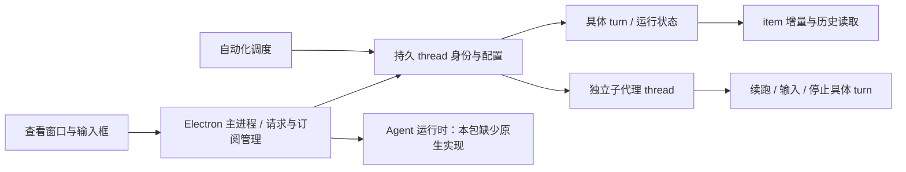

# Codex 实现对照与 Aether 演进

**用户最新顺序（2026-10-13 16:46 UTC）**：先完整核对Codex功能块并接入可用能力，再审查差距与不合理流程、优化引擎，最后启动正式运行测试。研究/实现准入完成前不新建正式root、不模型预检。仅收尾已启动的本地合成关闭对照；功能入口要核对操作、副作用、持久化与恢复，不能只对齐视觉或添加无效控件。

已独立验证native unwind 11帧，故障在Node inspector I/O线程WebSocket写入：`TcpHolder::WriteRaw → WsHandler::Write → InspectorSocket::Write → InspectorIo::ThreadMain`；主线程CrBrowserMain54112与fault72220不同，rdi=0/read0x148。官方MODULE与准确半开函数/源码行映射已匹配。三关闭入口（自动quit、产品窗口IPC、无Node inspector的直接启动＋Chromium CDP）同profile两次关闭/重启对照，最新 `wTyAQj-native-close-matrix-v2.result.json` 15/15、0skip/0flaky、准确client/tests稳定。原48420 native失败不抹掉，具体竞态原因仍待vendor源码复核；不得将复跑或无调试器通过概括为原问题已修复。

Codex关闭对照见 `.ae/tmp/codex-native-shutdown-comparison-20261014.md`：可借鉴提前退出标记、迟到generation保护、资源归属释放、拒绝pending RPC和本地跨重启dump索引；其worker刷新失败也exit0、非gitterminate立即resolved、disposed非零被抑制，不能复制为Aether业务cleanACK。新功能差距专题继续汇总后落实实现。

**当前状态（2026-10-13 16:36 UTC）**：p4qYd4 在30.8161分钟失败停止，独立审计无活动任务，完整一小时验收未通过。history/grep/wire v2实际引擎typecheck与320项联合合同通过；准确wTyAQj＋history-wire-0014组合的73项窗口、2项流式、4项小窗目录验证通过。生命周期原轮10通过/1失败：重启后的Electron主PID48420关闭时发生0xC0000005；后续串行repeat3的33项通过不能抹掉原失败。原生根因未定位，准入仍拒绝，不创建新正式root、不调用模型预检。下文各轮“运行中”是当时记录，不能代表当前状态。

### Electron 原生关闭阻断（16:36 UTC）

原轮 `.ae/qa/wTyAQj-history-wire-lifecycle.result.json` 的关闭断言如实失败。host48420、shell launcher53576；Crashpad dump确认读取地址0x148，RIP在electron.exe+0x7fd435。JS will-quit/process-exit(0)与nativeEvents为空均不能证明OS正常退出；25秒清理截止未触发，不能据此猜测根因。dump SHA `a7ea349dba6c285a937e3a59128241328e255c0dba7811c007fd7113a63f43df` 保持本地，仅导出结构元数据。只读报告见 `.ae/tmp/lifecycle-electron-native-failure-20261014.md`，包括用户关窗/Playwright退出入口、静态资源join缺口与可失败对照矩阵。

`.ae/qa/wTyAQj-history-wire-lifecycle-repeat3.result.json` 在16:31:28.491 UTC结束，33/33、0skip/0flaky、exit0，client/tests摘要稳定。原始失败未删除、未改成通过；当前禁止新root或真实模型预检。正以匹配Electron39.8.10的公共符号和本地dump结构定位，不上传dump或读取任意业务内存。

本组合 `.ae/qa/wTyAQj-history-wire-streaming.result.json` 2/2、`directory.result.json` 4/4均通过，完整73/73与320/320引擎合同证据保持。上述为本地合成验证，正式一小时仍未开始。

### 历史锁隔离集成准入（16:17 UTC）

精确patch `8d642c7d49a0032259236fdb08a7edbd992c665b960e3d0df109e8654e554147`、manifest `e320b5e71942fce083f7cc2d21786623335631204b65cfb310fab39a028e1c82`独立签审通过，七生产＋四测试基线准确核验后应用。采用短锁prepare、锁外摘要、短锁CAS commit；同session压缩lease维持root顺序，其他session不等模型。race只覆盖模型等待；append/commit已dispatch后等待真实ACK并如实报告。旧run迟到通知的共享cache按runId归属保护。还修复JSONL Windows clear回退自锁/clearfalse缓存与SQLite keepRecent=0越界。所有旧合同/夹具失败保留，SQLite成功full compaction后的原全文恢复与JSONL不同，不能概括为所有后端永久保留原文。

实际应用后 `.ae/qa/history-wire-grep-integrated-20261013.result.json` **320/320，0skip**，typecheck exit0、550项源码/配置前后摘要稳定。新 `D:/dev/ai-agent-engine/.tmp/plan-one-hour-candidate-20261014-history-wire-0014` guarded依赖检查＋私有TypeScript/runtime资源构建通过，buildId `sha256:868b42195a1f11601c656fcd4cdfa4d82861a0ce98336f2b301bd2adcc3614ad`，不覆盖公共dist。`wTyAQj-history-wire-full.result.json` **73/73，0skip/0flaky**，准确client/tests稳定、health/native无失败；这是本地合成真窗口验证，真实模型一小时仍未启动。

继续Codex对照的P1合同见 `.ae/tmp/subagent-active-discovery-codex-contract-20261014.md`：未加载后页active发现、发布水位coverage恢复与usage聚合需一起设计，不能直接删snapshot后页。现A2只证明已加载active的公平定向刷新，不证明全局active发现或所有持有入口内存有界。该协议目前是只读方案，尚未实施。

### 子代理目录与小窗局部验收（15:55 UTC）

第一次真实目录窗口发现合法未登录 `accountId=null` 被A1拒绝，报 `Invalid subagent directory scope`，第一页无法展开。这是产品缺陷；原n0KI6f失败和nullable旧版2/2失败均保留。scope校验现接受契约已有null，null/undefined按实际连接key等价，真实account/instance变化仍拒绝迟到内容。五spec纯合同 **74/74**，不会以只有string的旧夹具补签。

新准确独立客户端 `.ae/qa/post-soak-client-build-wTyAQj`：443源/107out，原 `npm run build`含node/web typecheck通过，originDrift为空；sourceDigest `2d99359c80f879b257f6f0fa4d814b0f28dfb49313ab8a1a0db63db9afae5a71`，clientDigest `f2fc75200e601bbfb4d220dbd4303b918d87bda1fba4d9530114c4c40188f6df`。`wTyAQj-directory-content-scroll.result.json` **4/4**真窗口通过、0skip/0flaky，candidate/test摘要稳定、Electron health/native无错误。129run三页目录、跨页身份归组、失败重试/草稿保留、已加载active无SSE定向刷新、准确取消、父/来源迟到保护均有可失败断言。

已实际查看940×640、1100×760、1440×900各深浅主题共六张截图：窄窗正常标签导航，续跑区小窗默认折叠，正文和独立滚条可用。geometry十二组视图均scrollWidth等于clientWidth，无横向溢出；最小窗完整对话正文259px、轮次结果可滚区278px，底部约36.8px留在窗口内。Tab/Escape/CtrlEnter、IME、显式展开偏好/草稿和真实续跑已验证。前两轮mobile helper/resize handle hover夹具失败未删除。这是准确客户端＋旧1411runtime的本地夹具验证，不是新history修复、全局active发现或60分钟压力通过。

### 安全请求诊断补齐（16:02 UTC）

局部patch `cd31855412d3e6991c7dc9f506a53674abbc20c59213f41abd6eef6de71973d1`已准确哈希预检并应用四文件，记录 `.ae/tmp/dispatch-v2-warn-candidate-20261013/external-application-receipt.json`。producer由最终system/developer wire检测mutation标记，v1缺字段保持未知；局部Pino info child让allowlist记录在父warn下落盘，未提升其它日志等级。应用前独立46/46合同和完整只读overlay typecheck通过，真实Pino文件及五provider两mode两stage SDK路径有证据。应用后合同/联合typecheck与新runtime尚待完成。本地dispatch不是网关收件或模型遵循提醒的证明。

### p4qYd4 新正式一小时轮（14:40 UTC）

持续点击 CPU 诊断定位到 `subagent-state` 的逐字符 `TextEncoder.encode`：13.68 秒采样中，preview inclusive 8.345 秒、GC 3.566 秒（不可重复相加）。公共 UTF-8 预览改为直接计代码点字节，不改变预算和 Unicode 截断语义；独立364,762次原函数对照一致，34项纯回归通过。Markdown重复前缀扫描另有复杂度问题，但不是此次采样主热点，未混入本次修复。

新准确客户端 `.ae/qa/post-soak-client-build-p4qYd4`：typecheck/build通过、441源/107out、originDrift为空，sourceDigest `2f0b98c3f02ccf8379ec03aa93b51e5ee659761f6cd6a7b7724805eea23e9052`，clientDigest `71eca636f77f575315c284ff49853379fcec8c4b98dccebda5fbbabe84f2d002`。`p4qYd4-mutation-full` **73/73**，`p4qYd4-streaming-freshness` **2/2**，Electron health无失败且候选/测试摘要稳定。此前streaming-fixed的26次操作最高response130.6ms、无长任务，但固定HTTP数量断言因未变化revision合法缓存而失败，原报告保留。后续fixture明确每次刷新前新增记录，仍要求原2500ms预算、确切新水位、每次真实page请求、引用最新草稿/成果和所属取消范围；未放宽预算。

引擎使用1411冻结候选。新root `six-20261013T143500-p4qYd4` / `a5e572b6-84ab-4f7c-a001-b3846a4e6747` /12542。双模型真实预检14:37:55/14:38:01 UTC通过，clean/ACK/exit0与独立无活动审计通过；准备收据保存在`preflight-receipts`。11驱动冻结。监督器70227已启动，正式 **14:40:02.801–15:40:02.801 UTC**，正在运行，尚无最终验收；旧轮及准备时间不累加。

只读耐久复核确认V2持久delta、准确水位、同seq合并、事务、终态和持续恢复已有实现。仍待集中处理：当前turn子代理水位及会话snapshot全量聚合、客户端run集合只刷新64条首页且未使用nextCursor、message.tools里的子代理投影副本不在subagent-store的4MiB预算内。不能宣称第65条必然丢失或总客户端内存已受该预算约束；这些与此次五子Agent CPU修复分开验收。

### LC24GQ 回归与持续输出阻断（14:23 UTC）

准确独立客户端 `.ae/qa/post-soak-client-build-LC24GQ` 的 typecheck/build 通过，440 源文件、107 out，sourceDigest `ce4bf94a1449ec6d66cd4a589b338c40b97fded4d1c3646ce1790cc694eb49ca`，clientDigest `70c0120688bdf0bdbefd7e2c99149b08489f4e0f3482094dc4c46ae6ccb2b49d`。与新 1411 引擎组合的八 spec 窗口回归 **73/73 通过**，native errors 0。首次 full 的恢复测试失败与随后补前置的 6/6 结果均保留，不能把首次结果改写。

引擎重复操作提醒 v2 已应用到实际外仓，经完整 typecheck、六 spec **143/143** 验证并独立 build；buildId `sha256:05a256cde2efaa164fc0e17913f3d8bd091f38f829dd688b856b71aafbeb774a`。提示只进下一模型请求，不改变原硬停计数或证明相同输出没有副作用。

新增 50ms SSE、五子代理与大 Markdown 点击合同仍失败。`GAjuXf-streaming-control2` 在打开活动时 response 3670.7ms；`LC24GQ-streaming-mutation` 在打开完整对话时 click 4849.4ms、response 5455.4ms，超出 2500ms 预算。新版本前三个标签操作约 152–443ms，但不能据此称全局性能问题解决。新版本采到 66 个长任务、累计6253ms，历史读取仅一个 header 与一页且追加版本正常；需要 CPU 调用栈定位。两轮第二用例均未运行。更早 control 的夹具协议错误另行保留，不作为产品复现。

`six-20261013T141500-LC24GQ` / `e18fc9f0-ad87-42e5-802f-6ea77568ac58` 目前仅准备、零模型启动与独立清理审计通过；尚未双模型预检、冻结驱动或正式启动。当前指针仍为已失败 GAjuXf。正式一小时未完成，持续点击阻断修复验证前不启动新正式轮。

### GAjuXf 正式失败与流式交互修复进展（2026-10-13）

准确 GAjuXf 客户端独立 `npm run build` 通过，440 源/107 out，sourceDigest `db1074951deebc4400ba9be6d94433c129506cd3fbcbba0e9930d0cc8f8724be`，clientDigest `743c0bbcd9be5e3b4965c2a1dd02453f6063a04831a24ae52f2e306fe6de7498`；Work 35 项和八 spec 73 项真窗口回归全部通过，仅证明该准确冻结版。

新 root `six-20261013T131500-GAjuXf` / `c5738d52-3bb8-431f-be2f-570c15b96026`，12542，DeepSeek/Qwen 在13:17:47/13:17:53 UTC各自真实预检通过。正式13:21:03.504–13:28:44.230 UTC，仅 **7.6787667分钟，失败**。监督器17002退出1。完整对话、成果标签、已完成活动在STOP前出现20秒超时，另外选择会话也在STOP前失败；不能把这些当清理噪音。UI延迟跨页面累计上升；renderer/console错误为0，原生健康无失败，不足以称用户操作可持续正常。Code A/Cron A尚无首轮交付，共享协作0；其它lane有交付也不能使本轮通过。

STOP仅让本轮监督器清理。clean=true/ACK=true/engine exit0，18 root/21 child/19 command全终态，两Cron禁用，12542不响应；finalize联合验收false，独立audit noActiveWork=true。所有失败、预检、冻结候选与原报告保留，不复用root、不累计旧时间。

只读报告 `.ae/tmp/GAjuXf-click-failure-audit-20261013.md` 确认已有hidden WorkspacePane comparator，不能将“隐藏面板每token重绘”认作准确根因。明确额外成本为子Agent notify直接setMessages绕过80ms合并、隐藏SubagentCard自身订阅与时钟、大结果Markdown使用inline fileContext。当前补丁采用窄props/显式draftSource/稳定callback、读取最新草稿、子Agent父投影80ms合并且终态/取消立即更新、隐藏卡片停止订阅/计时/读取、关闭卡片不构建结果Markdown。类型检查通过，准确新独立build和持续SSE点击回归待验；这些优化尚不能被称为解决原20秒根因。

2026-10-13。参考版本：Codex 26.1007.21434，Electron 42.3。研究源为用户提供的 `E:/rea/codex-src` 发布包。本文汇总运行恢复、子代理、自动化、宿主生命周期和界面阅读的实际实现证据，并给出 Aether 的实施与验证顺序。

## 范围与方法

该目录包含 Electron 主进程、preload、worker 和前端压缩 bundle，适合追踪协议和状态流；它没有原始 TypeScript/source map，也不包含 Rust agent 运行时。前端 assets 实际有 19,961 个文件，其中 14,770 个 JS。本次按模块名、协议事件和调用链筛选阅读，没有执行提取的 JS/native，没有整体装载 583/587 MB 分析 JSON，没有读取用户会话、业务资料或模型凭据。

证据分为三类：包中直接看到的行为、Aether 当前源码的差距、尚待运行验证的改进。模块出现某个字段不代表所有账户/通道都启用对应功能。前端分页、折叠或退出码 0，也不能单独证明服务端内存有界、全部落盘或长期零故障。

可复核的专题资料：

- [会话发现与恢复](D:/dev/aether-code/.ae/tmp/codex-runtime-reference-20261013.md)：8 处运行事件与 hydrate/resume 定位，主要使用 UTF-8 字节偏移。
- [子代理与历史耐久性](D:/dev/aether-code/.ae/tmp/codex-subagent-durability-reference-20261013.md)：18 处定位，使用 UTF-16 字符偏移，附 SHA256。
- [自动化与生命周期](D:/dev/aether-code/.ae/tmp/codex-automation-lifecycle-reference-20261013.md)：24 处定位，使用 UTF-16 字符偏移，附 SHA256。
- [产品关闭合同](D:/dev/aether-code/.ae/tmp/codex-engine-shutdown-contract-20261013.md) 与 [第一期局部实施建议](D:/dev/aether-code/.ae/tmp/codex-engine-stop-p01-diff-proposal-20261013.md)：未应用的三期协议/退出/资源 join 设计及可失败测试矩阵。
- [界面模块取样](D:/dev/aether-code/.ae/tmp/codex-ui-reference-evidence-20261013.json)：9 个精选 chunk 的 imports、短片段、字符/字节偏移和 SHA256。

两种偏移不可混用；引用必须同时核对版本、文件名与指纹。

## 核心架构：查看窗口不能决定任务寿命

Codex 将持久 thread、具体 turn、item、查看窗口和运行进程分开。新一轮由 thread 级事件发现，正在执行的一轮由 turn/item 流更新；详情关闭只退出查看，停止需要指向准确 turn 与后代。

这解释了 Aether 的多类体验问题：聊天终态之后仍需要发现下一轮；同名 Agent 不等于同一上下文；关闭面板不能停任务；暂停计划不能取消本次运行；已有事件流不能代替完整历史入口。

## 会话发现、恢复与竞态

直接证据：`app-shared-737655e1fb23.js` 分别处理 `thread/status/changed`、`turn/started`、`turn/completed`。hydrate 按 thread 单飞，记录 generation；resume 同时校验当前请求对象身份，断线更换 generation 并清理旧恢复。完成前先排空 item stream。

Aether 的已确认缺陷发生于上一正式轮 STOP 之前：服务端开始新 root，已选 Code 终态会话没有显示准确新 user。根因不是 UI 文案，而是当前轮 SSE 结束后缺少独立的会话发现入口。同 ID 导航也只打开面板，不再触发恢复。

当前补丁以轻量 GET `/chat/status` 发现同 session 的新 root，复用现有 snapshot hydrate 和 GET 订阅，不重新 POST 任务。仅当前模式、历史已恢复、无活动 SSE/停止/应答/恢复的 scope 可探测；迟到响应按 source/session/viewEpoch 丢弃，相同终态不重复下载或复活。另在复审发现清历史/删回合期间的竞态，正在加 mutation 锁和失效保护；该部分完成前不得把旧候选视为最终候选。

验证应断言准确 run/turn/user/assistant/model、请求次数和持久副作用，不能只断言出现一句相同文本。原客户端可失败窗口回归已复现遗漏；新客户端先通过准确新 user/assistant 显示，但测试误选隐藏 Work 模型控件导致主轮失败，原报告仍保留，修正控件范围后必须补跑。

## 子代理、通讯与详情

直接证据：协作事件带 sender/receiver thread 身份，动作有 `spawnAgent/sendInput/resumeAgent/wait/closeAgent`；列表显示名称、目标摘要、真实状态和 elapsed，详情复用同一个 thread。向运行中 thread 输入时带 expectedTurnId，传输结果未知不会简单当作未发送。

采用原则：

- 子代理固定 child 身份，每次续跑有独立 activation/turn。名称、状态、最新动作、父任务可识别，完整聊天按需打开。
- 发送、等待、停止分开；失败与等待用户输入不能用永久 spinner 替代。未知投递结果需要可追溯状态，不能无条件重发副作用。
- 后台未订阅详情的高频 delta 可以不广播到窗口；生命周期、控制和审批事件仍必须传递。重新打开时补准确快照并追赶水位。
- 停止先处理已知活跃后代，再发现遗漏后代，指向准确 turn；不得影响其他 root。

Codex UI 限制首屏 4/10 条、thread/list 单页 200、完整 item 单页 500；这些都不是全局后端预算。完整历史路径仍会累积所有页。协作 schema 也不证明共享文件互斥、exactly-once mailbox 或上下文/资源绑定的原生实现。Aether 应保留自己的 tenant/session/root/seq、权限和持久绑定契约，用合成任务实测多次续跑、双向通讯和共享文件交接。

## 自动化：配置、运行、通知三份事实

Codex 有两种不同生命周期：heartbeat 在既有聊天继续；cron 创建独立任务，可使用 local/worktree 和 project/projectless 目标。忙、审批等待、用户等待、历史不明或连接切换会阻止 heartbeat 贸然启动，并记录重检原因。run-now 是真实操作，不是修改 nextRun 的按钮。

调度默认 30 秒 tick、每 tick 取 3 个 due 项，提供入口背压；这不表示全局同时最多运行 3 个。nextRunNominalAt 和实际 nextRunAt 分开，运行记录先 pending 再关联 thread，启动对账保留中断结果。

Aether 已有 occurrence 唯一 claim、revision/outbox、root 关联，以及时间/时区/间隔、创建/编辑、复用或独立目标、Agent/模型、nextRun/运行记录、暂停恢复、丢弃草稿。保持这些实现，不能用较简 Codex run 表替换。

后续增量能力需全链开发：真实手动立即运行、公平调度准入、失败时通知、具有明确决策协议的重要更新、worktree 目标、一次性/月度/截止规则。当前仅 `all_runs/silent` 等已实现能力才能显示为可操作控件。

Codex 既有任务编辑 600ms 自动保存。Aether 用户已明确要求关闭丢弃、完成才保存，因此保留显式保存。参考是实现依据，不覆盖用户偏好。

## 宿主生命周期：产品关闭合同仍待补齐

Aether 产品 `process-manager.ts` 使用 attached child 和 SIGTERM→SIGKILL；`child.killed` 及强杀后 200ms 就可能结束等待，不能证明引擎或 SQLite 已关闭。准确 0822 引擎入口没有 IPC shutdown/ACK、父租约；SIGINT/SIGTERM 只在 listen 后安装。QA 的独立 bootstrap 有自己的关闭协议，它的 clean/ACK 成功不能代替产品实现。

Codex 一个 Artifact 独立宿主提供可借鉴结构：初始化前父 stdin 租约，Windows EOF 触发关闭，等待实际原始进程退出，截止后才强杀。这不是 Rust app-server 的直接证据，不能据此解释 Aether 旧 0xC0000005。

产品修复必须联动 launcher 与引擎：阻止新准入→停止调度→中止并等待生产者与后代→持久终态/命令结果→关闭服务、PTY、skills/memory→关闭数据库子进程→返回带失败阶段的 ACK→核验实际 exit。Fastify 的 `onClose` 晚于等待 HTTP 连接关闭，持续 SSE 不能只依靠它开始清理。记忆后台任务、daemon 重新排 timer 和命令结果持久失败也须纳入 join/失败语义，详见专题后续关闭合同。当前 memory=off 压测不能覆盖这些记忆分支。

## 界面阅读与苹果风格组件化

本次继续应用 ui-ux-pro-max 与 macos-design，以层级、阅读位置、键盘/焦点和真实反馈为先，磨砂材质只作为少量导航与浮层的表现层。

| 直接观察到的 Codex 结构 | Aether 映射和实施原则 |
| --- | --- |
| turnKey、动态测量高度、DPR 取整、二分视口与 overscan、anchor 补偿 | Code 尾部限量加“加载更多”和 Work 历史分页不能称完整动态虚拟化。后续在共享 TurnViewport 中保持稳定身份、上滚阅读锚点与流式尾部；同时量 DOM 与 JS/传输预算。 |
| 统一 thread scroll/controller 与 composer/footer inset | 消息、过程卡和输入框共享横向容器。小窗使用标签/覆盖面板和内容最小宽度，禁止把浏览器挤成单字列。新增内容只在用户跟随底部时推进。 |
| 用户消息按测量折叠，默认 20 行；跨边界 code block 不截半，隐藏互动 inert/aria-hidden，搜索可 reveal | Aether 已有 8 行纯文本/引用折叠，不必改成 20。当前引用是 span，无隐藏按钮，不把 inert 当现有已复现故障；若扩展 Markdown/可点击引用，需一起补焦点和搜索揭示。 |
| 通用 Popover 挂最近 dialog、collisionPadding、hideWhenDetached 和焦点回归 | Aether 已有 body portal、测量/翻转、隐藏锚点退出和嵌套菜单保护。抽成明确 overlay owner/层级/focus 契约，覆盖 @、/、模型、Agent、自动化；不能只无限增加 z-index。 |
| 子代理摘要与完整 thread、输出摘要与输入详情分开 | Work 过程复用 Code 紧凑工具行，默认读结果，需要时展开参数。最新动作、耗时、错误和查看活动入口集中显示，避免多个含义不明的圆环。 |
| preview/header 与正文滚动职责分开 | 成果列表、内容、改动采用同一文件身份和独立滚动；沿用 Code FileGlyph、Markdown/高亮/diff，而不是另造无法操作的外观。已有 Work 成果标签、FileGlyph 与会话文件读取保留，后续以实际状态复验。 |

`composer-suggestions` 取样是普通跟进建议，不作为 @Agent/斜杠补全的实现证据；通用浮层证据是 `popover-27c4fbdc9c29.js`。主题令牌仍以 Aether tokens.css 为唯一事实来源，不复制 Codex 色值，也不替换用户当前 Work 手动修改。

## 优先级与可失败验收

| 优先级 | 工作 | 完成标准 |
| --- | --- | --- |
| P0 当前修复 | Code 新 root 发现与历史 mutation 隔离；observer 每个 Work/Cron 子代理完整对话真实验收 | 旧版本失败保留；准确新版本 build/typecheck；消息/模型/无重复POST；clear/delete迟到快照不回填；每会话真实 transcript receipt，缺访问不得通过。 |
| P0 产品生命周期 | owned 父租约/关闭协议、准入停止、生产者/资源 join、真实 ACK 与 exit | Windows正常退出、初始化前后父断开、运行中停止、SQL/命令持久失败、超时/native 非零退出均可失败；独立无残留审计，不能把强杀标 clean。 |
| P1 耐久边界 | child 集合/水位持久分页、巨型正文可完整分段读取、JSONL单行预算、anchor原子条件写入 | 多万child与正文超524288 JS字符有界响应；准确已发布prefix；页间新事件不混水位；JSONL驻留量、两后端barrier、未落盘不ACK。 |
| P1 自动化增量 | run-now、公平准入、失败通知和真实heartbeat状态判定 | 操作有API/持久记录/有效模型/目标；暂停与本次停止分开；同分钟多计划、重启、忙/审批/历史未知、通知去重均验证。 |
| P1 公共交互 | TurnViewport、Overlay owner、子代理详情与成果/改动共用组件 | 940/1100/1440内容视口、深浅主题、reduced-motion、IME、Tab/Escape、长内容与真实滚轮；真实副作用和阅读位置保持。 |
| 持续验收 | 新冻结候选的一小时真实模型六任务 | Code/Work/真实Cron各2，DeepSeek/qwen3.8-flash，子代理复用、双向交接、80案例集成、三视口；整60分钟和关闭联合通过，不能累加失败轮时间。 |

四项耐久边界与旧 native/Auto 耗时分开；没有参考包证据可直接关闭原生 JSONL/事务风险。每次产品改动必须基于新源码捕获构建并运行对应真窗口/引擎验证。全量重跑只在新改动或剩余风险需要时进行，Electron 串行，不覆盖公共 out/dist。

## 本次真实状态

上一正式轮 `six-20261013T102007248Z-kHsdCa` 在 4.1952166667 分钟失败，监督器 46659 已结束；无活动 owned 任务，两 Cron 禁用，独立关闭审计通过，但压力测试仍失败。

客户端 `post-soak-client-build-h3UWh4/client` 已在准确源码快照中完成 `npm run build`（含 node/web 类型检查）。窗口 70171 原始报告为 **70 passed / 1 failed**，失败为新测试模型 selector 同时选中了 Code 与隐藏 Work；准确新消息前置断言已经通过。报告/trace不改写，修正 selector 后仍需补跑；新增 history mutation 保护需另建候选，不能由 h3 报告补签。

本次研究没有启动新的正式轮，也没有完成一小时压力通过结论。继续顺序：封版当前保护与 observer 合同→准确新客户端构建/窗口→新 root/全依赖冻结/双模型新预检→完整一小时→联合与独立关闭审计。产品生命周期演进单列，不能以 QA bootstrap 的验收冒充完成。一次通过也不能证明未来永久 7×24 无故障。

### 11:26 UTC 补丁与新验收准备

历史 mutation 保护已完成：clear/delete/retry/revert 在失效旧读取后使用不可变 scope token，finally 仅释放对应对象；被动发现和 archive 读取门控，主动 retry send 不被自锁。6 项 mutation、7 项发现、23 项恢复纯合同共 36/36 通过。

旧 h3 客户端的第二次六项真窗口对照为 4 passed / 1 failed / 1 未运行：准确外部下一轮已经通过；慢速 truncate 被延迟的 5.5 秒中，产品发出了 2 次 `/chat/status`，违反新门控合同。它证明保护缺失，不代表已观测到内容复活；原 trace 与报告保留。第一次对照在全局“运行状态”选择器匹配两轮消息处失败，仅把终态断言限定准确新 assistant ID 后才进行了第二次对照。

新客户端 `post-soak-client-build-UFXeXd/client` 于 11:22:47 UTC 完成独立原 `npm run build`，439 源/107 out，capture/source/freeze 均稳定，originDrift 为空；sourceDigest `406b6d9a4a8d454d12fb11a48f47f5d39669e572996d0cc57551aeb0b84069a9`，clientDigest `2cf89006ed8620798a2f32ce5ff7aee4bbb0cc123feb3561161f7628bf87be8d`。73 项窗口回归正在 1706 串行执行，不能提前称通过。

Observer 与 finalize 已要求每个 Work/Cron 任务有自己的完整对话访问 receipt；加载验证以一次 DOM 快照读取 busy、错误、计数和唯一 ID，避免跨帧拼接。24 项新合同、57 项完整准入合同通过；未增加运行依赖。

新 root `six-20261013T112456603Z-ioXBhb`，runId `0fdf9540-5dc3-4c68-8395-19b04a096a3c`，仅 prepare/freeze，0 正式分钟。准确 UFXeXd 与完整 11 项 driver 已冻结，原同网关合成数据授权沿用；窗口通过后才可重新执行双模型预检与正式轮。产品关闭三期建议未应用，不能借此候选或 QA 清理验收称产品 ACK 已支持。

### 11:38 UTC 准确窗口通过与新正式轮

UFXeXd 准确客户端的 exec 1706 已退出 0。11:24:32–11:26:55 UTC 的八 spec 真窗口回归为 **73 passed / 0 failed / 0 skipped**；客户端和测试源码前后指纹稳定。原始证据位于 `.ae/qa/codex-reference-after-20261013-UFXeXd.{run,result,report}.json` 与相邻日志/截图。这证明相应用例的真实交互、恢复、持久化、布局与资源绑定，不是持续模型压力证据。

ioXBhb 在模型预检阶段失败，0 正式分钟。`engine.log` 的底层原因是 `node:net internalConnectMultiple` 返回 `AggregateError [EACCES]`；默认沙箱的无凭据 TCP443 检查也返回相同错误。新旧隔离模型端点、Node、bootstrap 与引擎版本一致，未发现代理配置。清理 clean=true / ACK=true / exit0，11:32:03 UTC 独立审计无活动；原失败不改写。

使用正常联网执行审批后，新的 `six-20261013T113300373Z-6KAMfN`（runId `28767529-20e8-4da5-b6ad-b013ce23920f`）已完成两模型真实新预检：DeepSeek 11:34:33、Qwen 11:34:58 UTC，均准确读取当前随机 proof、静默维护计划、未复用旧证据。清理 ACK/exit0，11:35:38 独立审计无活动；预检回执另存 `preflight-admission-archive/`，不混入正式时间。

新正式轮由 supervisor exec **56607** 运行，**11:37:02.930–12:37:02.930 UTC**（北京时间 19:37–20:37），准确 UFXeXd 客户端和 11 项驱动冻结，0822 引擎 buildId `sha256:5dec5bf00e63c0f7d3dfd9ceeaca31296c797f10d0a3e539cbc5553756d18ddd`，12541，thinkingMode=off。六条 Code/Work/Cron root 已运行，子代理启动，Electron 首轮观察无错误；当前仍是运行状态，尚无完整一小时通过结论。不能据此称 Auto 耗时、原生关闭异常或耐久边界已解决。

产品 P0.1a 的真实退出、停止合并与 owned handle 保留将独立实施、独立构建验证，不改变此冻结轮，也不能由此轮补签其正确性。

### 11:53 UTC 正式失败与停止审计

6KAMfN 已失败，实际正式区间 **11:37:02.930–11:52:13.967 UTC，15.18395 分钟**；supervisor 56607 退出 1，未满足 60 分钟。Work 子代理在正常追加对话时，前端分别请求 header 与 page，随后把两次请求的 revision/total 变化当错误拒绝，页面出现“子代理对话在读取期间有更新，请重试”。原始 UI 报告 3 项失败中，1 项是此真实错误，另外 2 项发生于 STOP 后观察，不能统称三个产品故障。926 项操作的 p95 为 2111ms，11 项超过 10 秒，最大 18812ms；同时间 health 约 12–14ms，尚未证明慢操作根因。

关闭 clean=true、ACK=true、engine exit0、forced=false；11:53:25.101 UTC 独立审计确认 13 根（7 成功/6 取消）、14 子代理（8 成功/6 取消）、219 命令（217 成功/2 失败）均无 active，两 Cron 禁用，12541 不响应。联合验收仍为 false。关闭与残留审计不能把压力失败改为通过。

另发现 Work A/Cron A 实现子代理与 Code A 审查子代理反复执行相同命令、同内容写入/执行交替或无匹配 grep；前两条任务没有第一轮交付，共享项目交接/集成为零。完整 SQLite detail 保存错误与输出，2048 字符 summary 的截断不能被表述为引擎丢失错误。当前只读研究继续核对请求级提醒与重复识别，不能靠放宽交付断言解决。

当前补丁未签真窗口通过：transcript 刷新在 revision 变化时只采纳一个请求内部一致的有界页，不混合不同 revision；最多两次追赶最后页，连续追加时返回的是某一时刻可读窗口，不保证绝对最新。older 仍拒绝混页且保留旧数据。产品 P0.1a 增加 eager exit/close、单飞停止、失败保留及显式 start 的 closed gate；24 项纯合同通过，尚需真实 Windows 子进程、准确新 build 和 Electron 回归。用户手动修改继续保留，后续构建捕获独立稳定源码，不覆盖公共 out/dist。
### 15:16 UTC：p4qYd4 正式失败、关闭与隔离后续

`six-20261013T143500-p4qYd4` / `a5e572b6-84ab-4f7c-a001-b3846a4e6747` 的正式时段为 **14:40:02.801–15:10:51.767 UTC，30.8161 分钟**，supervisor 70227、runner/observer 均退出 1，完整一小时与联合验收失败。`GET /chat/snapshot` 的 Code A 请求在 15005ms 超时，随后五条 owned 根取消请求各在约15秒超时。首次30分钟 Code A/Cron A没有首轮交付，Work B审查未完成；共享往返和80案例集成为0，后续进度不能补签已经结束的窗口。

本轮页面累计4454次点击、5065次测量，p95 262ms、最大7240ms，renderer/console/native异常0；observer的两项失败发生在runner进入cleanup之后，原报告保留，不能将它们改写成通过或统称两个新的页面异常。关闭 `clean=false`、engine exit1、无ACK、未强杀；15:16:27.482 UTC独立审计34根/37子/254命令active均0、两Cron禁用、12542不响应。无残留不能代替关闭成功。

已确认的产品阻碍：`createConversationHistory` 为所有backend套上 `DATA_DIR+tenant` 的全调用序列锁，`compress` 在该锁内等待模型summary（JSONL1304/SQLite660）。这时SQLite写事务尚未开启，网络await却使别的session快照/取消等待相同tenant锁；最后health仍200/16ms，不能归因为整个事件循环冻结。下一候选采用锁内prepare、锁外模型、锁内session版本CAS与取消保护；保持物理SQLite事务串行，不能粗暴把通用锁改成per-session。

另一实际工具缺陷是 `grep_search` Node降级对单文件path调用目录遍历，产生ENOTDIR。offset本来合法且已执行；空页却省略metadata，非空分页metadata也没有进入provider的tool-result正文。下一候选补单文件/目录行为一致、正文可见的offset/count/hasMore/nextOffset、耗尽页明确反馈与已知字段校验，不将不同合法查询硬判重复。仅有readonlyHintPresent不能判断mutation提示是否发送；本轮LOG_LEVEL=warn过滤info派发日志，公开取证0条也不能证明没有派发。

客户端增量已在本轮停止后的源码中接入：3页/192引用/256KiB有界目录与“加载更多/返回第一页”、已加载active的公平定向读取（每背景周期1目录+最多7child、batch2并发）、小窗默认折叠续跑输入且保留草稿和展开偏好。纯合同已执行，新的准确构建/真实窗口尚待执行，不能使用旧冻结p4qYd4签后续源码。message.tools副本/全session child聚合仍是单列P1，目录预算不是整个客户端RSS预算。源补丁、隔离候选与失败档案均保留；不得复用失败root或累计其时长。

