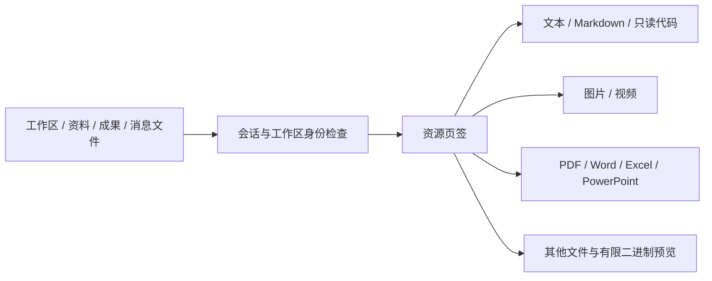

# 编辑器与文件预览的当前边界

更新日期：2026-11-17。保留旧文档路径，本文以当前默认界面可达的组件为准。当前文件预览与编辑能力、限制和源码入口统一在本文维护。

## 当前用户实际进入的路径

Aether 只有一个默认工作台，没有独立 Code OSS 页面或第二套 IDE 模式。用户从工作区、资料、成果或消息中的文件入口打开资源，进入资源页签，再按文件类型显示预览。

[WorkspaceView.tsx](../src/renderer/src/features/workspace/WorkspaceView.tsx) 与 [ResourceTabs.tsx](../src/renderer/src/features/workspace/ResourceTabs.tsx) 管理资源容器；[FilePreview.tsx](../src/renderer/src/features/editor/FilePreview.tsx) 分发文件预览；[CodePreview.tsx](../src/renderer/src/features/workspace/CodePreview.tsx) 创建明确设置 `readOnly: true`、`domReadOnly: true` 的 Monaco 实例。

默认代码预览支持选择、复制、定位、引用和相应上下文动作，不提供把代码直接改写并保存的工作流。插件读取当前代码预览时也会收到只读标识。通用文本预览使用 [TextPreview.tsx](../src/renderer/src/core/editor/TextPreview.tsx)；工作区同名文件只是转出入口。

## 预览能力

| 文件类型 | 当前能力 | 边界 |
| --- | --- | --- |
| 文本、代码、Markdown、JSON、HTML 等 | 阅读、选择、复制、定位；按类型提供结构化或格式化展示 | 默认入口只读；HTML 可通过单独浏览器预览链路运行 |
| 图片 | 缩放、平移、图片查看与标注入口 | 图片标注能力不能推导为 PDF 标注能力 |
| 视频 | 浏览器支持格式的播放与静音等控制 | 格式解码取决于当前 Electron |
| PDF | 页面阅读与导航 | 只读，不提供 PDF 内容编辑或批注写回 |
| Word | 文档解析、页面阅读 | 只读，分页和排版以 Word 为准 |
| Excel、CSV、TSV | 表格、工作表、单元格／范围及支持的图表阅读 | XLSX 公式使用文件已有缓存结果，不重新计算；复杂格式和对象可能不同 |
| PowerPoint | 幻灯片阅读 | 只读，不是 PowerPoint 原生渲染或编辑 |
| 未识别二进制 | 有限前缀的十六进制展示或不支持提示 | 不保证完整解析 |

格式与提示以 [document-kind.ts](../src/renderer/src/features/documents/document-kind.ts)、[documents](../src/renderer/src/features/documents/) 和 [capabilities.ts](../src/renderer/src/core/workbench/capabilities.ts) 为准。文档解析有输入大小、ZIP 展开量、页数、工作表、行列／单元格数及超时上限；目前文档输入大小上限为 16 MiB。不能把受限预览当作原生 Office 的无损审阅替代。

[office-render.ts](../src/main/office-render.ts) 及文档解析层处理隔离读取与资源限制。文档中写出的脚本、链接或内容不授予额外宿主权限。

## 保留的编辑器基础设施

仓库仍有编辑器与语言服务基础设施，必须与已挂载界面区分：

| 设施 | 源码 | 当前说明 |
| --- | --- | --- |
| Monaco 初始化、主题、模型与文件身份 | [monaco-setup.ts](../src/renderer/src/core/editor/monaco-setup.ts)、[file-identity.ts](../src/renderer/src/core/editor/file-identity.ts) | 被预览及其他组件复用；Monaco 依赖本身不包含 VS Code 完整工作台 |
| 文件编辑状态、保存与冲突检查 | [editor-store.ts](../src/renderer/src/core/editor/editor-store.ts) | 有可写宿主实现，但默认只读预览不注册为可写编辑组 |
| 当前编辑器及原生命令路由 | [active-editor.ts](../src/renderer/src/core/editor/active-editor.ts)、[editor-commands.ts](../src/renderer/src/features/editor/editor-commands.ts) | 命令执行依赖实际活动编辑器；不能以命令已注册证明用户能编辑和保存 |
| TypeScript 语言服务与跨文件桥 | [core/lsp](../src/renderer/src/core/lsp/)、[monaco-workspace.ts](../src/renderer/src/core/editor/monaco-workspace.ts)、[main/lsp](../src/main/lsp/) | 当前默认装配未调用 `wireTsLsp` 或挂载可写编辑器注册；不承诺默认文件页的 F12、F2、项目诊断和跨文件保存 |
| 显示偏好 | [editor-display-options.ts](../src/renderer/src/core/editor/editor-display-options.ts) | 字体、自动换行、小地图等偏好通过 `aether.editor.displayOptions` 保存，跨重启保留 |
| 内置命令目录 | [register-builtins.ts](../src/renderer/src/app/register-builtins.ts) | 保存等命令仍在目录中，但需要对应活动上下文；不是独立可写入口 |

本文源码核对未发现 `registerActiveEditor`、`setActiveEditorGroup`、`wireTsLsp` 在当前默认界面中的挂载调用。若以后接入，应同步更新界面、文档和真实交互测试，验证实际修改与落盘，不只验证命令可见。

## 本地与远端文件

会话文件使用 [fs-client.ts](../src/renderer/src/core/workspace/fs-client.ts) 绑定的来源、引擎、会话、目录与绑定版本。远端会话可通过服务端工作区 API 获取文件和预览；这不表示远端文件成为本机路径，也不表示语言服务自动接入远端项目。

用户显式选择的外部文件只能按所选文件授权读取。工作区切换、账号变化、引擎来源变化后，旧异步读取不能覆盖新目标。回退后的资源刷新属于工作区与成果链路，不通过保留旧 Monaco 模型制造文件仍存在的假象。

## 与完整 IDE 的差距

目前不应宣称具备 VS Code／Code OSS 工作台、通用 VSIX 扩展宿主、DAP 调试、Notebook、完整可写编辑组或默认挂载的项目语言服务。文件树修改、搜索替换、Git 操作、Agent 文件修改和终端是独立能力，不要求把只读预览描述成可写编辑器。

如需恢复完整编辑体验，应逐项接通活动编辑器、模型生命周期、脏状态、冲突检测、显式保存、跨文件修改、撤销与语言服务，再验证本地／远端目标身份和退出恢复。旧阶段的测试用例名称和历史通过记录只能作为设计线索。

当前用户操作见[使用指南](user-guide.md)，功能全景见[功能覆盖表](feature-map.md)。本次为文档与源码核对，没有重新执行历史编辑器验收，也不引用旧通过数量。
