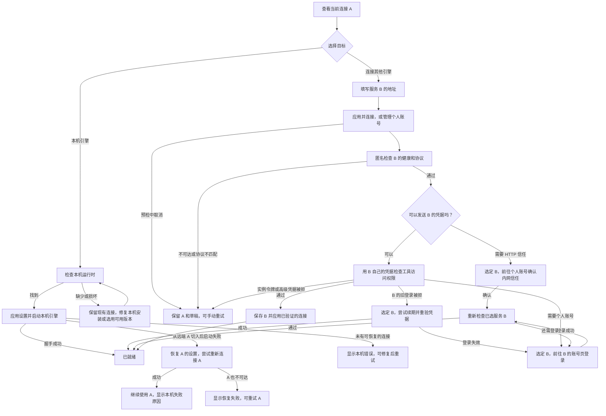
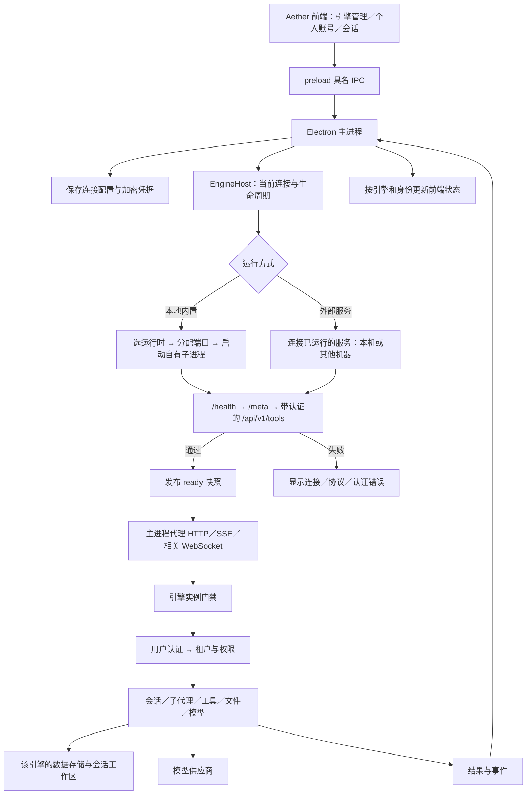
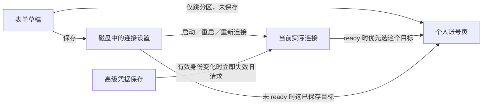
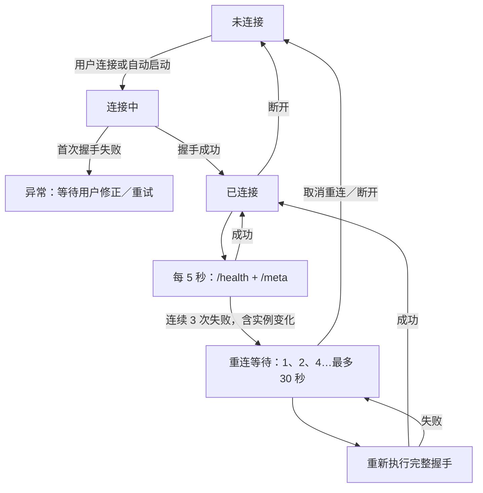

# 引擎管理全链路调研

核对日期：2026-11-18。本文核对 Aether 桌面与配套引擎源码。下图为改版后的实际连接路径；第 1–9 节保留改版前的调查记录，便于追溯旧截图中的行为。生产服务、会话和凭据未参与验证。

2026-11-19 补充：已连接的引擎新增「打开管理后台」入口。桌面自管引擎使用独立窗口，其他引擎转到系统浏览器；两种入口都校验后台管理员身份。参见[后台进入、鉴权与操作链路图](../../ai-agent-engine/docs/operations/engine-admin.md#进入后台)。

## 当前连接链路

打开「设置 → 引擎管理」时，第一组显示实际连接，第二组选择「本机引擎（推荐）」或「连接其他引擎」。后者也可以是用户在本机单独启动的 localhost 服务。

验证候选服务期间，原连接 A 仍可用。未通过预检的草稿不会保存，也不会在后台不断尝试。已经保存的远端服务则不同：启动或运行中遇到临时网络故障会退避重试，可以取消；认证或协议错误需要用户处理。只改「启动应用时自动连接」只影响下次打开应用：已连接的不会重连，已停止的不会启动，已失败的不会重复尝试。

从远端改用本机时，预选版本不会打断当前工作。真正应用后才会断开远端并启动本机；若启动失败，会尝试重新连接原远端。恢复连接后可以发起新请求，已经中断的请求不会自动重发。本机已停止时，选用版本只更新下次启动的版本；运行中换版本才会确认重启。带有配套 Node 运行时的 Windows x64 客户端支持导入 `.tgz`，不支持时界面会提示安装对应的完整客户端。

高级设置中的随机生成只准备本地草稿。自建服务要把相同的实例令牌配置为服务端 `AETHER_INSTANCE_TOKEN` 并重启；高级 API Key 需由同租户具有 `admin` 角色的服务管理员登记，普通新账号的 `tenant-admin` 角色没有这项权限；JWT 由受信方签发。界面不会因点击生成就更换服务端凭据。本机版本下拉框不显示压缩包文件名；选中版本后可在「版本信息」中查看原始文件名。

「已就绪」表示引擎握手成功。账号归属、模型是否配置、是否有额度仍是不同的判断。进入监控时读取一次资源，之后使用刷新图标手动更新；连接健康检查不会触发资源采样。

## 改版前的调查记录（第 1–9 节）

## 1. 各层分别负责什么

| 层 | 实际职责 | 用户在哪里操作 |
|---|---|---|
| Aether 桌面 | 界面、连接配置、代理请求、本机文件与浏览器宿主、凭据安全保存 | 应用设置、工作区、底栏 |
| 引擎运行方式 | Aether 启动本机子进程，或连接外部 HTTP(S) 服务 | 引擎管理 |
| 实例令牌 | 确认请求有权进入这个引擎实例 | 引擎管理中的“远端令牌” |
| 用户身份 | 个人账号，或管理员提供的 API Key/JWT；确定租户与权限 | 个人账号／高级用户认证 |
| 模型供应商配置 | 决定实际调用哪个模型、使用哪个供应商密钥 | 模型设置 |
| 会话工作区 | 决定任务在哪里执行、文件属于哪个目录 | 会话／项目工作区绑定 |
| 引擎监控 | 展示连接健康与按需读取的资源样本 | 主导航“引擎监控” |

账号认证、实例令牌和模型 API Key 不能互换。引擎已连接也不意味着模型已配好、额度可用或当前任务拥有所需权限。

## 2. 当前整体链路

渲染层不直接持有长期凭据，也不直接向引擎随意发请求。主进程负责注入认证、核对目标、限制远端路由和路径，并把流事件返回界面。当前运行与持久化 UI 状态都按来源隔离，切换引擎／身份不是把数据迁移到新服务。

## 3. 前端操作与真实效果

| 操作 | 真正发生的事情 | 当前容易误解的地方 |
|---|---|---|
| 点击本地内置／远端服务 | 修改表单草稿 | 尚未切换当前运行连接 |
| 修改地址、目录、端口 | 修改组件本地 state | 当前状态卡仍展示旧连接 |
| 保存 | 持久化设置；带凭据时走专用保存 IPC | 普通连接参数不立即切换；高级身份变更可能立即中止旧请求 |
| 保存并重新连接／重启 | 先保存，然后 stop → 按已保存配置 start | “已保存”在连接完成前出现，不能当作连接成功 |
| 启动／连接 | 按已保存设置启动 | 不读取未保存草稿；按钮文案可能仍按旧 snapshot 的模式显示 |
| 停止（本地） | 关闭 Aether 拥有的引擎子进程，撤销传输 | 当前任务可能被中断 |
| 断开连接（外部） | 停客户端探测和重连，撤销连接 | 不关闭外部服务器；也不是“取消所有任务” |
| 重新连接（外部） | 客户端 stop → start | 不重启外部服务进程 |
| 管理个人账号 | 切换设置分区 | 未保存的地址不会成为账号目标，切走还会卸载草稿表单 |
| 清除令牌／凭据 | 标记清除，保存时删除对应本地存储 | 若启动环境仍提供凭据，后续仍可能启用环境值 |
| 自动连接开关 | 保存后影响下次应用启动 | 不是立即启动、关闭引擎或禁用断线重连的开关 |
| 导入引擎包 | 选择并校验 `.tgz`，加入可选运行时 | 导入本身不切换当前引擎 |
| 使用导入引擎／恢复默认 | 确认后切换运行时并重启；失败尝试恢复原选择和运行状态 | 代码版本切换保留同一数据位置，不等于数据备份或数据库降级保障 |
| 删除导入引擎 | 删除未激活的运行时文件 | 不是清除会话、工作区或账号 |
| 打开引擎监控／刷新图标 | 初次按需读取，此后手动采样 | 不等于重新连接，也不表示重启引擎 |

三份状态的当前关系：

## 4. 本地引擎生命周期

应用打开时读取设置、创建窗口；若自动连接开启则调用 `EngineHost.start`，引擎启动失败不会阻止窗口打开。

运行时来源优先级有开发／安装包区别：开发启动的显式入口覆盖优先；其次是已激活导入包；安装版再取内置包，开发版再取同级引擎构建产物。开发启动器有显式覆盖时，选择导入包不一定改变实际解析出的来源，应显示“选择的版本”和“实际运行版本”。

实际本地启动路径为：解析入口及 manifest → 准备运行环境和加密密钥 → 必要时执行已有的旧模型配置迁移入口 → 预留可用端口 → 生成随机实例令牌 → 启动自有 Node 子进程 → 等待监听 → 三步握手 → ready。代码仍有旧模型配置迁移函数，但它不迁移会话历史。

引擎绑定 `127.0.0.1`，默认端口为 `12323`，端口占用时尝试其他端口。当前正常路径不会复用任意占用端口的既有引擎；`adopted` 字段和“复用已有引擎”展示分支不代表当前会主动这么做。

停止过程追踪自有进程句柄与关闭回执；未确认旧进程关闭时，不应再开第二个引擎写同一存储。引擎异常退出进入 error，本地没有对应远端的无限自动重连循环。应用真正退出时会清理流、终端等，再停止本地引擎；仅隐藏窗口的托盘流程需要与真正退出区别理解。

## 5. 外部服务连接、握手与恢复

1. 读取保存的 URL、实例令牌、工作区配置。URL 支持 HTTP(S)，不允许把用户名密码塞在 URL 中；非回环地址要求配置实例令牌。
2. 请求 `/health` 检查基本健康。
3. 请求 `/meta` 检查版本、buildId、协议、子代理 schema、`general` 工具能力和实例 ID。当前协议不要求保留旧 Code 模式能力。
4. 携带实例门禁和当前用户身份请求 `/api/v1/tools`，避免“公共健康接口通了但业务无权访问”被误当成连接成功。
5. 成功后发布 ready，并开始主进程统一健康探测。

已保存实例令牌优先；若它被明确识别为实例认证失败，而启动环境中另有不同令牌，会尝试一次环境值。此行为是现有回退策略，不等于页面已保存值被更新。

首次连接失败当前不会自动进入上述重连循环。循环是在曾经 ready 后、健康失败触发的，没有总次数上限；用户断开可终止。初始连接的页面停止按钮反而被 busy 禁用，虽然主进程具备中止启动的能力。

断开外部连接不会请求取消所有任务。已经被引擎接纳的 durable 会话运行可以在客户端断开后继续；接纳前准备阶段和显式停止任务是另外的生命周期，不能说所有操作断线后都一定继续。重新连接恢复的是传输与状态读取，不会自动重新执行原请求。

## 6. 认证、账号和数据归属

引擎请求有两层判断：实例门禁与用户身份。公共健康／元数据探针不要求登录；账号注册、恢复凭据登录及 refresh 跳过用户认证，但仍受已配置的实例门禁约束。第三方登录可在没有用户凭据时开始；绑定／重新验证在路由中要求有效当前账号。浏览器 callback 无法携带实例头，因此有专门例外，由一次性 state/flow 校验，回调本身不直接返回凭据。

独立引擎未配置实例令牌时可以不启用该门禁，而桌面仍要求非回环外部 URL 填写实例令牌。这是客户端与部署规则的差异，不能仅根据账号已经可用判断连接页一定能通过。

| 凭据 | 发送方式／用途 | 当前客户端保存策略 |
|---|---|---|
| 实例令牌 | `X-Aether-Instance-Token`，实例入口 | 一个全局加密文件；尚未按 URL 分开 |
| 个人账号 | `Authorization: Bearer` access token；支持 refresh | 按本地 scope 或精确服务地址保存；系统安全存储不可用时可仅保留本次运行 |
| 高级 API Key | `X-API-Key`，用户认证 | 按规范化的精确服务地址加密保存 |
| 高级 JWT | `Authorization: Bearer`，用户认证 | 同上 |
| 模型密钥 | 引擎访问模型供应商 | 属于引擎业务配置，不属于本页连接身份 |

账号优先于高级身份。显式退出留下受管理状态，避免旧 API Key/JWT 静默接管；账号过期也不会悄悄降级到旧高级凭据。需要切高级身份时，应显式退出后重新填写并保存。允许匿名的服务可在缺少用户凭据时使用默认租户，但显式无效凭据不能被当作匿名请求忽略。

个人账号的 HTTP 传输有单独策略：回环地址可用 HTTP；非回环 HTTP 需在账号流程明确标记为可信内网，否则使用 HTTPS。实例令牌和高级 API Key/JWT 分支当前没有同等的 HTTP 信任检查，可能出现高级身份可连、个人账号却要求确认的差异。后续应在发送任何敏感凭据前统一校验目标和传输，而非仅改提示文字。

客户端正常只选择一种用户身份。若外部调用方同时发送两种用户凭据，服务端优先验证 API Key，再处理 Bearer；后者区分账号会话 token 与 JWT。新个人账号是租户管理员，不等同实例管理员；权限不足也不意味着连接失败。

正常的新用户路径应区别以下情况：

- **内置引擎**：通常自动启动；默认允许匿名时可先配置模型和工作区使用，账号按需创建／登录。
- **需要账号的外部引擎，当前没有 ready 旧连接**：保存地址和实例令牌 → 到个人账号登录／创建；账号身份更新后，主进程发现未 ready 会自动尝试连接。第一次连接报“需要用户认证”不表示服务器坏了。
- **从 ready 的 A 切到 B**：只保存 B 后，账号目标仍优先 A。当前可用路径是“保存并重新连接”先应用 B → 按需信任 HTTP → 到 B 登录 → 主进程自动重试连接。用户可能先看到“需要用户认证”的连接错误，再去另一页登录；现有界面没有把它编排成“服务可达、等待登录”。
- **管理员提供 API Key/JWT**：填写对应高级身份并应用连接，不应把模型供应商 API Key 填进此处。

数据归属如下：

| 数据 | 内置引擎 | 外部引擎 |
|---|---|---|
| 连接设置、界面偏好、安全凭据 | 当前 Aether profile | 仍属于当前 Aether profile |
| 引擎程序包 | 安装资源／导入运行时目录 | 由服务管理员部署 |
| 会话、子代理、记忆、任务和模型配置 | 当前本机引擎的数据空间，受租户边界约束 | 对应服务端的数据空间，受租户边界约束 |
| 默认任务文件 | 引擎默认工作区及会话沙箱 | 服务端默认工作区及会话沙箱 |
| 用户选定的项目文件 | 显式绑定的本机目录 | 显式绑定的服务端目录，受服务策略约束 |

本地 `engineDataFile()` 指向 `<userData>/engine/state/agent.db`，它是数据库文件路径。相关历史／日志可能在关联侧文件中，不能把这一个文件当作全部数据；界面 `snapshot.dataDir` 实际拿到的也是该文件路径，“数据目录”命名不够准确。

换引擎地址／账号会切换数据视图；不会自动同步旧会话、复制文件或迁移匿名数据。恢复码恢复目标服务中的身份，不能恢复一台新服务器上根本不存在的数据。外部服务的 PID、磁盘目录和本机资源统计目前也不能靠客户端猜测。

## 7. 工作区字段的实际冲突

改版前，主进程发起新 Work 会话时不会把全局目录放入聊天请求。但渲染层在创建草稿任务、上传附件和清除目录时仍会先用这个全局值绑定会话。即使聊天请求的 `workspacePaths` 为空，引擎也会优先使用前面建立的绑定；只看聊天请求会误判文件落点。

改版后，Work 优先使用会话已有的绑定或用户选择的项目。两者都没有时，附件、任务和会话代码索引使用该会话的独立目录。即使旧草稿未显示所选项目，已上传的附件仍在原绑定目录；清除尚未锁定的项目选择会保留草稿和原项目文件。打开或刷新 Work 首页不会绑定或扫描旧通用目录；输入 `@` 时，远端文件候选只读取当前草稿或任务实际绑定的目录。

旧字段并非专供技能和代码图：独立的技能和代码图设置在远端直接读取配置路径；通用文件、搜索、语言服务以及非任务的 Git 和终端按需使用通用工作区。通用文件第一次真正需要访问配置目录时才使用该服务自己保存的通用会话 ID 绑定。工作区排除偏好可以仅用已知路径作键，不为此请求文件树。

## 8. 状态、采样与性能

- 渲染层 `useEngine` 初次取 snapshot 后订阅推送；日志走独立 store，不因为每条日志让整个应用 Context 更新。
- 主进程已连接时每 5 秒检查 `/health` 和 `/meta`，共用一次 3 秒超时，不重叠执行；连续 3 次失败才判连接异常。这是连通性探测，不是数据库容量或进程资源扫描。
- 后续健康探测不重新检查 `/tools` 用户授权，所以 `ready` 不保证账户一直有效，也不检查模型供应商可用性。账号有自己的刷新／状态检查，不能靠增加资源采样修复认证状态。
- 引擎监控初次进入读取一次，之后由图标手动刷新。页面隐藏后不靠定时器继续扫描；运行时细项按展开／显式刷新触发。
- 资源、进程树、存储读取有同源请求合并；非强制请求分别缓存 5 秒、15 秒、60 秒，显式刷新绕过这些缓存。扫描有条目、深度、时长限制，最多保存少量来源快照。
- 外部模式不能用本机 OS 统计冒充服务器 CPU、PID 和存储容量；支持的引擎运行时 HTTP 指标与客户端 OS 诊断是不同来源。
- 当前监控界面仍有语义问题：远端 `pid=null` 时提示“当前应用启动”；“采样时间”使用 `snapshot.updatedAt`，实际是连接状态变化时间。应与独立诊断的真实采样时间分开。
- 连接身份包含 mode、URL、instanceId、accountId；身份或连接代际变化会撤销旧传输并拒绝过期回执。持久化界面偏好按服务／账号隔离，避免一次引擎重启丢失全部 UI 偏好。

还有三个可测量的优化点，目前只是源码观察，没有本轮耗时基准：高级凭据和 HTTP 信任存在请求路径上的同步读盘，可增加严格失效的小型缓存；普通远端聊天先额外读取 runs 获取目录，多一次网络往返，可由服务端在会话绑定中统一解析；大运行时导入虽流式解压、进度限频，校验与复制仍有同步目录操作，适合移到受控 worker。账号每 30 秒检查是否需要刷新、最多每分钟读取身份状态，已有并发合并，不等于每 30 秒都强制换令牌。

后续改造应保留以上请求合并、来源隔离和手动诊断机制；不要为“显示准确”再添加一套前端高频轮询。

## 9. 优先问题清单

下列“已确认”指源码路径确认；除第 11 节列出的契约测试外，本轮没有操作用户窗口复现。

| 优先级 | 已确认的问题 | 用户影响 | 改进方向 |
|---|---|---|---|
| 高 | 草稿 B 地址点击账号仍指向 ready 的 A；表单卸载丢草稿 | 可能在错误服务创建／恢复账号 | 账号动作绑定显式目标；保留草稿；展示目标服务 |
| 高 | 保存普通配置只持久化，保存高级身份可立即撤销请求 | 用户无法预测是否打断当前工作 | 分离编辑／保存与应用事务，统一生效规则 |
| 高 | 实例令牌全局保存，高级凭据按服务保存 | 换地址后“已配置”不能证明属于此服务；旧令牌可能发往新目标 | 实例令牌和环境来源也绑定目标服务；迁移时明确来源 |
| 高 | 实例令牌／高级身份缺少账号层相同的 HTTP 信任检查 | 不同登录方式的传输约束不一致 | 在主进程发送所有敏感凭据前统一目标与传输校验 |
| 高 | 远端工作目录的说明与 Work 路径不符 | 填了目录却没有按预期执行 | 迁移到统一会话工作区体系，修正文案与旧消费者 |
| 中 | 先保存后 dirty 清零，“保存并重新连接”禁用，无“待应用”状态 | 不知道还需去下面重新连接 | 单一主操作与显式“尚未应用”提示 |
| 中 | 首次连接不能取消，初次失败与断线恢复行为不同 | 感觉界面卡住或自动恢复不一致 | 开放取消，区分首次连接／认证等待／网络重连 |
| 中 | 更换外部目标通常先断旧连接，失败不会恢复旧外部连接 | 试错会中断已有工作 | 切换前轻量预检，失败留在原目标；单独处理身份变化 |
| 中 | `ready` 只表示连接层；账号和模型状态不清楚 | “已连接”却无法开始任务 | 分别表达服务连接、账号、模型准备情况 |
| 中 | 导入包、协议、入口、PID 与普通连接混在长页面 | 新用户必须理解运维概念 | 版本管理与诊断放高级区域 |
| 中 | 状态区按钮直接调用 Promise，缺少局部 catch | 非快照式 IPC 异常可能没有清晰反馈 | 操作状态与错误出口统一 |
| 低 | 数据目录／PID 来源／采样时间文案不准确 | 诊断数据容易被误读 | 按真实来源与时间命名 |

## 10. 改版后的操作边界

- 草稿跨设置分区保留；未提交的密码只在当前表单内存中存在。更换地址时清空密码输入，避免把 A 的草稿交给 B。
- 实例令牌、账号和高级凭据按规范化的服务地址隔离（包含端口和路径）。个人账号优先；退出后不会自动回落到旧高级凭据。实例令牌校验、个人账号和模型供应商密钥仍是三种不同用途。
- 旧实例令牌只迁移到可识别的原服务。部署可用 `AETHER_IDE_REMOTE_INSTANCE_TOKEN_URL` 指定环境令牌目标；没有显式目标时，首次绑定仅记录原地址，之后改变连接设置或重启都不会让它跟随新地址。
- 本机引擎由桌面启动；外部服务由部署方启动。断开后，服务已经接纳的任务可能继续。已连接服务掉线时显示重连次数；手动试新地址失败可以修正草稿重试。
- Work 使用任务已绑定的目录或用户选择的项目；尚未绑定且没有选项目时才分配独立目录。旧版通用目录按完整服务地址保存，首次连接 B 不会向它发送 A 的目录；切回 A 才恢复。打开 Work 首页不会绑定或扫描旧通用目录。
- 引擎监控区分本机数据库文件、外部服务未公开的进程信息、连接状态更新与资源采样时间。

## 11. 验证入口

以下均使用隔离的临时配置。桌面交互测试先构建桌面；真实账号集成同时要求配套引擎已构建。报告和夹具位于仓库内的 `.e2e-tmp/`。

| 场景 | 验证文件 |
|---|---|
| 本机启停与失败恢复；远端试连、取消、登录、重试、目录与技能隔离 | [engine-connection-flow.spec.ts](../e2e/engine-connection-flow.spec.ts) |
| 本机启动偏好、停止与失败恢复，区分恢复失败与用户取消 | [engine-local-connection-contract.spec.ts](../e2e/engine-local-connection-contract.spec.ts) |
| 通用目录按需恢复、合并并发请求、忽略上个引擎的迟到回执 | [workspace-restore-contract.spec.ts](../e2e/workspace-restore-contract.spec.ts) |
| Work 首页不绑定通用目录、文件引用、上传落点和旧草稿恢复 | [work-home-ui.spec.ts](../e2e/work-home-ui.spec.ts) |
| 底栏状态、设置入口、键盘和窄窗 | [engine-status-bar-ui.spec.ts](../e2e/engine-status-bar-ui.spec.ts) |
| 凭据与旧工作目录按地址隔离、重启恢复、写入回滚与 HTTP 信任 | [engine-credentials-contract.spec.ts](../e2e/engine-credentials-contract.spec.ts) |
| 账号优先级、注销、身份变化、旧传输撤销 | [account-main-contract.spec.ts](../e2e/account-main-contract.spec.ts) |
| 隔离桌面 → 真实引擎 → 账号数据库 | [account-engine-integration.spec.ts](../e2e/account-engine-integration.spec.ts) |

本次隔离验收（2026-11-18）：14 个引擎连接场景、6 个 Work 工作区场景和 1 个项目技能读写场景通过；同一桌面构建的账号与底栏 18 项、历史与成果显示 2 项也通过。真实本机场景使用配套引擎构建，在临时配置内建库、读取模型列表并停止；未通过模型商发送对话，也未操作现用客户端。平台导入提示和版本选择已验证，未用正式发行的 `.tgz` 做安装验收。

早先两次桌面测试中设置面板意外消失，初次记录不足以确认具体原因。对相同场景记录窗口和页面事件后未再观察到自动重载；最终测试窗口隔离系统鼠标输入，同时验证 Esc 和点击遮罩仍能关闭面板。

## 12. 关键源码索引

| 证据 | 位置 |
|---|---|
| 设置表单、保存、生效、账号跳转 | [EngineSettingsView.tsx](../src/renderer/src/features/settings/EngineSettingsView.tsx)、[草稿状态](../src/renderer/src/features/settings/engine-connection-editor.ts) |
| 设置分区挂载 | [AppSettingsView.tsx](../src/renderer/src/features/settings/AppSettingsView.tsx) |
| 设置请求选择 | [renderer client.ts](../src/renderer/src/core/engine/client.ts) |
| 启停／导入激活／凭据保存 IPC | [main ipc.ts](../src/main/ipc.ts)、[连接提交](../src/main/engine/connection.ts) |
| 生命周期、账号目标、握手、健康与重连 | [host.ts](../src/main/engine/host.ts)、[候选服务预检](../src/main/engine/remote-probe.ts) |
| 运行时选择与稳定数据路径 | [runtime.ts](../src/main/engine/runtime.ts)、[runtime-location.ts](../src/main/engine/runtime-location.ts) |
| URL、协议与认证错误识别 | [protocol.ts](../src/main/engine/protocol.ts) |
| 令牌保存及高级身份来源 | [remote-token.ts](../src/main/engine/remote-token.ts)、[remote-auth.ts](../src/main/engine/remote-auth.ts) |
| 账号刷新与目标边界 | [account service.ts](../src/main/account/service.ts)、[transport-trust.ts](../src/main/account/transport-trust.ts) |
| Work 远端目录处理 | [remote-workspace.ts](../src/main/engine/remote-workspace.ts)、[sessions runtime.ts](../src/renderer/src/features/sessions/runtime.ts) |
| 通用工作区的按需恢复与文件访问 | [workspace-store.ts](../src/renderer/src/core/workspace/workspace-store.ts)、[fs-client.ts](../src/renderer/src/core/workspace/fs-client.ts) |
| 直接读目录配置的设置 | [SkillsSettingsView.tsx](../src/renderer/src/features/settings/SkillsSettingsView.tsx)、[CodeGraphSettingsView.tsx](../src/renderer/src/features/settings/CodeGraphSettingsView.tsx) |
| 身份缓存与快照订阅 | [source.ts](../src/renderer/src/core/engine/source.ts)、[useEngine.ts](../src/renderer/src/core/engine/useEngine.ts) |
| 监控展示与手动采样 | [EngineMonitorView.tsx](../src/renderer/src/features/monitoring/EngineMonitorView.tsx)、[manual-diagnostics.ts](../src/renderer/src/features/monitoring/manual-diagnostics.ts)、[diagnostics.ts](../src/main/engine/diagnostics.ts) |
| 引擎认证中间件 | [middleware.ts](../../ai-agent-engine/src/api/http/middleware.ts) |
| 引擎 durable 会话断线处理 | [chat.ts](../../ai-agent-engine/src/api/http/routes/chat.ts)、[tool-profile.ts](../src/main/engine/tool-profile.ts) |

服务端协议与工作区行为以配套引擎实现为准。
