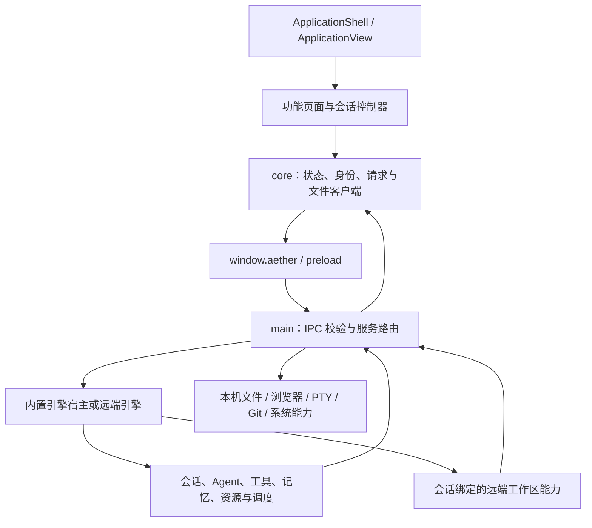

# 前端结构、功能边界与插件承载约定

源码核对日期：2026-11-17。

应用只有一个默认界面。产品代码不再按 Code / Work 模式分目录；浏览器协议和已保存的数据键中保留的 `work` 是既有身份，不代表第二套界面。

| 目录 | 职责 |
| --- | --- |
| `src/renderer/src/app` | 应用壳、页面装配、导航、内置命令注册、管理页按需加载 |
| `src/renderer/src/features/sessions` | 会话状态、草稿、控制器、首页和会话列表 |
| `src/renderer/src/features/conversation` | 对话、运行反馈、消息和工具活动；`shared` 为输入、附件和 Markdown 共享组件 |
| `src/renderer/src/features/composer` | 默认输入区、附件和工作区选择 |
| `src/renderer/src/features/workspace` | 工作区页签、文件树、资源预览、资料 |
| `src/renderer/src/features/artifacts` | 成果、交付文件、变更审阅和回退 |
| `src/renderer/src/features/agents` / `collaboration` | Agent 管理、子代理交互与运行详情 |
| `src/renderer/src/features/plugins` | 插件项目 CRUD、导入、编辑、发布、工具运行表单 |
| `src/renderer/src/features/extensions` | 插件前端贡献注册、启停生命周期、自定义页面桥接 |
| `src/renderer/src/features/services` | 服务托盘、通知摘要、已读状态、服务动作菜单 |
| `src/renderer/src/features/*` | 浏览器、终端、Git、设置、项目、监控等独立功能域 |
| `src/renderer/src/ui` | 无业务归属的按钮、图标、菜单、弹窗、浮层、分栏和动效 |
| `src/renderer/src/core` | 引擎通信、文件服务、平台适配、主题和共享状态设施 |
| `src/shared` | 主进程、预加载、渲染层共同使用的 IPC 与协议类型 |

`ApplicationView` 负责页面装配、导航和前台会话桥接。对话正文、运行反馈和工作区分别由 `ConversationView`、`SessionFeedback`、`WorkspaceView` 管理。管理页首次打开才加载；自定义插件页只在打开时挂载，关闭释放 iframe 和事件监听。

## 页面、进程与数据链路

当前主导航为工作台、项目、Agent、插件、自动化、引擎监控；浏览器由工作区、菜单和命令进入。会话工作区内的首页、成果、工作区、资料、浏览器、子代理、终端、Git 不是第二套应用模式。设置由 `AppSettingsView` 聚合账号、引擎、模型、资源与外观等领域。

渲染层不直连引擎服务，不持有通用 Node 权限。`src/shared` 定义 IPC 和领域数据形状，`src/preload/index.ts` 暴露具名桥，`src/main/ipc.ts` 与领域 IPC 注册实际操作。引擎 HTTP／SSE 在主进程统一代理；内置与远端都需要核对协议、实例与认证身份。

本机文件服务、原生浏览器、PTY、系统打开方式和 Office 解析仍属于桌面主进程。会话文件由 `core/workspace/fs-client.ts` 根据绑定目标路由；远端目录绝不当作同名本地路径访问。普通资源读取不能用过期 UI 路径提示隐式重新绑定会话。

## 身份与状态边界

同一个路径字符串不足以确认操作目标。文件、搜索、Git、终端与资源预览需要同时核对引擎来源、预期引擎、会话、工作区根目录与绑定版本。账号或引擎切换后，旧请求和异步回执不得写入新身份的状态。停止当前运行与切断整个引擎连接是不同动作。

会话事实由引擎提供；`features/sessions` 负责列表、草稿、选择与状态呈现，`core/engine/useChat.ts` 组织运行事件与请求。后台状态同步用于侧栏及非前台会话，不能用当前可见流是否结束推断所有子代理和后台服务都结束。

下一轮队列有主进程持久存储与派发服务，相关入口集中在 `session-next-turn-ipc.ts` 和 `next-turn-*`。队列按来源／账号／会话归属，接受结果不确定时进入恢复处理；不能以 renderer 重挂载为由重复派发。补充消息仍属于当前轮次，下一轮条目则有独立排队与确认生命周期。

账号凭据由 `main/account` 管理，界面只读取脱敏状态。模型密钥、实例令牌、个人恢复凭据与高级认证各有用途；登录切换的缓存失效边界见[账号与登录](accounts-and-login.md)。设置、窗口状态、显示偏好与会话内容也分别存储，不能把浏览器缓存或 localStorage 当作完整业务数据源。

## 功能装配与显示边界

- `composer`、`conversation`、`interactions` 与 `sessions` 协作处理输入、附件、补充、排队、审批、提问、历史与会话动作；删除历史和文件回退必须按动作语义区分。
- `workspace`、`explorer`、`projects` 与 `artifacts` 共同管理目录绑定、项目聚合、资料、交付和文件变化。成果撤回依赖真实变更与快照，不依赖展示卡片是否存在。
- `agents`、`collaboration` 与 `models` 处理 Agent 配置、子代理谱系／续跑／补充、模型与并发；执行及上下文压缩仍由引擎负责。
- `settings` 承载记忆、技能、MCP、知识库、代码图和其他管理入口。`general`／`code` 是工具配置，不是两套前端模式。
- `automations` 管理计划与历史，实际调度属于引擎；暂停后续触发不代表取消当前运行。
- `monitoring` 在进入时采样，之后手动刷新资源与存储诊断。连接及任务事件仍可实时更新；不能把每次界面渲染都变成诊断采样。
- `search`、`git`、`terminal` 有独立的操作和身份链路；远端支持以服务能力为准，不通过本机接口猜测远端文件。
- `browser` 管理标签和交互，`documents` 与 `editor` 管文件预览。默认文件界面是只读预览；保留的 `core/editor` 与 `core/lsp` 并不证明可写编辑宿主已经挂载。

完整 26 个功能目录、主进程与 IPC 映射见[功能覆盖表](feature-map.md)，用户流程见[使用指南](user-guide.md)，可写编辑基础设施与默认预览的区别见[编辑器与预览边界](editor-code-oss.md)。下文聚焦插件承载；公开 API 不在本文件重复维护。

## 插件贡献

已发布并启用的插件通过 manifest 的 `contributes` 声明 `pages`、`navigation`、`workspaceTabs`、`services`、`commands`、`menus`、`views`、`statusBar`、`settings`、`editorDecorations`、`hooks`、`background`。前后端校验和创建模板提供同一套协议目录。页面支持宿主工具表单、隔离 HTML 以及 `native` JSON 声明的 React 组件。公开参考以本仓库 `docs/plugin-api/content/*.html` 为唯一源，构建入口为 [Aether 插件 API 参考](plugin-api/dist/index.html)，维护规则见 [维护说明](plugin-api/maintenance.html)。引擎同级仓库的 `docs/examples/workbench-extension` 保留完整示例工程。

实际功能组件通过 `features/extensions/slots.tsx` 获取菜单和内嵌界面；`interactions.ts` 统一命令、快捷键、宿主编辑目标与事件。菜单位置有消息、会话、文件、编辑器上下文及工具栏、应用菜单、服务菜单、输入工具栏；内嵌位置有消息、输入与工作区。组件提供宿主目标上下文，不能从插件业务参数决定授权会话。

系统弹窗、通知、剪贴板通过 `shared/plugin-host.ts` 和 `main/plugin-host.ts` 的具名 IPC 接入，主进程重新核验权限与修订。原生页面不是第三方 React 模块注入，Webview 也不获得通用 Electron IPC。

贡献以插件 ID、发布 revision、hash、引擎来源和实例身份归属。替换版本时撤销旧贡献；旧清理函数不能删除新实例。停用移除入口、页面、服务视图和定时回调。`scope` 与 `when` 控制会话、工作区、引擎就绪条件。

`core/engine/plugin-catalogue-sync.ts` 在应用生命周期订阅引擎目录变更，独立于管理页与当前会话。初连和重连同步目录，后台或子代理的变更统一失效 `@` 缓存并协调各挂载区域；没有周期性全量扫描。管理操作成功通知不依赖页面仍打开，手动刷新也走同一通道。宿主保留未变化的应用，对临时读取失败最多重试三次，列表读取失败不误卸载已有插件。引擎切换拒绝旧响应，页面卸载释放连接，主进程保证每窗口只有一个插件目录订阅。

外部 HTML 位于无同源权限的 sandbox iframe。它没有 Electron preload，不能直接访问宿主状态和 IPC；使用 `window.aetherPlugin` 调用当前页面声明的工具、读取受限上下文、导航至自身页面和操作自身服务。工具仍在引擎运行，使用固定发布版本。页面加载不把所有插件工具加入 Agent 请求。

`window.$AE` 是同一隔离桥上的平台 SDK：`skills`、`session`、`models`、`ai`、`agents`、`mcp`、`knowledge`、`workspace`、`settings` 使用统一的 `call(capability, method, args)`。会话 ID 由宿主绑定，插件参数不能改变外层会话授权。权限目录来自引擎；插件须在 manifest 声明权限，并在管理页获得用户授权。单插件和批量开关只提交已声明权限，旧版授权与草稿授权分别显示；引擎再次核验授权与版本。

## 本地插件开发

插件页的「开发模式」直接打开引擎所在电脑的源码目录，工程根目录需要 `aether-plugin.json`。已登录的本地桌面管理员可以使用该入口；远程部署不隐式获得本地文件执行能力。

开发页提供界面预览、工具测试、权限和已有会话绑定。它复用 `ExtensionWebview` 的隔离文档、主题、下载和 SDK 桥，不写入已安装插件注册表，也不替换同 ID 的发布版本。源码修改后手动刷新；工具调用携带 revision/hash，未刷新时拒绝运行变化的代码。同一目录且插件 ID 未变时，刷新保留已授权且仍声明的能力；新申请能力默认关闭，改变插件 ID 后清空授权。退出或切换工程关闭开发会话；引擎来源切换后忽略旧响应。

`PluginDevelopmentMode` 管开发流程，`PluginDevelopmentPermissions` 管快照授权，`core/engine/plugins.ts` 管开发会话契约；平台权限共用 `PluginPermissions` 的目录与开关样式。运行产物由引擎隔离保存，不在源码目录产生安装副本或测试垃圾。

## 浏览器里的插件页面

插件页面与开发预览的“在浏览器中打开”使用结构化插件身份创建受信标签。`browser-store` 保存有界的插件文档句柄，`PluginBrowserSurface` 复用隔离 `ExtensionWebview`；浏览器地址栏显示的 `aether-plugin:` 地址不是授权入口，手动输入该协议不会创建能力。插件标签保持原会话绑定，刷新校验版本，关闭释放页面；开发标签持有独立开发会话，所以离开开发管理页不会中断它。

普通 HTTP/HTTPS 网页继续由无 preload 的原生 `WebContentsView` 承载，不注入 `$AE`。在插件标签输入网址会新建普通网页标签，不传递插件权限。插件标签目前不支持原生网页的 AI 点击/截图操作，浏览器状态栏不会将其标记为“AI 可操作当前网页”。

`services` 截止时间由桌面内存维护；`background` 周期任务由引擎独立持久化与恢复。`main/plugin-background.ts` 在关闭窗口时读取有效授权任务，有任务则隐藏到系统托盘，退出菜单仍执行正常进程清理；真正退出后不运行，下次引擎启动恢复。插件代码、业务数据和会话事实由各自引擎存储负责。

## 服务与通知

消息和消息历史入口位于底部状态栏，消息只显示尚未查看的全局插件通知，消息历史只保留全局已读通知；当前会话的服务入口位于会话标题旁，服务运行记录与结束记录都绑定当前会话的终端。`ApplicationView` 通过 `features/services/tray-context.ts` 提供当前会话与终端操作，`StatusBar` 只承载全局消息入口。服务和消息菜单调用真实的打开、停止、复制与已读动作。

托盘不读取命令输出，也不增加日志轮询。通知只保存有界摘要，显式插件通知首次读取为未读；结束服务留在当前会话的服务历史中。全局插件通知跨页面共享，会话服务按引擎和会话隔离。删除历史或卸载插件会撤销对应记录。

## 后续扩展规则

- 新功能落入所属 `features` 域；不要恢复 `contrib/work` 或复制第二套默认界面。
- 跨进程类型放 `src/shared`；插件宿主契约集中在 `plugin-contributions` 与 `features/extensions`，不要散落字符串注册。
- UI 组件复用 `ui`，颜色使用 `assets/tokens.css` 的既有令牌，图标操作保留可访问名称和键盘入口。
- 保留会话、来源、版本边界；不得把界面显示状态当作引擎运行事实。
- 删除代码先查实际入口、静态/动态导入以及 worker/CSS 引用；编辑器、终端和预览仍是默认应用功能。
- 修改后执行 `npm run typecheck` 和 `npm run build`，再串行运行相关 Electron E2E。测试使用独立 profile、端口和数据目录。

重点回归：`extension-host-ui.spec.ts`、`service-tray-ui.spec.ts`、`work-terminal-ui.spec.ts`、`work-home-ui.spec.ts`、插件管理、成果/附件/子代理交互。测试文件中的历史 `work` 名称及已有持久键不会创建新的产品模式。

开发与平台能力回归：`plugin-permissions-ui.spec.ts`、`plugin-session-review-ui.spec.ts` 使用鉴权 API 夹具与真实 Electron iframe；`plugins-development-real-engine.spec.ts` 启动隔离真实引擎，验证源码运行、刷新、能力调用、权限失效和不安装。前者的模型响应是测试夹具，不证明外部模型推理质量。
