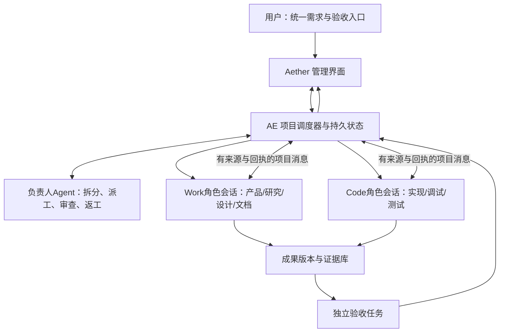

# AE 引擎对「总负责人／管理与验收」的能力审计

调研日期：2026-11-04（Asia/Shanghai）。读取的引擎提交为 `d25d93a68ce44b5bc5498584434b40c9ac9b7441`；读取时 `git status --short` 为空。本次只做源码、接口及数据结构调研，未调用模型、启动 Electron、运行测试、修改源码或用户配置。下文“已存在”指可定位的实现，不替代新模式的端到端验收。

## 结论

**引擎必须参与。** Aether 可以新增统一的用户入口、团队视图和验收界面，但可靠的任务分派、跨会话通信、权限委派、重启恢复和交付状态不能只放在渲染进程。

现有 AE 已有相当多可以复用的基础：根运行账本、独立子会话、异步子代理、同根消息队列、追加要求、真实取消、工具权限、版本保护与文件回滚。缺少的是**跨根运行、跨 Work/Code 模式、持续存在的项目级组织与验收层**。不能把“已有 `subagent_send`”解释为“现有两个独立 Work/Code 会话已经能随意互发要求”，也不能把 `plan_update` 的完成状态当成验收通过。

建议由三个部分共同组成：Aether 的管理界面；引擎中确定性、持久化的项目调度器；按事件唤醒的负责人模型。负责人模型负责理解目标、拆分任务、派工、审查证据和请求返工，不直接修改业务代码或办公成品。它仍需要只读查看产物和证据，否则无法真正验收。

还有一个需要先澄清的现实：当前 AE 使用自研 ReAct 与 `@anthropic-ai/sdk`、OpenAI 适配器，并不是 Claude Agent SDK 运行时。依据为 [package.json](D:/dev/ai-agent-engine/package.json:36)、[子代理 ReAct 构造](D:/dev/ai-agent-engine/src/tools/subagent/subagent-tool.ts:317)。新编排层应面向执行器接口；如果以后采用 Claude Agent SDK，可以作为一种 worker 执行器接入，而不是把项目任务状态绑定在某家 SDK 的进程内对象上。

## 1. 已有能力、可复用程度与准确边界

| 能力 | 当前实现与证据 | 对新模式的判断 |
|---|---|---|
| 根任务身份与状态 | `RootRun` 有 run/session/turn/message ID、seq/version、模型、工作区、pending；状态为 running/waiting/succeeded/failed/cancelled/interrupted。[root-runs](D:/dev/ai-agent-engine/src/storage/root-runs/index.ts:15) | 可复用执行账本，但根运行是一次执行，不是整个项目生命周期。 |
| 根会话启动、追加查看与流恢复 | `POST /chat`；`GET /chat/snapshot`、`/chat/runs`、`/chat/status`、`/chat/stream`。[chat](D:/dev/ai-agent-engine/src/api/http/routes/chat.ts:600)、[查询与流恢复](D:/dev/ai-agent-engine/src/api/http/routes/chat.ts:2087) | 可作为 worker 的执行和观察通道；缺项目任务与多会话映射。 |
| 独立子会话与后续续跑 | 保存 childSessionId、parent/root 身份及 continuation；`resumeRunId` 只能继续同父任务且已结束的子代理，不能更换原角色、提示或权限。[子代理](D:/dev/ai-agent-engine/src/tools/subagent/subagent-tool.ts:164)、[continuation](D:/dev/ai-agent-engine/src/core/subagent/types.ts:37) | 已能保存角色上下文；不是可被任意另一项目接管的全局员工。 |
| 异步子代理 | `subagent_start` 返回 admitted/runId/childSessionId；`subagent_wait`、`subagent_cancel` 等待真实执行、结果投影和票据完成。[start](D:/dev/ai-agent-engine/src/tools/subagent/subagent-tool.ts:145)、[控制工具](D:/dev/ai-agent-engine/src/tools/subagent/async-tools.ts:73) | 可复用启动、等待、取消及状态语义，不必另写一套虚假的“Agent完成”。 |
| 同根代理通信 | `subagent_send` 的发送者由真实执行身份确定；目标必须属于同 rootRunId/rootAttemptId；相同 requestKey 只能重试相同接收者与正文。[send](D:/dev/ai-agent-engine/src/tools/subagent/async-tools.ts:51)、[根作用域检查](D:/dev/ai-agent-engine/src/core/collaboration/store.ts:222) | 可复用消息信封、幂等和来源验证；**不能直接向其他独立根会话发消息**。 |
| 消息整合到模型上下文 | SQLite/JSONL 私有执行边界在每次模型迭代整合消息；JSONL有 pending/integrated/suppressed 记录，并在预算后检查历史未变。[安装](D:/dev/ai-agent-engine/src/core/collaboration/production-boundary.ts:9)、[JSONL边界](D:/dev/ai-agent-engine/src/core/collaboration/jsonl-react-boundary.ts:61) | 很适合承接“运行中补充”。integrated 仅表示进入历史，不等于已理解、已执行或验收完成。 |
| 用户运行中追加 | `/collaboration/roots/:rootRunId/controller-context` 和 `/messages`；要求真实用户/owned local controller；绑定精确 attempt、recipient invocation、requestKey。[HTTP](D:/dev/ai-agent-engine/src/api/http/routes/collaboration.ts:69)、[控制器](D:/dev/ai-agent-engine/src/core/collaboration/controller.ts:111) | 可复用当前运行的定向追加。不能让普通模型冒充用户控制器；当前接口也不会自动启动或重启接收者。 |
| 角色配置 | Agent记录含 systemPrompt、model、temperature、skills、mcpServers、knowledgeBases、allowedTools。[Agent存储](D:/dev/ai-agent-engine/src/storage/agent/index.ts:5) | 可复用角色模板，但还没有部门、项目分工、角色实例和协作关系。建议模板与本项目临时角色实例分开。 |
| 用户主动选择协作者 | `/chat`可携带collaborators，服务端验证；用户选择的子Agent在父模型首调之前启动，最多8项；同Agent可继续最近子会话。[collaborators](D:/dev/ai-agent-engine/src/core/subagent/collaborators.ts:17)、[确定性委派](D:/dev/ai-agent-engine/src/core/subagent/collaborators.ts:75) | 已有明确用户委派与自动模型调用的权限区分。不能把负责人自动决定的派工伪装成这里的显式用户选择。 |
| Work/Code工具分工 | ToolProfile目前只有general/code；Code允许专业文件/命令/浏览器/子代理及`office_inspect`，排除`office_document/office_environment`和agent/task管理工具。[profile](D:/dev/ai-agent-engine/src/tools/tool-profile.ts:4)、[Code目录](D:/dev/ai-agent-engine/src/tools/tool-profile.ts:20) | 分工已有基础，但没有supervisor profile；当前worker继承父profile，不能给同一父级任意创建两种profile的孩子。 |
| 子代理权限 | 普通子代理工具不超过父任务；不允许递归subagent或ask_user；reviewer强制只读；用户明确委派的配置Agent可保留其授权资源。[工具快照](D:/dev/ai-agent-engine/src/tools/subagent/subagent-tool.ts:90)、[角色和授权](D:/dev/ai-agent-engine/src/tools/subagent/subagent-tool.ts:173) | 必须新增独立的“可委派能力”授权模型，否则纯管理父级没有写工具，其孩子也拿不到写工具。不能通过把所有写权限放回负责人解决。 |
| 现有reviewer的实际限制 | 只读集合允许文件读取、浏览器快照和部分观察工具，不含`execute_cmd`、浏览器click/navigate；spec/code-quality reviewer即使传inherit也保持只读。[集合](D:/dev/ai-agent-engine/src/tools/subagent/subagent-tool.ts:72)、[强制reviewer规则](D:/dev/ai-agent-engine/src/tools/subagent/subagent-tool.ts:178) | 可以做静态审读，不能直接当“运行测试+操作界面”的完整验收Agent。应另有受控测试执行角色/服务，使用隔离副本并输出证据，生产代码保持不可写。 |
| 并发池 | 每个父会话的SubagentPool默认3个槽位，等待与内部工具槽分离；runner以tenant+parentSession分组。[pool](D:/dev/ai-agent-engine/src/core/subagent/pool.ts:13)、[acquire](D:/dev/ai-agent-engine/src/core/subagent/runner.ts:298) | 可复用资源调度基础；不等于项目全局并发、角色优先级或依赖调度。 |
| 计划与待办 | plan是当前session内的`id/step/status`数组、explanation/revision；没有assignee/dependencies/artifact/review字段。[类型](D:/dev/ai-agent-engine/src/storage/todo/index.ts:37)、[持久化](D:/dev/ai-agent-engine/src/storage/todo/index.ts:198) | 可保留作为Agent个人计划；不应强行充当跨角色项目任务图。 |
| 旧task队列 | `/tasks`只接受已注册executor类型，没有则501；工具描述明确是旧版队列，不包括命令/子代理/当前AI任务。[路由](D:/dev/ai-agent-engine/src/api/http/routes/tasks.ts:14)、[描述](D:/dev/ai-agent-engine/src/tools/task/task-tool.ts:17) | 不可直接把它改名“团队任务”后当功能已有。它的持久claim模式可参考，业务调度层需新建。 |
| 变更与回滚 | FileChange绑定session/turn/run、路径、前后hash和二进制snapshot；`/changes/revert-batch`等提供版本保护回滚。[记录](D:/dev/ai-agent-engine/src/storage/changes/index.ts:15)、[API](D:/dev/ai-agent-engine/src/api/http/routes/changes.ts:23) | 是交付版本与证据绑定的良好基础；`kept`只表示保留改动，不代表质量验收通过。 |
| 重启与恢复 | 引擎启动把未结束root标interrupted；旧子代理持久记录不自动取得真实executor join，不自动重跑。[root恢复](D:/dev/ai-agent-engine/src/storage/root-runs/index.ts:117)、[子代理边界](D:/dev/ai-agent-engine/src/core/subagent/runner.ts:150) | 不能宣称当前已支持“关闭应用后公司继续、重启自动恢复整项目”。需持久调度器恢复策略和副作用核对。 |
| 费用/用量 | 父子共享RequestBudget；HTTP当前使用Infinity，跟踪物理attempt；根回调做observe和dispatch日志。[chat](D:/dev/ai-agent-engine/src/api/http/routes/chat.ts:1080)、[budget](D:/dev/ai-agent-engine/src/core/subagent/budget.ts:64) | 可做成本观察与显式预算；仍需项目级物理请求账本，不能把多会话累计快照直接相加。 |

### 一处需要专门核对的能力声明

[GET /collaboration/capabilities](D:/dev/ai-agent-engine/src/api/http/routes/collaboration.ts:47) 仍返回 `mailboxConsumer:false`、`runtimeCommunication:false`、`asynchronousAgentTools:false`、`jsonlDelivery:false`，同时单独宣告root用户追加可用。另一方面，[registry-factory](D:/dev/ai-agent-engine/src/tools/registry-factory.ts:341) 已注册异步子代理工具，[默认暴露规则](D:/dev/ai-agent-engine/src/tools/tool-exposure.ts:33) 未排除这些工具，聊天路由也在canonical admission后安装production boundary（chat.ts:1493）。

这是一项静态可见的声明与实现覆盖范围不一致。应在新模式开发前按真实路径补能力契约测试、明确哪些调用可用；本调研不凭某个布尔值或单个文件就断言整条能力已全量开放或完全未实现。

## 2. 为什么只在客户端加一个“管理模式”不够

纯客户端方案可以较快做到：创建两条会话、分别发prompt、订阅流、在列表展示状态。这适合概念演示，但至少有以下不可解决或很脆弱的问题：

1. 关闭窗口/renderer崩溃之后，内存里的“等Code完成再让Work写文档”丢失；重连时容易重复发任务。
2. 正在运行的会话不能简单再POST一条`/chat`当即时追加；追加、排队下一轮和新派工需要不同语义。
3. 客户端若拿用户身份替Agent互发要求，会丢失作者和授权来源，甚至把Worker的建议提升成用户最高优先级命令。
4. 对话文本“我做完了”不能推动交付到accepted；验收必须绑定任务、输入版本、产物hash、运行和实际证据。
5. 多模式共享目录存在并发覆盖、文件版本失效、重试副作用重复的问题，不能靠UI顺序或Prompt约定保证。
6. 当前会话重发/截断会删除相应root行，[conversation/truncate](D:/dev/ai-agent-engine/src/api/http/routes/conversation.ts:340) 和 [deleteTurns](D:/dev/ai-agent-engine/src/storage/root-runs/index.ts:456)。独立的项目任务审计与提交版本不能随UI对话删改消失。

用户看到仍然是一个应用，也不需要启动第三个服务。项目调度器可以作为AE进程内模块、使用现有SQLite与HTTP/SSE，在未来需要远程执行时再独立部署。

## 3. 建议架构：项目调度器 + 负责人Agent + 专业执行会话

这里的“负责人”是一个逻辑角色，不要求一个永不结束的LLM调用。用户提交需求、Worker完成、验收失败、出现阻塞或有实质变更时才唤醒负责人。等待、队列、依赖满足、投递重试、租约、停止传播都由普通程序处理，避免为“还没做完吗”不断消耗token。

**推荐项目级协调，不推荐把整个公司做成一个无限根运行。** 理由是当前同根消息与子代理权限生命周期绑定root attempt；项目会跨多次用户输入、角色多轮工作、暂停/关闭/重启。项目任务是长期实体；run/attempt是短期执行实体。

现有subagent仍有价值：Code角色在自己的任务内部可以用它做短期并行检查、读文件、独立review。顶层团队成员则应是项目中有稳定身份、可独立续跑和观察的worker session。Work/Code是工作能力和显示方式，不是两个必须永远同时运行的大模型。

### 权限需要拆成两种

- **执行权限**：负责人只有查看项目/任务/证据、读取成果、派工、发消息、停止、请求验收等工具；没有`write_file/execute_cmd/office_document`等成品生产能力。
- **委派权限**：用户本次项目授权允许负责人调用哪些角色、模型、工作区、工具profile、MCP/Skill/知识库，以及是否可创建临时角色。由服务端生成不可被模型自行扩大的授权范围。

Worker拿到的是服务端批准的能力快照，与父负责人自己的只读工具集合独立；仍受项目授权上限。不要把`userDelegated:true`设置成模型可传参数，也不要让模型通过`http_request`拿用户密钥绕过编排API。

角色配置与本次角色实例要分离：永久模板是“前端工程师／产品经理”；项目实例是“本项目的前端任务负责人”，有选定目录、任务范围和资源版本。大多数需求不需要向全局Agent库写入大量一次性配置。

## 4. 最小新增数据模型

以下是建议，不是已有表或已有API：

| 实体 | 最小关键字段 | 目的 |
|---|---|---|
| Project | projectId、tenantId、用户目标、需求版本、授权范围、status | 所有协作的持久归属，不受某次会话结束影响。 |
| RoleInstance | participantId、projectId、templateId/version、work/code、sessionId、权限快照 | 跨轮保存角色身份与专业上下文。 |
| Task | taskId、目标/范围、owner、dependencies、inputRefs、acceptanceCriteria、revision、status | 表达依赖和完成标准；不以一段聊天文本代替结构状态。 |
| Dispatch | dispatchId、taskRevision、sessionId、runId/attemptId、idempotencyKey、lease、status | 把逻辑任务和一次实际执行连接起来，重试有新attempt且不覆盖旧证据。 |
| Message | messageId、projectId、sender、recipient、taskId、kind、causationId、requestKey、content/ref、state | 可审计跨会话投递，不伪装用户消息。 |
| Deliverable | artifactId、version、path/URI、hash、taskId、producerRunId、status | 交付必须绑定具体字节；新版本使旧验收失效。 |
| Review | reviewId、criteriaVersion、artifactVersions、reviewerRunId、evidenceRefs、verdict、issues | 独立记录验收与返工；不可仅由生产者标completed。 |

不要一次加入完整企业OA的组织、考勤、薪资等概念。这个产品需要的是项目协作与交付机制，角色只是为了专业分工。

建议任务状态：`draft → ready → assigned → running → submitted → reviewing → accepted`；分支为`blocked / changes_requested / failed / cancelled`。`succeeded`只表示某个执行正常结束，任务可能仍需review；`submitted`不等于`accepted`。

建议消息事实分层：`accepted → integrated → acted_on`。前两个由程序证明，第三个必须关联后续动作/提交或明确回应；最终验收由Review独立决定。不能把“模型读了消息”当任务已完成。

## 5. “Work直接对Code会话输入要求”的正确实现

用户的目标可做到，并且应直接显示在目标角色会话里；但底层不应是UI模拟点击输入框。建议流程：

1. Work调用项目消息工具，目标是明确的Code participant/session，携带task、消息种类和必要输入版本。服务端确定真实sender。
2. 服务端检查同项目协作关系、任务范围和资源授权，再用幂等键保存消息；返回accepted回执。
3. Code正在运行且接收“即时补充”时，将消息绑定当前run/attempt，在下一模型迭代边界整合。涉及正在执行的命令，消息不能时间倒流地改变已经启动的副作用。
4. Code正在运行但要求“下一轮处理”时，存入项目级待执行队列；当前轮结束后只启动一次新run。不要让两个同session运行同时写同一历史。
5. Code空闲时，依据项目授权启动新run；Code已结束/当前任务已验收时，需要明确创建返工任务或追加任务，不能静默改变已验收版本。
6. 回执和可见消息标明“来自产品角色·任务T-12”，保留作者、关联原消息与处理进度。负责人看到的是摘要、阻塞和证据；按需展开全文。

这既允许Work→Code，也允许Code→Work，比如开发已完成后请求更新操作说明；不是只有总负责人能传话。同行可以直接澄清接口、提交产物链接、请求具体修订，但改变全局范围、权限、验收标准或替代用户决策必须交负责人处理。

建议控制面新增服务方法，而不是先承诺具体public路由名：`createProject`、`assignTask`、`dispatchTask`、`sendProjectMessage`、`submitDeliverable`、`recordReview`、`cancelProject/Task`。它们可向UI暴露HTTP，也可向负责人暴露少量工具；两个调用方共用同一鉴权、幂等和状态转移实现。

## 6. 按任务难度分配团队

| 用户任务 | 建议执行形态 | 负责人行为 |
|---|---|---|
| 一份说明书、表格分析、单个文件修改 | 单Work或单Code角色 | 确认输出标准、派给一个角色，完成后做最小验收。不要为简单工作强行创建公司。 |
| 小型网页／方案+文档 | 一主执行角色，按需补一个专业角色 | 先确定依赖；文档可以在开发稳定后创建，不必同时读改。 |
| 产品+多模块开发+多格式文档 | 产品/开发/独立验收分工；开发内部适量子代理 | 需求版本先冻结可执行部分，组件并行，接口与产物显式交接，最终验收。 |
| 需求不清或高不确定研究 | Work先澄清/调研，再决定是否Code | 先把不确定性收敛；不能以“任务长”直接等价“需要更多Agent”。 |

路由判断应结合目标类型、依赖、角色技能、文件写范围和不确定性，而不仅是prompt长度。并发是可配置的资源调度，不能用增加固定工具调用次数上限来控制复杂任务；保持用户要求的自动压缩和长任务能力。

## 7. 防止“公司内耗”和token失控

- 负责人按事件唤醒；无状态变化时不让模型轮询。把运行中/排队/完成等机械检查交给程序。
- 消息须有task与目的（澄清／交接／返工／阻塞／结果）；默认不广播全文给所有角色。来源内容属于同事建议，不自动升级用户指令。
- 相同requestKey不能变正文；重复消息用内容指纹与因果链识别，不因网络不确定而换键重发。
- 任务依赖必须无环；互等时显式blocked并通知负责人。澄清消息不自动创建新任务，避免A问B、B问A互相唤醒。
- 同一问题多次返工无新增证据时，触发“重新检查前提”的管理事件；不静默终止项目，不再原样重复同一个测试或派工。
- 默认按子目录/文件所有权切分并行写范围，写入继续使用expectedHash；协调器处理冲突，不能把后写覆盖当合并成功。
- 负责人接收结构摘要与证据引用，必要时读取原始内容；不反复把整个项目或所有角色全历史拼进上下文。自动压缩不替代可检索的持久事实。
- 用量按物理requestAttempt去重，明确未知用量；分角色、任务、重试和失败展示。明确配置的预算可作为项目政策，不能私设产品级硬步数上限。

## 8. 验收必须比“再找个Agent说通过”更严格

最低三层：程序可复现检查（构建、规则、文件结构）、真实界面/文档视觉检查、需求与内容审读。每个判定附具体产物hash、运行/工具回执、环境/构建及检查项；证据未执行标未验证，不默认绿。

生产角色可以自测并提交，负责人决定是否需要独立验收角色。验收角色默认不能修改被验收对象；发现问题交回owner返工，然后对新版本复验。负责人可以管理任务和验收记录，但不能用自己的文字覆盖失败回执。

这里的“验收不改对象”不能简单等同当前readonly reviewer工具白名单。真实测试可能需要启动应用、写临时夹具和浏览器操作；应把测试副作用限制在独立副本/临时工作区，给测试执行角色足够但明确的工具能力，结果审读角色只读。现有子代理没有ask_user/审批通道，阻塞需作为结构事件上报负责人，再由统一用户入口处理，不能让Worker自行假定获准。

既有 `FileChange` 和 `expectedHash` 可复用；另外需要交付版本与Review表。验收通过后只要相关产物字节或需求基线变化，就将受影响验收标过期，不让旧截图、旧测试报告自动证明新版正确。当前 `/changes/:id/keep` 不承担这个职责。

停止应分层：停止某worker、停止某任务后续调度、停止整个项目。UI必须区分“已请求停止”和实际cancelled；已生成文件保留，外部副作用不能虚构自动撤销。修改方案/重试创建新attempt，不覆盖原运行证据，也不依赖聊天截断保存审计历史。

## 9. 建议分期与真正的验收门槛

**第一阶段：最小可用负责人。** 项目实体、任务与依赖、Work/Code角色实例、负责人只读执行权限+独立委派授权、任务派发与提交/验收状态、停止和事件日志。先支持预设角色；所有项目任务经服务端派发，不能让前端仅凭模型文字更新完成。

**第二阶段：真实跨会话协作。** 双向定向消息、running/idle/next-turn三种投递、requestKey及状态回执、来源标识、需求版本与产物引用、冲突与阻塞处理。补当前capabilities声明和真实路径的一致性。

**第三阶段：恢复和成本。** 项目暂停/恢复、引擎重启后的dispatch对账、文件与外部副作用核查、任务级用量、事件驱动唤醒、更多角色模板。不要先扩成大量角色再补可靠性。

至少覆盖以下端到端场景后才可说管理模式成立：

1. 单Work任务和单Code任务各自独立完成，不强制启动另一模式。
2. Work交需求→Code开发→Work写文档→独立验收→返工→通过，保持相同需求与产物版本链。
3. Work向正在运行的Code发即时消息，恰好整合一次；明确下一轮消息只进入新run。
4. Code向空闲Work发任务触发后续运行，界面展示真实发送者；旧attempt消息不误投到新执行。
5. 断网/请求ACK丢失重试无重复派工；关闭/重启后任务账本不丢、不会盲重放有副作用命令。
6. 停止一个worker不误停整个引擎；停止项目能阻止后续派发并真实收敛正在运行的子任务。
7. 负责人不能写业务文件，Worker不能扩权；不同项目消息和产物不能串线。
8. 需求或文件改变后旧验收失效，空泛“已完成”不能跳过submitted/reviewing门槛。
9. 任务依赖环、文件写冲突和互相澄清循环有明确可见状态，不静默挂起。
10. 用量统计包含取消/重试，不因聊天历史被截断而消失，未知用量不显示为0。

本审计提供的是架构可行性与实现边界，不把上述建议API、数据表、恢复策略或新验收流程写成已实现能力。

