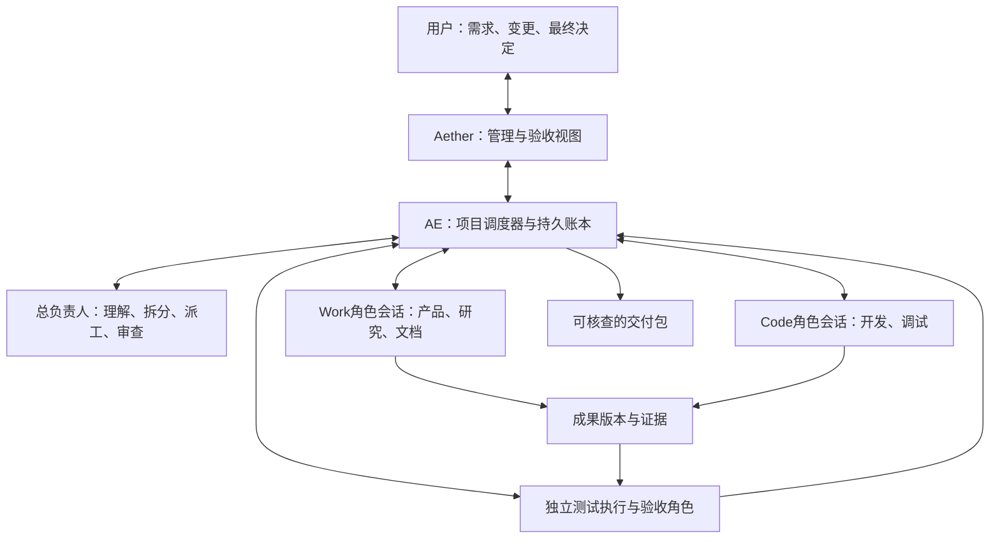

# Aether 总负责人模式：深度调研与落地方案

调研日期：2026-11-04（上海）。本次进行了本地源码审阅、官方文档检索与获取、GitHub搜索及固定提交的关键源码核查；未实施新功能、运行模型、启动应用或安装外部项目。当前基线：Aether `a41993dcb68c8d1b826fc6ce3c2758544a104f47`，AE `d25d93a68ce44b5bc5498584434b40c9ac9b7441`。旧对话中的部分测试报告不在当前源码树，本报告不把那些结果当作此版本的实测。

## 结论与建议

**这个方案可行，而且适合作为Aether下一阶段的产品主线。建议建立“项目总负责人”，让用户围绕需求与交付沟通，Work和Code承担专业执行。引擎必须参与，但不需要让用户再启动一个独立服务。**

用户提出的三块可以成立：管理与验收、Work、Code。它们是三种工作职责和界面视图，底层不应简单变成三个同权聊天框。真正需要增加的是：项目任务、角色实例、可靠消息、依赖调度、交付版本和验收记录。

总负责人应做到“不写业务代码、不制作办公成品”，而不是“什么也不能读取”。它必须能读目标、状态、产物和证据，决定分派、调整、退回和交付。测试执行、代码修改、文档制作仍交给专业角色。负责人模型负责判断，普通程序负责队列、状态、授权、停止、重试和通知。

优先吸收五类实践：**Paperclip的项目组织与版本化质量门槛，Codex的会话/运行/事件契约，Claude的角色与跨会话沟通，Gas Town的邮箱与工作目录隔离，OpenHands的控制台与执行器分层。** 不建议整体套入一个现成“多Agent公司框架”，也不建议为这个功能重写当前执行引擎。

## 1. 产品形态：用户管理项目，按需查看员工工作

默认入口建议叫 **“项目”** 或 **“总览”**，内部角色叫 **“总负责人”**；“管理与验收”用于说明职责。用户输入的是“我要什么”，系统展示的是“现在谁在做什么、卡在哪里、交付什么、凭什么通过”。

| 视图 | 用户关注的内容 | 默认展示 |
|---|---|---|
| 管理与验收 | 总目标、范围变更、任务依赖、阻塞、成果与结论 | 一条总负责人对话、阶段摘要、待验收项、最终交付包 |
| Work | 调研、产品、策划、设计、分析、文档等角色 | 选中角色的真实会话、资料与办公成果预览 |
| Code | 实现、调试、终端、浏览器、测试、代码变更 | 选中开发角色的真实会话与开发工作台 |

用户仍可单独使用Work或Code。总负责人也可将需求只交给其中一侧；“有管理入口”不意味着每次必开两个部门。

界面保持此前要求的精简：默认只展开当前选中工作的详情，其他成员显示单行状态。底部统一输入框明确标注收件人，例如“总负责人”或“产品负责人”；发送前可选择“立即补充/下一轮”。不要默认同时平铺三套聊天记录、全部工具日志和所有预览。切换收件人要保留独立草稿，不能把正在编辑的要求默默投给另一个Agent。

“总负责人正在管理”不要求它持续流式输出。等待时显示程序计算的真实任务状态与经过时间，模型只在有新事实时运行。

## 2. 当前Aether/AE的基础比从零开始好，但还不是团队系统

| 当前能力 | 本次源码核查结果 | 新模式需要补什么 |
|---|---|---|
| 两工作台 | Work/Code常驻视图、文件预览、代码/终端等已有 | 管理视图与执行profile解耦 |
| Agent角色 | 可配置prompt、模型、工具、Skill、MCP、知识库 | 可复用角色模板与本项目角色实例分开 |
| 子代理 | 启动、等待、取消、继续、观察和持久记录已有 | 长期团队成员不局限于某次父root/attempt |
| 运行中追加 | 精确run/attempt绑定、requestKey和核对已有 | 跨独立根会话的项目邮箱、来源与授权 |
| 下一轮队列 | Work已有主进程持久队列；Code机制不同 | 跨模式统一的派工/队列语义与项目恢复 |
| 项目与任务 | Work项目按目录分组；任务主要等于会话；个人plan已有 | 独立Project、Task、owner、dependsOn、验收标准 |
| 变更管理 | 文件版本、hash、回滚基础已有 | 成果版本、Review及验收过期规则 |
| 验收角色 | 只读reviewer能静态阅读 | 独立测试执行环境与实际界面/文档证据 |
| 重启 | 未结束root标interrupted，不自动续跑 | 项目dispatch对账、明确恢复与副作用处理 |

必须优先处理的两个接入问题：

1. 部分客户端请求仍从当前聚焦的AppMode推导工具profile或能力。总负责人后台向Code派活时，不能因为用户正在看Work，就发布Work身份。请求必须显式绑定目标session、executionProfile和能力。
2. 现有子代理继承父profile与权限。若负责人真正没有写文件/命令权限，其普通子代理也不能凭空获得开发权限。需要服务端的项目委派授权，让负责人可派出被项目授权的专业执行者，同时保持它自身只读；不能靠把所有写工具重新发给负责人解决。

此外，`/collaboration/capabilities`的一些旧布尔声明与实际异步工具/消息边界实现不完全一致，应在开发前用契约测试核实。不要仅凭“有subagent_send”就认定Work和Code两条独立根会话已经互通。

完整定位见 [客户端审计](D:/dev/aether-code/docs/supervisor-mode-research-2026-11-04/client-audit.md) 与 [引擎审计](D:/dev/aether-code/docs/supervisor-mode-research-2026-11-04/engine-audit.md)。这里的“已有”是源码事实，本轮没有重新运行E2E。

## 3. 引擎如何参与：建议采用持久项目调度器

图中的Work和Code可直接交换项目消息，统一由O保存、鉴权和投递；不要求负责人模型逐条充当传话筒。

| 方案 | 可取之处 | 主要问题 | 判断 |
|---|---|---|---|
| 只改客户端，轮流给两条聊天发prompt | 演示快，UI可见 | 权限来源、重启恢复、投递去重、验收事实分散；远端/多窗口更难一致 | 可做演示，不作为产品基础 |
| 一个超长总负责人root，所有员工都是它的子代理 | 复用现有子代理 | 生命周期/权限绑定一次root；项目跨多轮、暂停、返工时脆弱 | 适合短期子任务，不承载整个项目 |
| AE增加项目调度器，多个稳定worker会话 | 复用执行器，长期状态独立；支持直接通信与可审计验收 | 需新增项目模型和协议 | **推荐** |
| 立即换成完整外部公司框架 | 可获得组织面板与演示 | 原生Office、终端、权限、历史、预览和模型适配要二次整合 | 先吸收设计与局部实现，不整体替换 |

项目调度器先作为AE进程内模块，使用现有SQLite和HTTP/SSE；不要求用户启动第三项服务。Aether主进程保留本机文件/预览/待发缓冲职责，渲染进程负责视图。引擎退出时，本机任务不会凭空继续；应保存状态并在重启后对账，远端持续执行属于后续部署选项。

当前AE实际为自研ReAct加Anthropic/OpenAI等适配器，并非Claude Agent SDK runtime。建议保留一个Worker执行器接口：先接当前AE，未来需要时接Claude Agent SDK。用户的项目、任务、消息和验收记录不应随SDK更换而重做。

## 4. 总负责人拥有哪些权限

负责人允许：读需求和成果、创建/修改任务计划、分派与撤回、发送项目消息、观察状态、请求独立验收、根据证据提出退回或接受、汇总交付。负责人不允许：修改业务源码、生成/覆盖办公成品、直接执行任意终端命令、把失败证据改成通过。

UI与模型使用同一个服务端任务服务。模型可见工具保持少量，逻辑上可归为 `task / spawn / send / watch / review / stop / read`；这里只表示建议的职责和短名称，不是本轮重命名已有工具。`review`提交判定时仍受服务端证据、权限和版本校验，不是任意写一个accepted字段。

授权分两层：

- 执行权限决定该角色自己能做什么。负责人的执行权限保持只读和管理能力。
- 委派授权决定本项目允许启动哪些角色、工作区、工具和资源。由用户的项目范围与服务端策略产生，模型不能自行扩大。

创建角色优先生成项目内临时实例，按需选用模板，不把每次临时分工都写入全局Agent库。Skill/MCP/知识库按任务实际需要分配；“Work灵活”不意味着所有员工拥有全机所有工具。

这种预先授权的派工能力不等于权限绕过：负责人没有生产工具，与某个动作已被明确拒绝是不同情况。普通peer消息不能请另一角色代做已被拒绝的动作，项目调度也不能扩大用户授权；未来SDK接入须保留这一边界。

## 5. 直接给另一模式的会话输入：需要项目邮箱，而非模拟点击

用户需要的双向交互应该支持，并直接显示在目标会话里。收件人必须是明确的项目成员/session，发送者由服务端真实执行身份确定。

| 收件人状态/意图 | 推荐行为 |
|---|---|
| 正在运行，立即补充 | 绑定当前run/attempt，在安全迭代边界插入；已启动的命令不会被消息倒回修改 |
| 正在运行，下一轮 | 持久排队，当前轮结束后开始新run；同session不并行写历史 |
| 空闲，处理请求 | 按项目授权唤醒一次新run，保留原角色上下文 |
| 已完成任务，提出变更 | 创建后续任务或返工revision，不静默改掉已验收成果 |
| 引擎断线/收件人不可用 | 保存为待投递或明确失败；不把HTTP接纳当业务完成 |

例如：产品向开发发“FR-11需要死子确认，附需求v3”；开发向产品发“触控方案已落地，请确认交互和更新说明书”；开发完成后向文档角色发“请基于commit X及验收Y生成用户说明”。这些都应是有任务和产物引用的消息，不只是丢一段大文本。

消息至少绑定 project、task、sender、recipient、kind、requestKey、causation/replyTo、需求与产物版本。事实分层显示：**已接纳 → 已投递/进入上下文 → 已回应/关联后续动作**；完成任务和验收通过另计。不要声称网络系统保证所有外部副作用“恰好一次”，应使用持久投递、幂等消费和不确定状态对账。

同事消息必须标“来自产品/开发角色”，不能伪装成人类用户授权。双方可直接澄清、交接和反馈；改变总体范围、优先级、权限或验收标准则交总负责人管理。为了避免管理瓶颈，普通澄清不必每次唤醒负责人，只汇总会影响目标和阻塞的事件。

用户直接进入某个成员会话改变要求时，要同时生成带人类来源的项目变更事件。负责人必须更新受影响的任务与依赖，不能拿旧计划把成员已经执行的新要求改回去。这一行为可参考MagenticLite的用户介入处理；它与普通Agent之间的建议消息具有不同来源和优先级。

协议启发来自 [Codex turn/steer](https://learn.chatgpt.com/docs/app-server#steer-an-active-turn)、[Claude跨会话消息](https://code.claude.com/docs/en/cross-session-messaging) 以及GitHub案例里的邮箱/唤醒队列。传输仍可使用AE现有HTTP/SSE，不必照搬CLI的命名管道或tmux。

## 6. “根据难度派一个公司”应该按需组队

| 请求特征 | 最小合适团队 | 升级条件 |
|---|---|---|
| 单文档、表格分析、一次小修改 | 一个Work或Code执行者 | 出现另一专业能力或独立审查需求 |
| 小网页/成熟方案 | 一个主执行者，按需一个审阅者 | 可清晰拆分的实现/内容工作出现 |
| 产品+Web/H5+多格式文档 | 产品/文档Work、开发Code、按需独立验收 | 多个可独立模块才增加专业开发者 |
| 问题不明确、调研不确定 | Work先研究并收敛需求 | 可实现范围明确后再启动Code |

判断依据是交付类型、依赖、专业能力、风险、不确定性、可隔离写范围和预计收益，不是输入长度或模型觉得“很复杂”。最小团队先工作，遇到实际瓶颈再增加角色。

不建议每次固定生成“CEO/CTO/产品/前端/后端/设计/QA”等全套角色。角色越多，上下文、沟通和协调成本越高。可以保留“像公司一样交付”的体验，而不模拟企业仪式。

等待、状态刷新、依赖检查、重复投递重试由代码处理；只在用户输入、实质阻塞、成果提交、验证失败或范围变更时唤醒负责人。并发槽用于排队资源，不新增任意工具调用次数上限。预算如有，应是用户明确配置并可见的项目政策；未知用量不能显示为0。

## 7. 围棋需求的一次完整工作流示例

用户只输入：“做Web围棋，兼容H5，交付可运行项目、需求文档、计划表、说明书和演示稿。”

1. **总负责人**形成需求基线和验收项：规则范围、设备尺寸、产物格式、运行方法、不包含的功能。可安全推断的内容直接采用并记录，只有影响交付的歧义才询问用户。
2. **Work产品角色**给出规则、页面流程、需求编号、数据边界和可执行验收夹具。Code可参与可行性讨论，不必等长篇文档排版完才开始。
3. **Code角色**按照已经明确的需求切片开发，持久记录代码版本；对不清楚的规则直接问Work。Work回答关联原问题，必要的范围变化交负责人决定。
4. **独立测试执行角色**在受控工作区运行规则测试和浏览器交互；文档由独立读取/渲染流程检查。失败证据交回产物owner，而不是验收者偷偷改完再自称原任务通过。
5. **Work文档角色**基于实际通过的实现版本完善DOCX、XLSX、PPTX、PDF、说明与索引，标明已实现和未验证项。早期方案可以并行草拟，最终说明必须跟随真实实现。
6. **总负责人**核对交付清单、版本和证据。只有所有必需项满足才标交付；否则继续返工或明确告知缺口。用户从管理页打开产物、查看证据、提出新的要求。

若之后用户要求“再支持在线对战”，这是新需求版本和新增任务，旧的本地双人验收不会自动证明在线对战完成。

## 8. 验收必须有独立事实基础

程序至少区分以下状态：`ready / running / blocked / submitted / reviewing / changes_requested / accepted / failed / cancelled`。执行run的succeeded只表示这次运行正常结束，不等于Task accepted，更不等于Project delivered。

每项验收绑定：需求/标准版本、具体产物版本与hash、producer run、检查者身份、环境/构建、实际测试或视觉证据、结果及限制。新产物或需求基线改变时，受影响验收过期；没有执行的项保持“未验证”。

验收分三类：

| 类别 | 谁执行 | 证据 |
|---|---|---|
| 程序检查 | 受控测试执行器/测试角色 | 构建、测试命令、退出码、断言与报告，不只取一句success |
| 视觉与交互 | 拥有实际预览/浏览器资源的角色或验证服务 | 对应版本截图、真实动作和状态变化；后台deferred打开不能算已目视 |
| 需求与内容 | 只读审阅角色或总负责人 | 对照需求、跨文件语义与数值、一致性问题及定位 |

当前AE只读reviewer没有执行命令和浏览器操作权限，因此不能把它直接宣传成完整QA。应给“测试执行”单独的受控能力：可写临时夹具、启动测试、操作测试浏览器，但不改生产产物。真实桌面/同一窗口资源使用租约串行分配，避免两个Agent抢焦点；代码并行采用worktree或明确文件所有权。

负责人仍可以最终做质量判断，但关键通过条件由程序门槛与证据约束，不能仅凭另一个模型说“没问题”。这也不保证永远没有业务错误，衡量时必须关注错误接受率和人工发现的问题。

## 9. GitHub案例该怎样吸收

详查记录、许可证、固定commit和源码证据见 [GitHub案例报告](D:/dev/aether-code/docs/supervisor-mode-research-2026-11-04/github-cases.md)。下面给出选择结论；没有运行这些项目，不把源码机制等同于产品稳定性实测。

| 案例 | 值得吸收 | 不宜直接照搬 |
|---|---|---|
| [Paperclip](https://github.com/paperclipai/paperclip) | 最接近AI公司：项目/issue、成员、唤醒队列、执行锁、成本、交付质量门槛；验收绑定文档revision或附件hash | 完整企业管理信息密度、默认预算和人员仪式；本机Office/终端体验仍需Aether提供 |
| [Gas Town](https://github.com/gastownhall/gastown) | 任务邮箱、reply/thread关系、队列/中断区分、开发隔离、异步协作 | tmux操作、复杂角色名与运维流程；不适合作为办公UI骨架 |
| [OpenHands](https://github.com/OpenHands/OpenHands) | 当前Agent Canvas控制中心与Agent Server/SDK分层；多会话、工作区与事件 | 会话容器隔离不等于文件隔离；原生办公创建/显示仍要保留自己的实现 |
| [CrewAI](https://github.com/crewAIInc/crewAI) | 层级管理、任务分配、结构化流程的表达 | 不能用manager角色的一段最终回复代替持久项目状态和验收 |
| [Microsoft Agent Framework](https://github.com/microsoft/agent-framework) | 工作流、检查点、人参与和多代理编排机制 | 为了多代理概念直接再引入第二套完整runtime，增加状态与依赖复杂度 |
| [MagenticLite](https://github.com/microsoft/magentic-ui) | 用户直接干预成员后同步主管、保留新要求优先级；验证器明确证据范围 | 当前主分支不能按旧Magentic-UI演示介绍；浏览器应用不能替代Aether办公环境 |
| [ChatDev 2.0](https://github.com/OpenBMB/ChatDev)、[MetaGPT](https://github.com/FoundationAgents/MetaGPT) | ChatDev当前DevAll工作流/DAG；MetaGPT的软件SOP与阶段产物契约 | 旧ChatDev虚拟软件公司在独立分支；固定角色流水线与长篇角色聊天不保证自主交付 |

维护状态也影响选择：本次GitHub核查发现 `langgraph-supervisor-py` 已归档；AutoGen虽然API archived字段与README措辞不一致，README已指向Agent Framework迁移；Magentic-UI当前主分支已变为MagenticLite，不能沿用旧演示描述。需要采用具体代码时，应锁定commit、依赖和对应目录许可证再评估，不以star或旧文章代替维护状态。

官方资料另见 [协议与SDK调研](D:/dev/aether-code/docs/supervisor-mode-research-2026-11-04/official-protocol-research.md)。当前Claude Agent Teams仍实验性，SDK非交互会话不直接创建这种团队；独立跨会话消息是另一能力，不能把两者混淆。

## 10. 建议实施顺序

**先定义契约，再做最小真实闭环，最后动态扩队。** 第一版就必须包含Work↔Code直接通信和验收，不能只交一个可聊天的“老板”演示。

| 阶段 | 最小交付 | 通过门槛 |
|---|---|---|
| 0：补齐接口前提 | 视图/profile分离；能力声明一致；项目内委派权限；消息和任务状态契约 | 两模式切换不改变后台身份，跨项目请求拒绝，负责人无生产写权限 |
| 1：可用闭环 | 一个负责人、按需Work/Code、独立验收；项目任务/依赖；双向消息；提交/退回/接受；停止与重启对账 | 单Work、单Code、Work→Code→Work，以及真实失败→返工→复验四类流程成立 |
| 2：扩大专业分工 | 临时角色、多个可隔离worker、worktree、角色模板、按需工具资源、成本视图 | 更高并发带来有效交付收益，没有重复派工或冲突覆盖 |
| 3：高级协作 | 多项目、远端worker、模板化流程、可选SDK适配器、更完整恢复与长期运行 | 按实际需求扩展，不把新运行时迁移塞入第一版 |

第一版的重启对账与停止不是最后补的装饰：至少要保证记录不丢、不盲目重放有副作用的任务、已停止项目不再派发后继。无人值守的长期恢复和远端高可用可后续深化。

## 11. 必须验证的故障与指标

最少测试：双击/ACK丢失同键重试；旧run结束瞬间追加；空闲收件人唤醒；已验收任务收到变更；页面切换和关闭恢复；成员崩溃；停止成员和停止整个项目；依赖环/互等；并行同文件冲突；新产物使旧验收失效；来源冒充/跨项目消息；生产者自报完成但真实测试失败。

验收指标用：有效交付成功率、错误接受率、返工次数、人工干预次数、重复投递/派工率、阻塞时长、每次合格交付的tokens/金额、可归因的用量覆盖率。简单任务应与现有单Agent基线比较，复杂任务与固定双会话比较；记录同模型、同输入、同条件，并重复采样。Agent数量和消息数量不是成功指标。

消息和任务的防内耗机制包括：幂等键、因果链、只唤醒有明确目的的请求、状态通知合并、任务依赖无环、重复失败后检查前提。它们约束的是协议和资源，不以固定业务步骤上限替代自动压缩和持续执行。

## 12. 下一步的具体范围

建议下一步实施“单项目总负责人闭环”：保留现有Work/Code，增加管理入口和AE项目协调模块，先支持一个需求自动选用一侧或两侧、双方直接澄清、开发后触发文档、独立验收失败返工、最终版本化交付。先把这一条真实流程做可靠，再增加大量角色和并行度。

本轮已经完成的是调研、当前源码能力核查和架构建议。没有宣称第三模式、跨项目调度器或新验收系统已经实现，也没有用外部项目的README替代本机实测。
