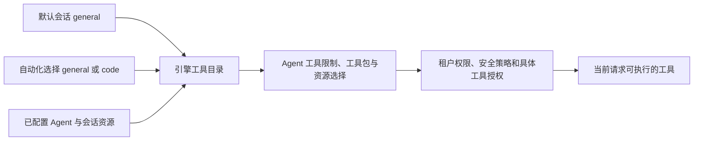

# 工具配置、资源绑定与记忆

源码核对日期：2026-11-17。Aether 只有一个默认界面；`general` / `code` 是请求的工具配置，不是两套前端模式。当前普通会话和 Agent 工具目录使用 `general`，不能继续按旧版“默认 Code、固定 25 个工具”的说明理解。

## 一次请求如何得到可用能力

主进程为 HTTP/SSE 请求附带工具配置，服务端决定可见和可执行集合。`general` 不意味着所有管理工具默认启用；工具包、Agent 白名单、技能/MCP 配置、租户权限和安全策略还会继续限制。工具包变化在下一轮生效，运行中不能借“立即补充”改变当前工具边界。

自动化的“工作工具”显示“通用工具”和“开发工具”，分别对应 `general` / `code`；切换只改变该自动化的工具配置。部分旧协议或协作接口保留 `code` 字段，不能据此推断前端存在模式切换。

## Agent、资源与工具包

| 配置 | 入口 | 作用 |
| --- | --- | --- |
| 主 Agent 与协作者 | 输入区 Agent 选择器、左侧 Agent 管理 | 选择执行配置；协作者还可使用内置调研、执行、通用角色 |
| Agent 允许工具 | Agent 编辑器 | 缩小 Agent 可调用的工具集合；可用目录由引擎提供 |
| 技能、MCP、知识库 | 输入区 `/` 资源选择、Agent 资源绑定 | 将已配置资源绑定给会话或 Agent；不会凭空安装资源 |
| 按需工具包 | 输入区 `@` 引用选择中的工具包 | 启用相应工具组；变更须等待下一轮 |
| 访问权限 | 输入区访问权限选择、设置 → 安全 | 控制命令确认和工具工作区范围，仍由服务端授权 |

技能目前有实际管理页、资源选择与 Agent 绑定链路，不是仅属于某个已删除的“专家模式”。能看到技能目录不代表有管理权限：普通账号可以使用可用技能；创建、导入、启停和删除由服务端 `canManage` 决定。会话请求有资源绑定，也不等于每次都把全部技能正文注入模型；具体加载由引擎决定。

MCP 设置支持项目/全局配置、启停、连接和工具详情、表单或 JSON 配置；本地命令和远程传输在引擎侧执行。知识库先在设置中建立并导入资料，再通过资源绑定供任务使用。

## 当前记忆界面

当前界面不再使用旧版“关闭 / 全局 / 仅本会话”互斥三选一：

- “设置 → 记忆”分别管理“全局记忆”和“默认开启会话记忆”。
- 输入区“对话偏好 → 本会话记忆”可选“本会话开启”“本会话关闭”“恢复默认”。这是本会话的覆盖值；全局记忆偏好是另一项设置。
- 服务端关闭长期记忆时，页面如实显示服务端状态；不能通过本地开关强行开启。
- 关闭长期记忆不删除聊天历史，也不等于清空模型当前上下文。
- 记忆管理页可按全局或指定会话查看、新建、编辑、删除条目，并按关键词和类型过滤。

自动上下文压缩是另一条机制。它控制模型请求使用的上下文体积；“加载完整对话”读取显示历史，不会自动把所有完整历史重新塞入下一次模型请求。界面用量中的上下文占用、单次/累计计费用量、缓存读取也应分别理解。

## 安全边界

“安全模式”进行完整策略检查；“标准模式”放行普通命令，但仍可能要求确认；“完全访问”自动通过本会话的操作确认，提问仍需回答。标准模式和完全访问都可能允许工具读写工作区之外的文件，不能把它们理解为操作系统级隔离。

工具配置、白名单和角色限制不会替代操作系统权限、账号租户隔离或具体工具授权。调研子代理的只读限制由运行时约束，不能只靠界面名称实现。

## 源码依据

- 默认请求：[Composer.tsx](../src/renderer/src/features/composer/Composer.tsx)、[useChat.ts](../src/renderer/src/core/engine/useChat.ts)、[host.ts](../src/main/engine/host.ts)。
- 资源与 Agent：[ResourcePicker.tsx](../src/renderer/src/features/conversation/shared/ResourcePicker.tsx)、[AgentManager.tsx](../src/renderer/src/features/agents/AgentManager.tsx)、[SkillsSettingsView.tsx](../src/renderer/src/features/settings/SkillsSettingsView.tsx)。
- 记忆：[ComposerOptions.tsx](../src/renderer/src/features/conversation/shared/ComposerOptions.tsx)、[MemorySettingsView.tsx](../src/renderer/src/features/settings/MemorySettingsView.tsx)。
- 自动化：[AutomationEditor.tsx](../src/renderer/src/features/automations/AutomationEditor.tsx)。
- 权限：[security.ts](../src/renderer/src/core/engine/security.ts)。

本页不固定工具数量，也不将目录中已声明的工具等同于当前账号已授权的工具；排错时应查看当前引擎实际返回的目录和请求配置。
