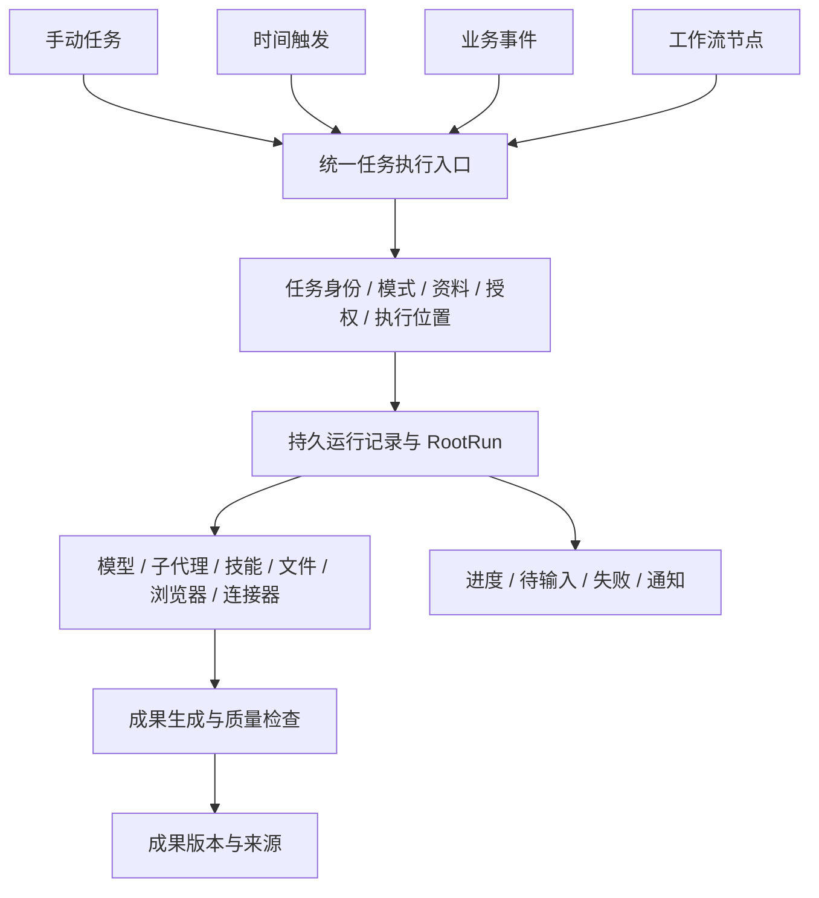

# Aether Work 模式：网上调研、功能块与初步方案

调研日期：2026-10-11。

范围：通用办公助手、企业协作与业务系统、后台任务与定时自动化。三类均纳入目标。本轮只调研与整理方案，不修改产品代码。

证据口径：网上部分实际查阅官方产品文档与技术文档；本地部分只读检查 Aether、ai-agent-engine 与 Wuzu 源码。未购买或实测竞品，未运行本地完整工作链。下文区分文档声明、源码事实和建设建议，不据此宣称端到端功能已经可用。竞品可用性随账号、平台、管理员策略及发布批次变化。

## 一、结论

现有引擎可以承载 Work，但需要新增任务与成果模型、Work 能力配置，以及适合持续执行的调度机制。可以复用模型调用、会话、RootRun、子代理、文件处理、知识库、MCP、技能和内置浏览器。

建议将 Work 定位为：用户给出工作目标和资料，系统完成研究、分析、文档生产及跨应用操作，交付可预览、可修改、可追溯的成果；重复工作可保存为自动化。

网上同类产品的共性是“目标 → 资料与工具 → 多步骤执行 → 用户介入 → 成果 → 再次运行”。对 Aether 而言，增加模式切换只是入口，完整工作链才是交付范围。

必须独立处理三条轴：

- 产品模式：Code / Work，决定默认工作台、能力和任务表达。
- 执行位置：本地 / 远程，决定资源可达性和在线要求。
- 权限策略：沿用用户选择与组织约束，决定动作的授权边界。

不能把现有 `engineMode=embedded|remote` 当作产品模式；也不能把 `general` 直接改名为 `work`。

## 二、网上官方产品调研

### 2.1 ChatGPT Work

官方资料：[Get started with Work](https://learn.chatgpt.com/docs/get-started-with-work)、[Scheduled tasks](https://learn.chatgpt.com/docs/automations)。

文档描述的核心能力：

- 把明确结果的多步骤工作委派给 AI，例如调研简报、表格分析、演示稿和周期更新。
- 联合文件、插件、已授权工具完成任务；桌面执行可使用本地文件、应用和浏览器。
- 执行过程可观察、回答问题、提供新信息和批准重要动作。
- 本地与云端执行有明确区别；依赖本地资源的步骤需要设备在线。
- 定时任务包含运行记录、手动测试、启停和需要关注的结果；会话内持续任务与每次新建会话的独立任务有不同语义。
- 官方说明 Work 与 Codex 共享核心能力，面向日常工作提供不同体验。

对 Aether 的启发：共用引擎符合方向。任务需要独立状态、资料范围和成果，不宜完全依附某个前台聊天组件。自动化要能试运行，并明确每次沿用上下文还是创建新上下文。

### 2.2 Claude Cowork

官方资料：[Get started with Claude Cowork](https://support.claude.com/en/articles/13345190-get-started-with-claude-cowork)、[Architecture overview](https://support.claude.com/en/articles/14479288-claude-cowork-architecture-overview)。

文档描述的核心能力：

- 与 Claude Code 采用相同的 agentic 架构，覆盖非编程知识工作。
- 处理文件、研究、生成格式化文档、包含公式的表格及多页演示稿。
- Projects 汇集任务、文件、链接、指令与记忆；提供子代理并行和中途调整。
- 插件封装技能、连接器与子代理；具备浏览器和本地文件桥接能力。
- 当前云架构将 agent loop 与执行沙箱放在云端，通过桌面桥接访问用户授权的本地目录与浏览器。
- 临时执行沙箱与持久会话/文件分离；依赖本机的步骤仍受设备在线状态限制。

产品边界：个人版本正在逐步合并部分 Chat/Cowork 入口；文档仍列有不能共享 session 等限制。因此不宜把固定三模式导航、完整团队协作都视为行业既定事实。

对 Aether 的启发：任务工作目录、持久资料、执行环境要有独立生命周期。可借鉴成果导向和资料组织；云桥接与隔离机制应按我们的部署条件设计。

### 2.3 Microsoft Copilot Cowork

官方资料：[Copilot Cowork 概述](https://learn.microsoft.com/microsoft-365/copilot/cowork/)、[个人账户入门](https://support.microsoft.com/en-us/microsoft-365-copilot/get-started-with-cowork)。

文档描述的核心能力：

- Word、Excel、PowerPoint、PDF 生成，以及现有 Office 文件修改。
- Outlook 邮件、日历会议、Teams 消息、OneDrive/SharePoint 文件与组织搜索。
- 多来源研究、会议简报、每日简报和定时提示；企业概述还列出事件驱动任务。
- 用户可暂停、恢复、取消或调整任务；查看文档与操作结果。
- 技能和插件提供领域能力与连接器；任务视图按状态管理工作，自动化单独管理。
- 重要操作有明确动作名称与控制方式，部分同类动作可调整后续提示策略。

版本边界：所查企业概述标注工作/学校账户正式发布，个人账户仍为预览；轻量应用生成功能另有 Frontier 预览限制。

对 Aether 的启发：企业 Work 需要可识别的业务账户、目标对象和动作结果。只有 MCP 地址配置，尚不足以构成用户友好的企业连接器中心。

### 2.4 Microsoft 365 Workflows

官方资料：[Get started with Workflows](https://support.microsoft.com/en-us/microsoft-365-copilot/get-started-with-workflows-in-microsoft-365-copilot)。

文档描述的核心能力：自然语言创建自动化，日程/事件触发，连接 Outlook、SharePoint、Teams、Planner 和 Approvals；可以在设计器中编辑、测试，在 Activity 中查看逐步输出与失败详情，并通过交互卡片和审批等待用户输入。

所查文档仍列有连接器范围、共享和语言等限制。借鉴点是自动化的可检查性和可维护性，而不是直接照搬其当前限制。

对 Aether 的启发：自动化必须有配置、试运行、执行历史、步骤输出、暂停与错误恢复，不能只提供 Cron 表达式和开关。

### 2.5 Temporal：持续执行的技术参考

官方资料：[Durable AI](https://docs.temporal.io/ai)。

文档提供的架构能力包括崩溃/网络中断后的执行恢复、长时间等待人工输入、单步重试、任务队列，以及活动心跳与取消。它是执行基础设施参考，不是办公工作台产品。

对 Aether 的启发：外部动作、持久状态和执行重试必须一起设计。即使采用持久工作流框架，也仍需应用层操作标识、外部服务幂等键或结果核对，避免重试重复发送消息、创建记录。

当前不建议直接决定替换引擎或强行引入 Temporal。桌面单机可以先评估现有 RootRun + SQLite 的持久任务方案；面向服务端多租户、高可用部署时再比较持久工作流设施。二者应遵守同一任务与运行契约。

## 三、完整功能块清单

阶段含义：P0 为合同和可靠性底座；P1 为通用办公闭环；P2 为企业连接及基础自动化；P3 为高级编排与规模化。所有功能都属于目标范围，阶段表示实施顺序。

| 编号 | 功能块 | 用户应该得到的体验 | 现有基础与主要缺口 | 建议阶段 |
|---|---|---|---|---|
| 1 | Work 入口与任务中心 | 不必先打开代码项目即可开始；按项目、状态查找任务；切模式后任务仍可继续 | 缺模式、任务归属与全局任务状态；历史能力可复用 | P0/P1 |
| 2 | 工作空间与资料管理 | 拖入文件、选择目录、引用网址；区分原始资料与生成成果 | 有附件与文件服务；需自动任务目录、处理状态与来源版本 | P1 |
| 3 | 研究与证据 | 联网检索、逐页读取、多来源对照，报告中的结论能追溯来源 | 有网络/浏览器/知识库；需来源引用协议和研究子代理能力 | P1 |
| 4 | 文档与 PDF | 起草、总结、翻译、按模板生成、预览后继续修改 | 有 DOCX/PDF 基础读写；缺统一渲染、格式检查与保真修改策略 | P1，逐步增强 |
| 5 | 表格与数据分析 | 多表分析、清洗、公式、图表、解释计算过程、导出结果 | 有 XLSX/CSV 基础读写；需完整表/区域选择、公式重算与结果验证 | P1，逐步增强 |
| 6 | 演示与可视化 | 资料变为 PPT、图表、可分享的 HTML；支持主题模板和迭代 | 缺 PPTX handler 与渲染验收链；现有 HTML/图片预览可复用 | P1 基础/P2 增强 |
| 7 | 成果中心 | 每项成果有名称、类型、预览、版本、来源任务，可打开、另存和继续修改 | 当前主要依靠回答中的文件链接；需正式 Artifact 模型 | P0/P1 |
| 8 | 浏览器工作 | 浏览、采集资料、填写网页、下载文件，失败可由用户接管 | 内置 Chromium 和 AI 工具可复用；需 Work 注册与任务归属 | P1 |
| 9 | 企业连接器与账户 | 按业务应用连接邮箱、网盘、日历、协作平台、CRM/OA；看见当前账户与可用范围 | MCP 可复用；需凭据生命周期、能力目录、健康状态、撤销与结果核对 | P2 |
| 10 | 企业搜索与知识库 | 在选定团队、项目、知识库范围检索；打开具体出处 | 有关键词检索与格式提取；需引用定位、权限同步、更新状态 | P1 基础/P2 企业化 |
| 11 | 项目与团队协作 | 团队空间、资料与成果共享、模板复用、评论/交接、角色权限 | 会话历史不等于团队协作；需服务端共享与访问模型 | P2/P3 |
| 12 | 人工接管与待处理中心 | 集中看到待回答、待处理和失败任务；修改目标、继续、停止、重试 | RootRun pending 可复用；需跨任务持久状态与通知 | P1/P2 |
| 13 | 定时自动化 | 一次性/周期任务、时区、下次运行时间、启停、立即测试 | 有基础 Cron；缺完整运行实例、错过触发与重入策略 | P2，P0 先铺底座 |
| 14 | 事件与工作流 | 邮件/消息/业务事件触发；条件、循环、并行、人工节点与步骤输出 | 旧 Flow 有执行接线问题；需统一执行入口后再接编排 | P2 事件/P3 可视编排 |
| 15 | 后台执行与恢复 | 切会话不中断；任务异常后明确可恢复范围；重启不重复外发 | RootRun 有持久状态但重启会 interrupted；需领取、心跳、幂等和恢复策略 | P0/P2 |
| 16 | 技能、专家与模板 | 研究、写作、分析等角色；模板说明需要什么资料和工具 | 技能/MCP/子代理可复用；需 Work 模板与启动前能力检查 | P1/P2 |
| 17 | 记忆与权限设置 | 区分任务资料、项目知识、长期偏好；可看、可改、可删除；授权原因清楚 | 已有记忆/安全模式；需 Work 默认值和统一规则，继承已授权范围 | P0/P1 |
| 18 | 质量、日志与运行统计 | 查看任务真实终态、费用、失败原因、来源与交付验证，团队可审计 | 已有部分事件和用量；需按 task/run/artifact 串联及执行检查 | P0 起持续完善 |

连接器先覆盖哪一家应按实际客户场景和可用接口排序。飞书、钉钉、企业微信、Microsoft 365、邮箱、CRM 等是目标类别示例，本轮未逐家验证其授权范围、事件能力和费用，不把它们列为已接通。

## 四、本地源码对照

### 4.1 引擎已有的可靠基础

| 基础 | 已观察的实现 | 需要保留的边界 |
|---|---|---|
| 模型与聊天 | 多模型、SSE、附件、资源选择与用量 | 增加 Work 目标和交付约定 |
| RootRun | 运行状态、等待交互、状态快照、幂等回答 | 状态落盘不等于进程重启后自动续跑 |
| 子代理 | 独立会话、事件、工具轨迹、取消、并发池、权限继承 | 研究代理需要专门联网能力；不能直接沿用只读代码代理白名单 |
| 知识与记忆 | 知识库 CRUD、FTS5/LIKE 搜索、格式抽取；记忆 off/global/session | 当前知识检索不能描述成已完成向量 RAG |
| 文件能力 | Word、Excel、PDF、图片与文本读写路径 | 文件能生成不等于渲染正确或可保真修改 |
| 扩展 | MCP、技能、资源筛选 | 企业账户体验和细粒度业务动作仍需产品化 |
| 浏览器 | 快照、截图、动作、控制台、网络列表及详情 | 当前仅 Code 注册，且依赖客户端浏览器桥在线 |

关键证据：

- [聊天入口](D:/dev/ai-agent-engine/src/api/http/routes/chat.ts:486)
- [RootRun 状态](D:/dev/ai-agent-engine/src/storage/root-runs/index.ts:9)
- [知识库检索](D:/dev/ai-agent-engine/src/storage/knowledge/kb-repo.ts:123)
- [子代理白名单](D:/dev/ai-agent-engine/src/tools/subagent/subagent-tool.ts:62)
- [浏览器桥](D:/dev/ai-agent-engine/src/tools/browser/browser-bridge.ts:32)

### 4.2 Office 能力的实际范围

直接阅读了以下处理器：

- [ExcelHandler](D:/dev/ai-agent-engine/src/tools/file/handlers/excel-handler.ts)：读路径主要返回首个工作表；写路径支持多 sheet、列/行、基本样式、图片和合并单元格。未形成公式重算与统一校验链。
- [WordHandler](D:/dev/ai-agent-engine/src/tools/file/handlers/word-handler.ts)：DOC/DOCX 提取文本，DOCX 可生成段落、表格、图片与基本样式；不是现有复杂文件的保真编辑器。
- [PdfHandler](D:/dev/ai-agent-engine/src/tools/file/handlers/pdf-handler.ts)：支持文本提取与分页读取，写入主要为基本文本排版。
- [HandlerRegistry](D:/dev/ai-agent-engine/src/tools/file/handlers/registry.ts)：没有 PPTX 专用 handler。

因此后续办公能力应拆为读取、结构化修改、生成、渲染、检查五个环节。第一版可以提供预览与对话修改；是否嵌入完整 Office 编辑器应单独比较授权、体积、部署、保真度和离线能力，不在本轮直接定库。

### 4.3 必须先处理的引擎缺口

1. **profile 只有 `general | code`。** 请求解析与发行 manifest 也只声明这两种。浏览器注册、SSE 断连保活、预算与子代理超时存在 Code 专用分支。应收敛成能力配置，让 Work 复用可靠运行策略。
2. **RootRun 重启只标记 interrupted。** 当前明确不自动恢复执行；应设计继续、重试和检查点，而非重放全部工具调用。
3. **Cron 未完整传递执行身份。** 触发请求未带 tenant/profile/workspace/model 等上下文，固定 120 秒请求超时；没有独立调度运行账本。
4. **旧 `/tasks` 还是队列骨架。** 全 src 未发现真实生产 handler 注册，运行中取消和恢复能力不完整；部分按 id 访问缺租户过滤。
5. **旧 Flow 与当前 ReAct 合同不一致。** executor 传入 Message[]，策略明确拒绝该形状；还存在固定 tenant、缺工作区/安全资源上下文等问题。属于静态发现，本轮未运行复现。

证据：

- [Profile 类型](D:/dev/ai-agent-engine/src/tools/tool-profile.ts:2)
- [Code 断连保活](D:/dev/ai-agent-engine/src/api/http/routes/chat.ts:755)
- [浏览器 Code 注册](D:/dev/ai-agent-engine/src/tools/registry-factory.ts:348)
- [重启 interrupted](D:/dev/ai-agent-engine/src/storage/root-runs/index.ts:103)
- [Cron 触发](D:/dev/ai-agent-engine/src/scheduler/cron-scheduler.ts:100)
- [任务队列](D:/dev/ai-agent-engine/src/storage/task-queue/sqlite-queue.ts:72)
- [任务路由](D:/dev/ai-agent-engine/src/api/http/routes/tasks.ts:34)
- [Flow 调用](D:/dev/ai-agent-engine/src/api/http/routes/flows/flow-executor.ts:135)
- [ReAct 入参检查](D:/dev/ai-agent-engine/src/core/agent-loop/react.ts:292)

这些问题不表示 Work 不可做，而是决定了可靠自动化不能直接建立在旧入口之上。

### 4.4 Aether 客户端

- 所有 HTTP/SSE 当前固定发送 `X-Aether-Tool-Profile: code`：[tool-profile.ts](D:/dev/aether-code/src/main/engine/tool-profile.ts:2)。
- 握手只要求 Code profile；Work 必须按引擎能力声明启用：[protocol.ts](D:/dev/aether-code/src/main/engine/protocol.ts:29)。
- 本地附件当前要求打开项目；Work 需要自动任务目录：[useAttachments.ts](D:/dev/aether-code/src/renderer/src/contrib/chat/useAttachments.ts:227)。
- 已有 Markdown/HTML/媒体预览，Office/PDF 成果展示需补齐：[preview.ts](D:/dev/aether-code/src/renderer/src/core/editor/preview.ts:11)。
- 切换会话只断开观察，不取消服务端执行；但前台 hook 的队列和状态不能直接承担全局后台任务中心：[useChat.ts](D:/dev/aether-code/src/renderer/src/core/engine/useChat.ts:352)。
- 视图注册虽有 `when` 字段，`getViews` 尚未执行该过滤；只加字段不会完成模式隔离：[view-registry.ts](D:/dev/aether-code/src/renderer/src/workbench/view-registry.ts:68)。
- 浏览器操作有引擎/会话归属，但 cookie partition 是共享的。需要明确共享或隔离登录态的产品策略：[service.ts](D:/dev/aether-code/src/main/browser/service.ts:159)。

UI 只需在下一阶段具体设计。本轮建议沿用公共组件和主题令牌，以任务会话为主区、资料/成果为辅助区，默认不展示 Git、LSP、代码大纲等 IDE 入口。共享消息时间线、输入与执行卡片，避免复制整份 ChatView。

### 4.5 Wuzu 可借鉴与不能误判的部分

值得借鉴：`work/code/design` 会话模式归属、各模式最近会话、常驻共享运行壳、临时工作目录、上下文选择、产物标签区、自动化历史和失败提示。

证据：

- [模式类型](D:/web/wuzu-client/src/types/myCatMode.ts:7)
- [共享 Cowork 壳](D:/web/wuzu-client/src/renderer/src/views/Cowork/index.vue:95)
- [产物面板](D:/web/wuzu-client/src/renderer/src/stores/workspacePanel.ts:23)
- [自动化数据](D:/web/wuzu-client/src/renderer/src/stores/lobsterScheduledTask.ts:28)
- [预览类型](D:/web/wuzu-client/src/renderer/src/components/workspace/fileTypeUtils.ts:6)

边界：旧 `WorkBelowInput.vue` 的文档/数据/PPT 按钮是无 click 的静态入口，当前已用 PromptCase 替代；未核实 DOCX/XLSX/PPTX 原生预览；浏览器走 Chrome 扩展桥接；跨模式工作日志仍是方案文档。应借鉴其任务组织和交互，不能把这些入口当作已完成的办公引擎。

## 五、建议的统一架构

建议明确下列实体及区别：

| 实体 | 含义 |
|---|---|
| Task | 一项业务工作：目标、验收、资料、所属空间、会话与成果 |
| Run | 某次实际执行：身份、能力快照、状态、事件、用量、错误和恢复点 |
| Artifact | 一项可交付成果：类型、位置、版本、来源 run、预览及检查状态 |
| Source | 输入资料及其版本、访问范围、引用位置 |
| Connection | 外部业务账户、授权范围、连接状态与凭据引用 |
| Automation | 触发规则与执行模板，每次触发生成独立运行记录 |
| Pending interaction | 待回答或待处理事项，归属原 run，响应后推进原任务 |
| Todo | 任务中的计划清单；本身不是后台执行任务 |

模式应绑定任务/会话及运行快照，不能根据当前 UI 切换按钮决定恢复中的 profile。切换 Code/Work 或会话，只改变查看对象，不能改变已经运行的授权与目录。

本地电脑关机、客户端关闭、远端引擎在线是三种不同情况。若任务需要 Aether 本机文件或浏览器，必须显示“等待设备在线”等真实状态。无人值守云端浏览器需要独立宿主与账户管理，不能由现有桌面桥自动获得。

## 六、实施顺序与可验收交付

### P0：统一合同与运行底座

- Work profile 与 manifest 能力声明；会话/任务/run 模式贯穿 IPC、HTTP、恢复与子代理。
- Task/Run/Artifact/Source 最小契约和全局任务状态。
- 租户、工作区、资源、模型和权限上下文统一进入执行入口。
- 外部动作的操作标识和重复执行策略；明确中断、继续与重试语义。

验收：切模式不会串会话、串目录、串权限；旧引擎不支持时明确提示；引擎重启后任务状态真实，不把 interrupted 显示为完成。

### P1：通用办公闭环

- 无项目创建 Work、自动工作目录、资料输入、联网研究与来源。
- 成果中心，报告/文档/表格/基础演示交付，预览和继续修改。
- 主子代理进度、待处理入口、基础模板与知识范围选择。

验收：给多份资料和网页，生成带出处的报告和可使用的表格；能预览、要求修改、保存第二版；表格计算及文档渲染有实际检查结果。

### P2：企业连接与基础自动化

- 首批连接器、账户管理、业务动作回执、团队资料范围。
- 一次性/周期任务、时区、手动测试、逐次运行记录、失败通知。
- 首批业务事件触发，持久等待用户输入，后台执行和恢复策略。

验收：从选定业务系统取数据，定时生成周报，按已配置规则完成审核/发送或写回；失败可以定位步骤；恢复后不会重复外发。设备不在线时准确显示等待原因。

### P3：团队与高级编排

- 团队项目、成果共享/交接、组织模板、角色权限与审计。
- 可视工作流、条件/循环/并行、步骤重试和补偿。
- 多租户运行隔离与吞吐治理；按部署需要评估持久工作流基础设施。

验收：多用户任务互不越权；可追溯每次运行与业务动作；长任务故障恢复不重复已确认完成的外部动作。

## 七、下一阶段还需验证的选型

1. Office：生成、修改、预览分别需要哪些本地依赖；复杂样式/中文字体/图表/公式是否可靠；是否需要嵌入完整编辑器。
2. 连接器：首批真实业务场景、OAuth/API/MCP、事件签名与去重、管理员控制和使用费用。
3. 执行部署：首版是否纯本地，是否已有常驻服务端；据此评估 SQLite 任务执行器与持久工作流基础设施。
4. 浏览器账户：Code/Work 共享个人登录态，还是按空间/账户隔离；远端任务所需的独立宿主。
5. 质量标准：各类产物可自动验证的字段和渲染结果，以及需要人工核验的内容。

这些是进入实现前的技术验证项，不影响目前确定完整功能块和复用边界。本轮没有修改引擎/客户端代码，也没有以静态阅读替代运行测试。
