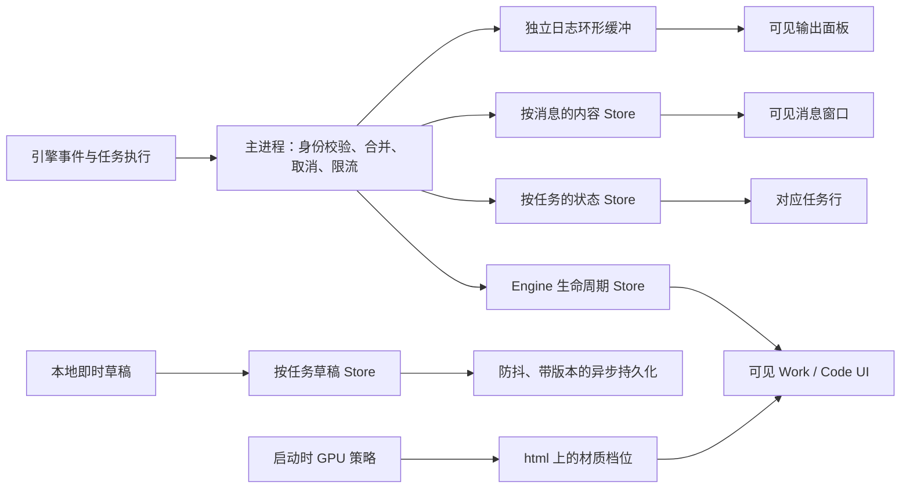

# Work 模式卡顿调研与企业级优化方案

日期：2026-10-12（北京时间）。调研对象：当前 Aether 工作树的源码构建。用户反馈：进入 Work 后，空闲点击、输入、设置均卡顿。

## 1. 可以直接采取的结论

**与截图相同的 Work 设置表面的调度卡顿，已在这台机器的独立 Electron 窗口复现。最强证据指向：Windows 默认关闭 GPU 合成，叠加大面积、多层 `backdrop-filter`。** 关闭设置区域的过滤即可恢复正常调度，不需要先重构整个 Work 模式，也不需要换硬件。本次未附加到用户原窗口或读取真实 profile。

实测硬件为 i9-14900KF、128 GiB 内存、RTX 4080 SUPER。当前源码在所有 Windows 上默认调用 `disableHardwareAcceleration()` 并使用 `in-process-gpu`，只有 `AETHER_ENABLE_GPU=1` 才绕过这两项。实机对照中默认配置的 `gpu_compositing=disabled_software`，开启配置为 `enabled`。大内存不能消除软件合成时的过滤成本。

**没有设置弹窗、没有引擎和历史数据的空白 Work，在 ASCII 输入/导航探针中未出现持续 rAF 卡顿。** 本次未直接测输入到屏幕呈现、IME 或真实任务下的输入延迟。因此“所有场景都卡”还不能全部归结为玻璃。代码另有日志全局传播、逐字同步存储、全快照轮询和历史全量渲染问题；这些是已核验的放大路径，其现场贡献仍需带真实任务的后续 profile。

建议顺序：先降低设置材质成本，再建立可靠 GPU 策略，同时隔离日志与输入状态；之后优化历史、不可见页签及状态通信。不能只做 `React.memo`，也不能直接删除 GPU 兼容回退。

## 2. 实机证据与测量边界

### 2.1 四组对照

已执行 `npm run build`，包含 Node/Web 两段 typecheck，随后用 Playwright 启动真正的 Electron 窗口。独立 `.e2e-tmp/` 用户配置，关闭引擎自动启动，不访问真实用户配置或任务。窗口 1800×1200 CSS px，DPR 1.5，即 2700×1800 物理像素；浅色主题。Electron 39.8.10 / Chromium 142.0.7444.265。

每个 GPU 配置按“原始 / 关闭过滤 / 关闭过滤 / 原始”顺序采样，缓解单向热身偏差；每组两轮、共 16 次设置导航点击。只改变 `backdrop-filter`，不改业务逻辑、布局、透明背景或阴影。各轮执行相同输入、Work 导航、设置导航及滚动。以下最终数据使用从 out 复制并冻结的构建，避免其他 chat 重建共享产物造成干扰；哈希随探针保存。源码工作树仍有其他改动，不把 commit 单独当构建唯一标识。

下表的点击指标是 **DOM click 捕获开始到第二次 `requestAnimationFrame` 回调** 的时间，作为绘制调度代理；不是完整输入延迟、屏幕实际呈现时间，也不是标准 INP。测量为设置已经打开后的内部导航，不含打开弹窗首帧。P95 按排序后 **0基下标** `min(N-1, floor(N×0.95))` 的项计算，小样本中等同最大值，不能当长期分布结论。

| 实际 GPU 合成 | 毛玻璃过滤 | 设置点击代理中位数 | 设置点击代理 P95 | 每轮设置 rAF 间隔 P95 |
|---|---|---:|---:|---:|
| 软件 | 保留 | **221.4 ms** | **439.9 ms** | **216.7–233.3 ms** |
| 软件 | 全关闭 | **28.4 ms** | **29.9 ms** | **16.8 ms** |
| 硬件 | 保留 | **29.0 ms** | **29.7 ms** | **16.8 ms** |
| 硬件 | 全关闭 | **29.0 ms** | **29.7 ms** | **16.8 ms** |

软件合成组关闭过滤，点击代理中位数下降约 **87%**，P95 下降约 **93%**。这是本场景的对照结果，不是所有 Work 操作的收益承诺。较早探索测量的软件＋过滤中位数为165.6ms，同样显示大幅改善；最终定量验收以冻结版本数据为基线。

设置样本未记录 Renderer Long Task，八次设置交互总 `ScriptDuration` 约 11–25 ms，仍出现显著 rAF 空档。层级探针另记录支持的 PerformanceObserver 类型和成功订阅情况，unsupported 返回 null。这说明只看 JS 长任务或 React 耗时会漏掉此次主要延迟；还必须看栅格、合成、浏览器 UI 线程和呈现。

### 2.2 定位具体过滤区域

层级轮另取冻结构建，固定软件合成，分别关闭各层；两套构建的哈希分别保存在证据文件中。重复原始、只关遮罩、关闭全部设置过滤三组各 16 次点击，其余探索组各 8 次。该轮窗口确认前台可见且聚焦。

| 改动 | 点击代理中位数 | P95 | 判断 |
|---|---:|---:|---|
| 原始 | 163.5 ms | 325.0 ms | 再次复现 |
| 只关全屏遮罩过滤 | 93.9 ms | 110.7 ms | 有改善，仍明显超预算 |
| 只关面板过滤 | 121.3 ms | 223.0 ms | 不足 |
| 只关内部导航和工具栏过滤 | 145.3 ms | 161.9 ms | 不足 |
| **关设置遮罩、面板、导航、工具栏过滤，保留顶部菜单栏** | **29.0 ms** | **29.8 ms** | 接近全关闭组 |
| 全部关闭 | 28.5 ms | 30.2 ms | 参考 |

没有据此声称各层成本可以相加；嵌套过滤存在相互作用，单层探索样本也少。足够支持第一阶段将整个大设置表面改为实色、保留小面积 Chrome 的决策。

### 2.3 沙箱与实际桌面的区别

最初沙箱试跑时，GPU 模式无法创建窗口，GPU 子进程反复以 `-1073741515` 退出；这是执行环境能力差异。相同探针在正常桌面权限下完成了全部四组，GPU 合成确实 enabled，测试期间未记录 GPU 崩溃。**短时间正常不等于长期兼容已验证。** 不能把沙箱中的 GPU 子进程失败解释为这台机器显卡不可用。

测试中的终端辅助进程还出现环境相关 `AttachConsole failed`，设置对照不依赖终端交互；原始证据中保留诊断。没有关闭 Windows Exploit Protection 或改变系统策略。

## 3. 代码级证据

### 3.1 图形兼容策略与多层材质：已用实机对照验证

`src/main/index.ts:19` 默认禁 GPU；Git 历史 `d856004`（10月1日）引入以规避 Exploit Protection/旧驱动 `STATUS_BREAKPOINT`，`786171f` 随后增加 `in-process-gpu`。这对所有 Windows 应用是过宽的兼容策略，需要按实际能力降级。

实机 computed style 捕获以下可见层：

| 表面 | 尺寸（CSS px） | 最终过滤 | 来源 |
|---|---:|---|---|
| 顶部菜单 | 1800×46 | blur(18px) saturate(1.45) | `assets/components.css:11980` |
| 设置遮罩 | 1800×1200 | blur(2px) | `assets/components.css:6323` |
| 设置面板 | 1000×780 | blur(28px) saturate(1.8) | `assets/components.css:11777` |
| 设置搜索工具栏 | 约999×56 | blur(28px) saturate(1.8) | `contrib/settings/settings-pages.css:690` |
| 设置导航 | 232×674 | blur(28px) saturate(1.8) | `assets/components.css:11145` |

Work 主区、侧栏本身主要为实色，并无常驻大面积 blur。`work.css` 的补全浮层已覆盖为实色，但全局文件/资源浮层过滤仍生效，有额外无视觉收益的成本。现有 `prefers-reduced-transparency` 仅覆盖部分表面；`@supports` 只检测语法能力，不能判断绘制性能。

### 3.2 日志更新传播到整个应用：结构已确认，现场占比未测

同级引擎 `src/api/http/middleware.ts:47` 为每个非 health/meta 请求写 info 日志。桌面 `src/main/engine/sdk/process-manager.ts:122` 将 stdout 每行转成日志；`src/main/ipc.ts:125` 逐条广播，经过 preload 到 `core/engine/useEngine.ts:49` 的 `setLogs`。

`core/app-provider.tsx:183` 的 Context 包含整个 `engine`，其中有 `logs`。日志变化会更新 Context，所有 `useApp()` 消费者收到更新，包括 Work controller、历史消息、Workbench 和设置。React 可能合并同批事件，不能把每条日志直接等同一次 commit，但传播路径确定。

输出面板使用 `ts-index` 日志 key，满 500 行后删除队首会改变其余行的 index，进一步增加重建。日志应拥有独立稳定 ID。

### 3.3 每个输入字符都同步保存全量任务状态

`WorkComposer.tsx:108` → `work-runtime.ts` 的 `setDraft/updateTask` → `work-state.ts:171`：遍历任务、同步 `JSON.stringify(next)`、`localStorage.setItem`、通知所有订阅者。归档任务和可能携带原文的 mentions 也在序列化对象里，任务数量没有限制。

探针中输入 135 个 ASCII 字符可观察到约 135 次 Work state 写入；小状态仅约 411 字符，单次 setItem P95 约 0.1ms，因此**此次小状态测量不能说明存储是空白 Work 的主因**。setItem 探针也不包含之前 JSON.stringify 的耗时。长期任务量、引用原文和历史 UI 会放大此结构，应另做规模测试。

### 3.4 状态同步拉取全历史快照

`work-runtime.ts:149` 每 1.5 秒对所有 running/waiting 任务调用 `/chat/snapshot`，只使用 `run.status`。N 个活动任务理论上每分钟最多 **40N 次全快照**，实际频率受请求时长影响。选中会话已有 SSE，也被重复轮询。

引擎 `routes/chat.ts:1518` 该接口会读并返回 history/runs/todos/changes/commandJobs/subagents/usage；传输、JSON 和 IPC 复制成本都扩大。全 draft/无活动任务时不会发这些请求，不能用该轮询解释此次无引擎对照。

现有 `/chat/status` 已返回 `{running, finished, lastEventId, run}`，桌面远端 allowlist 已允许它，P0 可迁移而无需先改引擎协议。但目前该端点还调用 `streamBus.snapshot()` 克隆当前轮投影；P1 需要专门的状态读取，不能认为换 URL 已消除所有引擎成本。

通用 management 请求超时为 120 秒（`src/main/engine/request-timeout.ts:4`），一次慢状态请求会让本轮 `Promise.all` 和 `syncing` 长期挂起。状态请求需要独立短 deadline，而不是把整个应用的 timeout 改短。

### 3.5 输入和日志会牵动完整消息树与隐藏页签

`WorkView.tsx:821` map 所有消息；`WorkMessage` 没 memo，每次构建时间线，向 memo Markdown 传新的 `fileContext` 对象，浅比较隔离失效。Markdown 的词法缓存、useMemo 和 `useChat` 的 80ms 流式合并已经存在，应在它们之上继续优化。

Work workspace 六个页签一次性挂载，仅用 hidden 隐藏；不可见 Activity 仍扫描工具、建立列表和大型 args/result 节点。两个 Code/Work 工作台也保持 mounted：display:none 停止绘制，但不停止业务订阅和派生计算。拖分栏每个 pointermove 更新根 view，布局 effect 随之写存储。

这些结构放大长历史、后台输出和拖拽压力，但没有在此次小数据测试中定量归因。

## 4. 企业级目标架构



### 4.1 GPU 与视觉效果分别管理

- GPU 配置 `auto / enabled / software`，启动早期读取，修改后重启生效。先对已验证机器灰度启用 auto，不一次性取消全 Windows 回退。
- auto 首次按 Chromium 正常能力启动；采集 actual GPU Feature Status、设备/驱动/Electron 版本、GPU 崩溃记录。真实失败记录回退，下一次冷启动使用软件模式；采用短时间崩溃次数阈值和有限重试，提供重置/再试。早期写入启动 attempt sentinel、健康确认后清理，或由独立监督者捕获 fatal 退出，避免进程来不及写故障记录。异常退出区分 confirmed GPU 与 suspected，不能把所有退出都当 GPU 故障。
- GPU 子进程已反复 fatal 时，不能依赖 renderer 内切开关救回；兼容回退要在启动策略和冷重启流程中实现。保留经验证的特殊企业环境兼容入口。
- 材质独立 `full / reduced / solid`，写到 `<html data-effects>`，覆盖 body portal 中的 Dialog/Popover。软件合成默认 solid，大设置表面始终使用实色；硬件 full 只为小面积浮层保留适量过滤。
- 用户关闭透明效果、系统 reduced-transparency 必须覆盖全部表面。reduced-motion 单独处理动画，不应当成关闭材质的替代品。
- CSS 用 tokens.css 两种主题的颜色令牌。必须同时取消 backdrop-filter 与 WebKit 版本；只将 blur 半径设为 0 仍可能留下 saturate 和过滤路径。诊断探针的全局 `*` 覆盖不作为产品实现。
- 大设置遮罩只压暗；面板、搜索栏、导航用实色、边框和现有阴影保留层级。禁止全屏模糊、同区域嵌套模糊、动画 blur 半径和常驻 will-change。小浮层建议 12–16px 以内、面积有上限，最终以参考机器 trace 验收。

### 4.2 React 状态与日志分域

- Engine 生命周期、设置、任务目录、消息、日志分别维护稳定 snapshot；UI 用 selector 或按 key 的 useSyncExternalStore。日志完全移出 AppContext，不能仅对含 logs 的 engine 做 useMemo。
- 日志使用有容量/字节上限的 ring buffer 和递增 ID，100–250ms 合并通知；不可见输出面板不持续渲染。高频访问日志默认 debug/采样；错误和告警不参与采样，诊断另有有界持久化通道。任务终态由 durable run store 保存，UI 日志 ring 可按容量淘汰。
- Message 更新只通知对应消息；已完成消息保持对象引用与 callbacks/fileContext 稳定。memo 边界不要携带每次新建的整个 controller。
- 不可见页签按需首挂载，再冻结 UI 订阅/派生计算；后台任务服务、SSE 和必要会话状态独立继续运行。不能为省 CPU 卸载任务 runtime 或终端会话。

### 4.3 草稿与持久化

- Composer 本地状态即时响应，按 taskId 草稿 Store 维护实时内容；300–500ms 防抖保存，2秒 maxWait。发送、失焦、切任务/模式时立即 flush。
- 原子记录按任务拆分；大规模数据使用 IndexedDB 或主进程异步写队列。每次写有 revision，串行提交或比较版本，防止旧写覆盖新草稿。不要每个字重写所有归档任务。
- Electron 退出使用显式 flush/ack 和有界截止时间；不能只依赖 beforeunload 触发异步写。保留旧 localStorage 数据的迁移/回退路径，迁移成功后才切换读取。
- no-op 更新不写、不广播；listener 按 source/task 作用域订阅。输入法 composition、引用 chip 和附件信息须完整往返。

### 4.4 通信与历史

- 当前任务以已有 SSE 的 run version/seq 为主；初始恢复、断线游标过期和显式 reload 才用全 snapshot。
- 后台任务先用 `/chat/status`，限并发、去重、带抖动；running 约 3–5秒兜底、waiting 约 10–15秒，仅保留必要健康检查。频率为起始配置，依据 SLO 调整。
- 状态超时 3–5秒，逐任务提交结果，加 lastObserved/stale；连接变化中止旧请求。主进程目前通用 timeout 并未支持普通请求的任意短 timeout，实施时需要专门策略和测试。
- P1 引擎增加仅复制小状态的 statusSnapshot/currentRun，再做批量状态或账号/工作区汇总 SSE；通过 meta capability 协商兼容旧引擎。
- 缓存/去重键含 mode、规范化 baseUrl、instanceId、accountId、sessionId；保留 expectedEngine、source epoch、迟到结果丢弃。version/seq 只在同一 runId 内比较，新 run 的 seq 可重置；状态应用前再校验 runId/任务操作 revision，防旧响应覆盖 stop/continue 后的新一轮。如新增取消 IPC，requestId 必须绑定发起 webContents。
- 任务、消息和活动列表窗口化；变高消息用测量缓存和滚动锚点，保留“回到最新”、跨任务位置、键盘访问、查找/复制。大型工具结果默认摘要，详情按需分页。流式代码先可读，再按预算高亮；无法识别语言时避免大块反复 highlightAuto。
- 分栏拖动 rAF 合并，局部 CSS variable 更新，pointerup 才提交最终布局和写存储。

## 5. 分期实施、风险和回滚

以下是单个熟悉代码的工程师的初步工作日估计，含定向验证；并非交付承诺。可按模块分工，Electron 真机测试保持串行。

| 阶段 | 内容 / 负责域 | 估计 | 依赖与回滚 |
|---|---|---:|---|
| P0-A | 设置四层去过滤、实色令牌；软件材质降级；补全实色取消过滤 / UI | 0.5–1天 | 优先独立发布；单独 effects flag，可恢复样式 |
| P0-B | 日志独立 Store；稳定 ID；切 `/chat/status`；草稿防抖与 flush / Renderer、通信 | 2–4天 | 保留旧持久化读取；逐项 flag；状态接口兼容确认 |
| P0-C | GPU 三态、诊断、有限失败回退 / Desktop | 1–2天开发＋兼容观察 | 不与业务重构绑定；随时回软件＋solid |
| P1 | 按消息订阅、历史/活动窗口化、隐藏页签冻结、拖动局部更新 / UI | 3–5天 | 滚动/复制/输入法回归最重要，列表策略可回退 |
| P1-Engine | 真正轻量状态、批量/汇总事件、限流取消 / Engine＋Desktop | 2–4天 | capability 协商、旧引擎 fallback |
| P2 | 性能诊断包、CI 性能门禁、长时间 soak、灰度 / QA、Desktop | 3–5天后持续 | 多硬件基线；回退必须保持用户任务完整 |

立即收益最大且风险最低的是 P0-A。GPU 自动启用需要跨驱动/企业策略验证；草稿防抖最重要的风险是丢最后几个字符，必须先证明退出 flush 和 revision 顺序。虚拟化最重要的风险是滚动锚点、复制与无障碍退化。

发布建议：内部固定机器 → 小比例可选择灰度 → 10% → 50% → 全量；每阶段按同版本硬件组比较卡顿与 GPU/Renderer 崩溃，不以平均 CPU 下降作为唯一放量依据。

## 6. 性能预算与验收

以下均为**建议目标**，不是本次已经通过的指标。统计口径固定：重复 warm/cold 场景，正常桌面权限、同尺寸/DPR/刷新率、引擎 fixture 固定输出率；开发版与安装版分别测。前台可见且聚焦与后台节流场景分别统计。P95 至少数百次交互，跨进程合成/呈现需 Chrome Tracing 验证，诊断 rAF 不能替代呈现指标。

| 指标 | 建议预算 |
|---|---|
| 常规输入到下一次界面呈现 P95 | ≤50ms；压力场景 ≤100ms |
| 设置/导航点击到反馈 P95 | ≤100ms；当前本机软件＋实色点击调度代理应 ≤50ms |
| 60Hz 参考机持续交互的帧间隔 P95 | ≤20ms；>50ms 空档数占全部间隔数 <1%，另报超预算累计时长 |
| 普通 UI React commit P95 | ≤8ms；输入不触发已完成历史消息 commit |
| 主进程 event-loop delay P95 | ≤20ms |
| 引擎日志与 UI | 无可见输出面板时，日志不能触发 Work/Settings commit |
| 空闲单任务无活动流 | 稳态 Renderer CPU 接近基线；前台60秒采样、CPU毫秒/墙钟秒、单核归一化占比、相对同机基线增量分别报告，建议增量≤10ms/s |
| 状态同步 | 不周期传历史正文/文件原文；轻状态字节数有上限，超时不阻塞其他任务 |
| 持久化 | 正常打字不逐字同步保存整库；flush 后重启内容、mentions、附件完整 |
| 2小时任务 soak | 热身后内存无持续线性增长；终态、取消、恢复、草稿均正确 |

最小矩阵包括：Code/Work、设置打开/关闭、硬件/软件、材质档位、DPR 1/1.5/2、1080p/高分屏；任务 0/100/1000、消息 0/100/500、工具结果 1MiB/10MiB、4个活动/等待任务、50/200日志每秒、流式正文、后台浏览器、隐藏模式、慢网/断线、窗口退出与重启。数字是压力档位，不是预期日常负载。

必要观测：Event Timing 与交互 performance marks、Long Task/Long Animation Frame（视 Chromium 支持）、生产 profiling 构建 React commit、Chrome Tracing 的 raster/compositor/present、app.getAppMetrics、GPU Feature Status、Main event-loop delay、IPC 条数/字节、状态 payload、日志率、持久化排队/flush。只收结构化数值，不收用户提示词、正文、密钥和文件内容；诊断默认本地导出，可控保留期。

实施后必跑 typecheck、build，并按 AGENTS.md 跑相关真实窗口 E2E：work-mode、work-timeline-ui、settings-responsive-layout、context-live-input-ui、composer、history-replay；改 IPC/GPU 启动还测 engine-host、remote-connection、browser 和终端能力分支。测试总数以 `playwright test --list` 为准，文档中的旧 103 用例不是当前基线。性能任务单独串行执行，避免与其他 E2E 争窗口/引擎。

## 7. 本次交付与复现

- 完成源码、CSS computed style、GPU 状态、引擎日志/HTTP/IPC 传播链和两轮真实窗口对照；没有修改产品功能或用户实际配置。
- `scripts/work-performance-probe.mjs` 为可复用隔离探针；本次最终正常桌面运行四组及层级探针均 exit 0。脚本的临时用户配置自动删除，结果 JSON 留作证据。
- `docs/work-performance-evidence-2026-10-12.json` 保存两轮结果、实际 GPU 状态、窗口参数、版本、commit 与构建产物哈希。测量的构建基于 HEAD `37a19660be4b7d7ad271f6dc461f82e5f99ef729` 加当时未提交工作树；仓库还有其他正在进行的修改，报告链接行号以调研时为准。
- 本次 `npm run build`（含 typecheck）成功；没有执行全量功能 E2E，因为本次产出是调研文档与诊断脚本。探针是定向实机实验，不能宣称完整业务回归已通过。

```powershell
npm run build
node scripts/work-performance-probe.mjs
node scripts/work-performance-probe.mjs --layers
```

在正常桌面权限执行，串行运行；查看 `.e2e-tmp/work-performance-results.json` 和 `.e2e-tmp/work-performance-layers-results.json`。脚本清除其子进程的 `ELECTRON_RUN_AS_NODE`，不修改系统环境变量；真实用户 profile 不参与。

当前源码的 GPU 比较入口为 `$env:AETHER_ENABLE_GPU='1'`，上面的隔离探针已在子进程中分别设为0/1。普通运行中的实例不会热切换 GPU。企业安装版应提供正式图形设置与故障回退，不让用户长期依赖环境变量。

参考：已核对 [Electron 官方性能指南](https://www.electronjs.org/docs/latest/tutorial/performance)，其重点是先 profile、避免阻塞 Renderer/Main、按需加载和减少不必要工作；图形启动策略依据本仓库源码、Git 历史及上述实际 GPU Feature Status。UI/UX 方案还参考本地 `ui-ux-pro-max` 的 React 长列表窗口化与动画性能建议，具体因果结论来自本项目实测。
