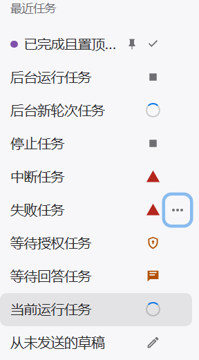
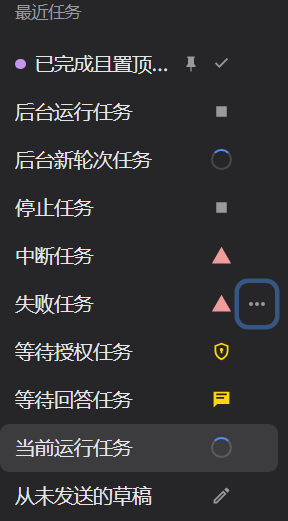

# Work 左侧会话状态与菜单验收

## 范围与参考

本次修改 Work 模式左侧「最近任务」与归档列表。参考 `D:/web/wuzu-client/src/renderer/src/components/code/CodeSessionHistory.vue` 的运行标记、等待处理、置顶、颜色标记和行菜单；参考项目仅只读检查。

样式按 macOS 桌面侧栏的克制层级设计：单行标题、32px 最小行高、14px 状态图标、单层浅选中底色、悬停或键盘聚焦时显示省略号。状态图标始终保留，菜单不挤掉状态。深浅主题共用语义令牌，颜色标记仅使用小圆点，图标具备文字提示和可访问名称，尊重减少动态效果设置。

## 最终行为

- 运行、正在停止、等待回答、等待授权、完成、失败、中断、停止、草稿和断连状态可区分；同时待授权与待回答时优先显示授权图标并说明两种等待。
- 切换会话后，后台任务继续更新状态。最近任务不再限制为前六条；置顶优先，其他按最近实际活动排序，被动读取旧状态不会把旧任务顶到前面。
- 行菜单支持置顶、重命名、六色标记、停止或继续、归档或恢复、导出。右键、Shift+F10、方向键、Home/End、Escape 可操作同一菜单。
- 置顶和颜色按引擎来源持久化，与执行状态分离。停止和导出使用目标会话作用域，操作后台行不误切换当前会话。
- 参考项目本身没有失败、完成、未读三种标记。本次失败、完成等来自 Aether 现有运行协议；没有新增未读状态或删除整个会话的能力。

## 状态准确性与开销

当前会话读取与 sessionModel.runId 匹配的 RootRun；后台读取 `/chat/status` 的结构化摘要。校验引擎来源、sessionId、runId、seq、version 和操作修订号，阻止旧请求覆盖新状态。高版本终态可以跨系统时钟回拨被接纳。

沿用活动任务 1.5 秒、窗口隐藏 5 秒的检查节奏。闲置任务每轮最多发现两个、每任务至少间隔 15 秒、并发最多两个；不扫描闲置归档任务，不读取完整历史来刷新状态。相同活动摘要去重，仅持久化标量摘要，不储存提问原文或逐 token 更新。

历史删除、截断、重新发起及文件回退在引擎确认成功后重建状态基准；恢复完成前使旧运行观察失效，避免被删除末轮重新覆盖状态。重试的新轮即使复用截断前的 seq，也能正常显示运行及终态。

导出检查来源、schema 和 sessionId。仅从未发送的真实草稿可以在请求失败时降级导出；错误会话响应不能生成文件。

## 文件

- `src/renderer/src/contrib/work/WorkSidebarTask.tsx`、`work-sidebar-task.ts`、`work-sidebar-task.css`：侧栏行、状态映射、排序、菜单与样式。
- `src/renderer/src/contrib/work/WorkView.tsx`、`work.css`、`src/renderer/src/assets/tokens.css`：列表接入和主题。
- `src/renderer/src/contrib/work/work-state.ts`、`work-status-poller.ts`、`work-runtime.ts`：持久化、后台发现、状态合并与操作作用域。
- `src/renderer/src/core/engine/useChat.ts`：历史变更成功通知与恢复期间观察失效。
- `src/renderer/src/workbench/ActionMenu.tsx`：受控打开、可用项焦点校正。

## 验证记录

测试使用独立 profile、本地 HTTP/SSE 夹具和单 worker，不调用模型，不操作用户当前窗口。

- `npm run build -- --outDir .e2e-tmp/work-sidebar-verified-20261106`：通过，包括 Node/Web 类型检查和主进程、preload、renderer 生产构建。
- 7 个纯测试文件共 **53/53 通过**：`chat-truncate-contract`（18）、`history-mutation-guard`（6）、`work-sidebar-state`（11）、`work-performance-state`（4）、`work-state`（6）、`work-run-list`（1）、`engine-interaction-feedback`（7）。
- `e2e/work-sidebar-status-ui.spec.ts`：**3/3 通过**，覆盖全部状态、后台新轮发现、会话切换、菜单操作作用域、置顶/重命名/颜色持久化、实际导出下载、错误 session 导出零下载、归档恢复、键盘、主题、减少动态效果和断连重连。
- `e2e/work-message-actions-ui.spec.ts`：定向 **5/5 通过（6.1 秒）**，覆盖重新发起、重新编辑、删除中间轮、延迟恢复后删除末轮与删空、文件回退冲突。验证重试采用较低 seq 后侧栏仍显示 running→done，删除失败末轮恢复 done，删空回 draft。
- 两组 Electron 均正常退出，健康检查 `nativeEvents=0`、`failures=0`。窗口测试使用上述最终构建，未复用旧 `out/`。
- 修改文件 `git diff --check` 通过。

窗口测试复跑设置 `AETHER_E2E_APP_ENTRY=D:/dev/aether-code/.e2e-tmp/work-sidebar-verified-20261106/main/index.js`。历史操作筛选为 `重新发起按|从此处重新编辑仅截断|删除仅删除|删除失败末轮|回退文件遇到冲突`。

最终侧栏 3 项在补充绘制就绪检查后再次通过（7.2 秒），已逐张检查深浅主题截图。测试产物：`.e2e-tmp/work-sidebar-paint-verified-results/`（最终侧栏截图与健康记录）、`.e2e-tmp/work-sidebar-history-results/`（历史操作截图与健康记录）。实际模型调用与完整全量 suite 不在本次验收范围。

浅色与深色侧栏实拍（测试任务名称）：

