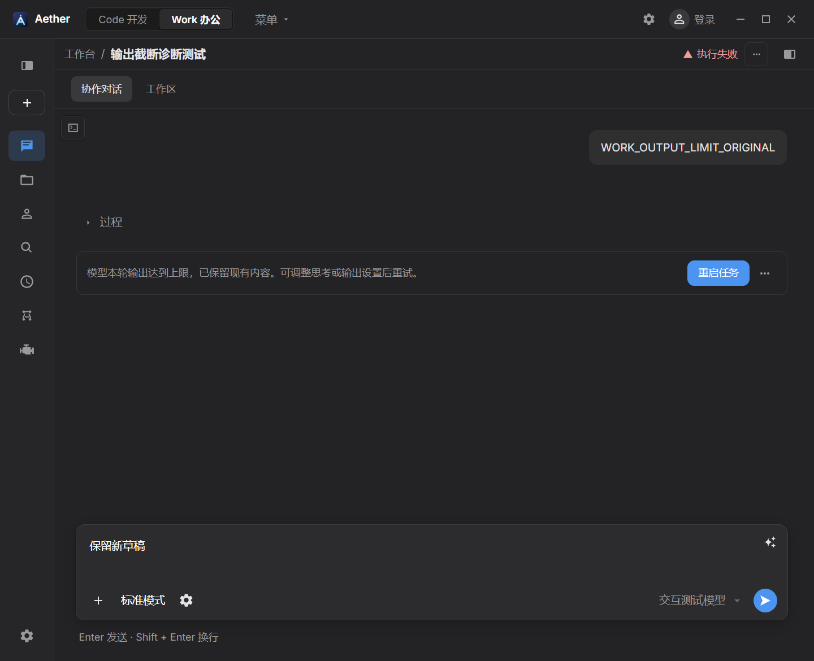

# Work 错误提示与任务重启验收

2026-11-06。

## 用户可见行为

- 根任务错误收为中性色提示行：原因、主操作“重启任务”、更多菜单。默认不展示重复标题、状态标签、运行 ID、错误码或大段诊断。
- 更多菜单提供诊断弹窗、复制诊断和编辑后重试；原始诊断仍保留。工具与子任务自己的诊断入口保持可用。
- 最新失败或中断任务（包括 `ENGINE_RESTARTED`）可在当前位置重启，在同一会话接续尚未完成的工作，保留历史、工作区、已有结果和未发送草稿。
- 只有确认对应恢复执行真正启动后，旧提示才淡出收起。遵循系统减少动画设置。恢复失败保留原因；回执不确定时提供“核对并重启”。
- 新的执行随后失败时显示新的原因；已解决的旧提示不会因刷新、历史分页或连续恢复重新出现。

这属于保留上下文的任务接续，不恢复已经丢失的进程内存或工具调用栈。继续指令要求先核对已有结果与状态不明的操作，只补未完成工作。不会直接重放原附件、协作任务或旧工具调用。

## 恢复依据与隔离

复用主进程持久队列与引擎 durable admission：每个原运行对应固定恢复项，冻结请求与精确回执绑定会话、引擎空间、前驱和请求摘要。未知回执复核原请求，不生成新的执行身份。远端适配后由主进程写入恢复关联与 `inheritContext`，不会放开任意客户端元数据。

引擎增加持久 `startedAt`，在建立执行 owner 与 live stream 后、发布运行帧前写入；仅受理请求不产生此标记。写入失败不执行模型，并撤销假 live 状态。队列保留精确启动证据及原运行到恢复运行的关系，旧错误的隐藏不依赖当前加载了多少历史。

恢复期间可编辑草稿，但未确认前禁止另行发送、入队或修改历史。已有普通待发不会被恢复按钮顺带发送；尚未提交且已被后续轮次取代的恢复项会安全清退。引擎或任务切换后，迟到回执不会应用到新视图。

## 验证

- Aether `npm run build -- --outDir .e2e-tmp/work-task-restart-final-build-20261106 --logLevel warn` 通过，含 Node/Web 类型检查。
- 引擎 `npm run typecheck` 与隔离编译 `npx tsc --outDir .e2e-tmp/work-task-restart-build-20261106 --noEmitOnError` 通过。
- 队列 dispatcher、gateway、foundation 共 125 项通过，覆盖冻结重试、崩溃恢复、暂停队列、资源配置、远端字段过滤、启动证据和过期恢复清退。
- 额外恢复展示 13 项、错误摘要 11 项、原轮草稿恢复 9 项、队列 owner 19 项通过。
- 引擎真实 Fastify 接纳与启动边界回归 6 项通过，包含启动标记写入失败时不运行模型。
- 最新隔离产物的真实 Electron Work 交互 6 项通过：实际 `ENGINE_RESTARTED` 中断、连续失败、启动失败后再恢复、未知回执核对不重复提交、草稿附件保留、诊断菜单及编辑操作。浅/深色、960 像素逻辑窗口与减少动画均覆盖。测试未调用外部模型。

Electron 最终命令：

```powershell
$env:AETHER_E2E_APP_ENTRY='D:/dev/aether-code/.e2e-tmp/work-task-restart-final-build-20261106/main/index.js'
npx playwright test e2e/engine-interaction-ui.spec.ts -g 'Work ' --workers=1 --output=.e2e-tmp/work-task-restart-work-ui-display-20261106 --reporter=list
```

验证中发现并修复了远端适配丢弃恢复标记、未确认恢复时仍可排队清空草稿两项问题。测试夹具同步了根运行序号、接纳回执与完整历史协议；最终结论针对上述 6 项 Work 交互，没有宣称全量 E2E 通过。

## 预览与生效




截图来自受控测试会话。验证使用隔离构建，没有覆盖当前运行的 Aether `out/` 或引擎 `dist/`。正式使用需重新构建并重启 Aether 与引擎，才能获得完整的启动确认与错误移除行为。旧引擎未提供启动标记时，不会仅凭受理成功就隐藏错误。
